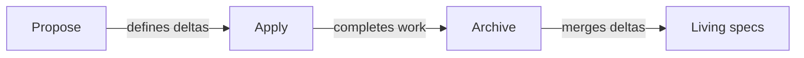

# OpenSpec: principles, internals and agent integration

Use this analysis to understand how OpenSpec manages proposed changes and living specs. It draws on the source of
OpenSpec **v1.13.2** (`@fission-ai/openspec`, MIT, ~48.6K lines of TypeScript in 197 files under `src/`), repository
documentation and live CLI runs. "Verified" means the research reproduced a result by hand.

## On this page

- [Purpose and philosophy](#-purpose-and-philosophy)
- [Command line](#-command-line)
- [Core model](#-core-model)
- [Agent integration](#-agent-integration)
- [Live runs](#-live-runs)
- [Strengths and limits](#-strengths-and-limits)
- [Terms](#-terms)
- [See also](#-see-also)

## 🧭 Purpose and philosophy

OpenSpec is a lightweight specification layer for AI agents. You and the agent agree on *what* to build before writing
code. Its philosophy is:

```
fluid not rigid         — no rigid phase gates
iterative not waterfall — artifacts are edited as work progresses
easy not complex        — minimal ceremony
brownfield-first        — changes to existing systems through deltas
```

It separates **living specs**, the current source of truth, from **deltas**, proposed changes:

```
openspec/
├── specs/<capability>/spec.md        # how the system works now (living specs)
├── changes/<change-id>/              # one change = one folder
│   ├── proposal.md                   # why and what
│   ├── specs/<capability>/spec.md    # DELTAS: ADDED / MODIFIED / REMOVED / RENAMED
│   ├── design.md                     # how (technical decisions)
│   ├── tasks.md                      # implementation checklist
│   └── .openspec.yaml                # metadata: schema, created, skip_specs, ...
├── changes/archive/YYYY-MM-DD-<id>/  # completed changes (history)
├── schemas/<name>/                   # custom workflow schemas (optional)
└── config.yaml                       # default schema, context, rules, operations
```

This diagram shows how a change becomes part of the living specs:



The cycle is `propose → apply → archive`. Archive merges deltas into `openspec/specs/`.

## 🛠️ Command line

The CLI (`openspec`) serves people and agents. Almost all commands support `--json`; stdout then contains exactly one
JSON document, as documented in `docs/agent-contract.md`.

| Group | Commands | Purpose |
|---|---|---|
| Setup | `init`, `update` | create `openspec/`, generate skills/commands for the selected agents |
| Viewing | `list [--specs]`, `show`, `view` | changes and specs |
| Validation | `validate [--strict] [--all]` | deltas, scenarios, SHALL/MUST and MODIFIED targets |
| Lifecycle | `archive <id> [--yes] [--skip-specs]` | merge deltas and move to the archive |
| Workflow | `new change`, `status`, `instructions`, `templates`, `schemas` | artifact engine for agents |
| Schemas | `schema init/fork/validate/which` | custom workflows |
| Stores (beta) | `store setup/register/list/doctor`, `context`, `doctor`, `workset` | multi-repository planning |
| Other | `config`, `feedback`, `completion` | profiles, telemetry, autocompletion |

In JSON mode, errors use `{severity, code, message, target?, fix?}` and exit code 1. OpenSpec chooses its root in this
order:

1. `--store`
1. nearest `openspec/`
1. declared store
1. global default
1. implicit root

## 🧭 Core model

Schemas describe artifact dependencies. Deltas describe requirements that archive merges into living specs.

### Schema as an artifact graph

A YAML schema (`schemas/spec-driven/schema.yaml`) describes a workflow. Each artifact has:

- `id`;
- `generates` (a path or glob);
- `template`;
- `instruction`;
- `requires`.

The `apply` block names prerequisites with `requires` and tracks progress with `tracks: tasks.md`.

```
proposal ──► specs ──┐
    └──────► design ─┴──► tasks ──► apply
```

- **Order** — Kahn's algorithm; ties are broken by declaration order in the schema (not alphabetically).
- **State** — file presence only. `done` means a file matches `generates`; `ready` means dependencies are complete.
  Other states are `blocked` and `skipped`. With `skip_specs: true`, artifacts under `specs/` count as complete.
- **"Dependencies are enablers, not gates"** — dependencies suggest an order but do not forbid anything.
- Schema lookup: project (`openspec/schemas/`) → user (`$XDG_DATA_HOME/openspec/schemas`) → bundled with the package.

### Instruction generation

`openspec instructions <artifact> --change <id> --json` gives the agent:

- `template` (the output format) and `instruction` from the schema;
- `context` from `config.yaml` (up to 50 KB) and artifact `rules`;
- dependencies and their paths, `unlocks` and the exact `resolvedOutputPath`.

For `apply`, it also gives `contextFiles`, task progress and the `blocked | ready | all_done` state. The CLI supplies
the logic and data so skills can stay thin.

### Deltas and merging (archive)
Delta format:

```markdown
## ADDED Requirements
### Requirement: <name>
The system SHALL ...
#### Scenario: <name>
- **WHEN** ...
- **THEN** ...
## MODIFIED Requirements      # the full requirement block, in its entirety
## REMOVED Requirements       # with **Reason** and **Migration**
## RENAMED Requirements       # FROM:/TO:
```

`archive` validates the change and asks for confirmation. It claims an archive location, then applies operations in
this order: **RENAMED → REMOVED → MODIFIED → ADDED**. Already synced deltas are idempotent. It moves the folder to
`archive/YYYY-MM-DD-<id>/` and rolls back specs on failure. The merge code spans `specs-apply.ts` (1.4K lines) and
`archive.ts` (2.4K lines). Many CHANGELOG fixes concern silent data loss during merges.

### Validation
`openspec validate` checks:

- delta headings (`### Requirement:` and exactly four hash marks in `#### Scenario:`);
- a scenario for each requirement and SHALL/MUST language;
- missing deltas unless `skip_specs` is set;
- MODIFIED targets against the main spec;
- Purpose length with `--strict`.

A proposal has `## Why` (50–1000 characters) and `## What Changes`.

### Configuration
- `openspec/config.yaml`: `schema`, `context`, `rules.<artifact>[]`, `operations.apply|archive.guidance[]`,
  `references` (stores) and `store`. Unknown top-level keys are **silently ignored** (verified).
- `.openspec.yaml` of a change: `schema`, `created`, `goal`, `affected_areas`, `skip_specs`, `retire_capabilities`.
- Global profile: `core` (propose, explore, apply, update, sync, archive) or `custom` (+ new, continue, ff, verify,
  bulk-archive, onboard). Delivery mode is `skills | commands | both`.

## 🔌 Agent integration

OpenSpec generates commands and skills for the selected agents.

`openspec init --tools claude,opencode` (verified) generates:

| | Claude Code | OpenCode |
|---|---|---|
| Commands | `.claude/commands/opsx/<id>.md` | `.opencode/commands/opsx-<id>.md` |
| Invocation | `/opsx:propose` | `/opsx-propose` |
| Command frontmatter | Listed below | `description` only |
| Arguments | Claude appends arguments | `**Provided arguments**: $ARGUMENTS` in the body |
| Skills | `.claude/skills/openspec-*/SKILL.md` | `.opencode/skills/openspec-*/SKILL.md` |
| Skill frontmatter | Listed below | The same fields |

Claude command frontmatter has `name`, `description`, `allowed-tools: Bash(openspec:*)`, `category` and `tags`.
Skill frontmatter has `name`, `description`, `allowed-tools`, `license`, `compatibility` and `metadata.generatedBy`.
Without `**Provided arguments**: $ARGUMENTS` in the body, OpenCode loses the arguments.

For `/opsx:propose`, the workflow follows these steps:

1. Stay within the planning boundary: write artifacts, not code.
1. Run `openspec list --json` to check for a root; do not create one silently.
1. Run `openspec new change "<name>"`, then `openspec status --change --json`.
1. For each artifact, run `openspec instructions <id> --json`, read dependencies, study code, write the file and
   check `status` again.
1. Stop and suggest `/opsx:apply`.

The agent executes the work; the CLI supplies state and templates. Commands and skills contain the same text. A skill
supports automatic invocation by the model; a command supports an explicit `/…`.

Observations on generation (verified):
- Skills are heavy: 10–22 KB each (`explore` is 22 KB); the six core skills total ≈ 90 KB. Commands duplicate them.
- With both agents selected, `openspec-*` skills go to `.claude/skills` and `.opencode/skills`. OpenCode reads both.
  With duplicate names, an unpredictable copy wins. See [upstream gaps](06-openspec-upstream.md).
- OpenCode gets only `description` frontmatter, without `agent:`. This avoids bug #334 (`agent: build`).
- `update` touches its own `openspec-*` directories and `opsx*` files. Neighboring `sdlc-*` files do not conflict.

OpenSpec does not create marker blocks in `CLAUDE.md` or `AGENTS.md`. `update` cleans up old markers.

## ✅ Live runs

These experiments show what the CLI accepts in practice.

| Experiment | Result |
|---|---|
| `openspec archive <id> --yes` with 1 of 2 tasks done | **archived**; there are no gates ("fluid") |
| Extra files (`.sdlc.yaml`, `review.md`) | `validate`/`status` work; the files move to the archive |
| An unknown `sdlc:` key in `config.yaml` | silently ignored |
| Custom schema with `intent` and `plan` | `openspec schema validate` passes; other tools work |

Extra files are in the change folder and move with the change. With the custom schema, `status` and `instructions`
work, and `/opsx:*` understands its artifacts.

These facts support using OpenSpec as an unmodified subsystem. The harness adds its own schema and adjacent files
through OpenSpec's standard mechanisms.

## 📊 Strengths and limits

The research found these strengths:

- Deltas support brownfield development, and living specs grow when changes are archived.
- Schemas extend the artifact graph; thin skills use the CLI's JSON contract.
- OpenSpec supports 30+ tools and receives active maintenance.

From an SDLC perspective, the limits are:

- There are no gates, approvals, verification evidence, review role or release role.
- Prompt text alone holds phase boundaries in place.
- Parallel changes can overwrite a requirement without a warning.
- There is no audit of who approved what; prompts are heavy.

## 📚 Terms

The [glossary](glossary.md) defines [delta](glossary.md#-ad), [living spec](glossary.md#-ip),
[gate](glossary.md#-eh) and [spec](glossary.md#-rw).

## 📚 See also

- [Landscape and reviews](03-landscape-and-reviews.md) compares community experiences.
- [OpenSpec upstream](06-openspec-upstream.md) separates process gaps from core bugs.
