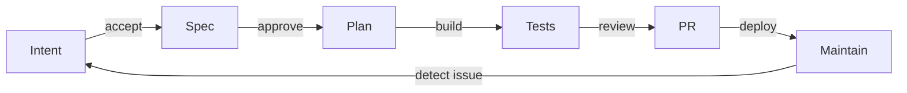

# The AI-Native SDLC playbook and OpenSpec

Use this page to see how the [AI-Native SDLC playbook](https://claude.com/blog/the-ai-native-sdlc-playbook)
(Louis Claxton, August 21, 2026) informs sdlc. It maps the playbook's stages to OpenSpec and the process controls
around it.

## On this page

- [The playbook's idea](#-the-playbooks-idea)
- [An artifact at each stage](#-an-artifact-at-each-stage)
- [Stages and plays](#-stages-and-plays)
- [Mapping to OpenSpec](#-mapping-to-openspec)
- [Terms](#-terms)
- [See also](#-see-also)

## 🧭 The playbook's idea

The playbook says agents can write code in hours while the surrounding process still moves at human speed. This shifts
attention to:

- planning, review, testing and deployment;
- controls that can keep up with agent output;
- governance costs when exceptions require committees.

An **AI-native SDLC** keeps the control objectives. An agent works at each stage, and handoffs form a loop.

## 🔁 An artifact at each stage

Each stage commits an artifact for the next stage to read. Commits record the request, output and approval.

> Each stage ends by writing one [artifact] to version control … and the next stage begins by reading it. The chain
> of commits is also the audit trail: who asked for what, what the agent produced, and who approved it.

```
intent.md ──► spec.md ──► plan.md ──► diff + tests ──► PR + review findings ──► incident ──► intent.md …
  (Plan)      (Design)     (Build)        (Test)            (Deploy)            (Maintain)
```

The diagram shows the handoffs as a loop:



An accepted intent starts requirements and design. An approved spec starts plan mode. A merged PR starts the
pipeline. A breached production control band starts a new `intent.md`. People decide at the [gates](glossary.md#-eh).

## 🔁 Stages and plays

Each play covers what changes, its prerequisites, how to run it, governance and leading or lagging measures.

| Stage | Artifact | Decision maker |
|---|---|---|
| **1. Plan** | `intent.md` | Product owner |
| **2. Design** | `spec.md` | Product owner; tech lead for high risk |
| **3. Build** | `plan.md`, diff | Engineer; tech lead or architect for high risk |
| **4. Test** | Test, build and screenshot evidence | Code owner |
| **5. Deploy** | PR findings and hook decisions | Code owner; release manager at production |
| **6. Maintain** | Incident record, lessons, new `intent.md` | Service owner |

The plays add detail to each stage:

- **Plan:** capture Problem, Proposed outcome, Affected users and systems, Constraints and Open questions in
  `intent.md`, with Author and Status. Acceptance is a merge or closed review.
- **Design:** write requirements and design in one session. Policies act as skills. Flag "areas of concern" in
  `spec.md`; policy owners resolve conflicts.
- **Build:** use plan mode by default, with auto mode available. `CLAUDE.md` and skills hold institutional knowledge;
  hooks guard actions. Parallel sessions use worktrees and subagents. `plan.md` names files, order, risks and proof.
- **Test:** the agent checks its work in a feedback loop; CI runs continuous evals. The code owner sees the attached
  evidence and eval suite.
- **Deploy:** AI reviews the PR using `REVIEW.md`. Hooks gate approval. CI/CD, sandbox, MCP deployment and rollback
  support the release; branch protection gives the code owner the decision.
- **Maintain:** deterministic detection starts a new `intent.md`. Regular security scans and Claude on call
  (Claude Tag) inform service-owner triage.

### Controls carried into sdlc

These details guide sdlc's process controls:

- **Separation of duties**: "the agent that wrote the code has no way to approve it".
- **Skills and hooks**: a skill advises; a hook enforces deterministically. "The skill makes violations rare and the
  hook makes them close to impossible".
- **Bug fix**: a failing test first; then a hook that blocks test edits during the fix.
- **Plan drift**: "When implementation departs from the plan, update plan.md in the same commit. Consider using a
  hook to enforce synchronization". Review compares the diff with plan.md.
- **REVIEW.md**: review covers bugs, security and compliance against spec.md, plan.md and design principles.
  Comments distinguish Important from Nit, with a limit on their number.
- **Production gate**: a hook blocks deployment until the release manager authorizes it.
- **Measures**: track time from intent to spec, rework after plan.md, first-pass changes, the CI first-pass rate and
  review time. Git history and PR metadata provide the data.
- **Source of truth**: name one system for each artifact. It may be the repository or a legacy system such as Jira.
  At minimum, cross-reference record ID ↔ commit SHA.

### Adoption order

The plays are adopted in prerequisite order:

- Start with `intent.md`, `CLAUDE.md`, skills, the feedback loop and hooks as approval gates.
- Add requirements and design after intent and policy skills.
- Add plan mode, parallel sessions and evals.
- Add PR review, then CI/CD after review and hooks.
- Close the loop after intent, review, hooks and rollback are in place.

## 🧭 Mapping to OpenSpec

This table shows which part OpenSpec supplies and what sdlc adds around it.

| Playbook stage | OpenSpec foundation | sdlc addition |
|---|---|---|
| `intent.md` (1) | `/opsx:explore`, proposal Why | `intent` artifact and gate |
| `spec.md` (2) | `proposal.md`, `specs/`, `design.md` | `spec` gate and delta checks |
| `plan.md` (3) | `tasks.md` in part | `plan` artifact and gate |
| Diff and tests (4) | `/opsx:apply`, `/opsx:verify` prompt | `sdlc verify` |
| PR review (5) | None | `review.md` and review gate |
| Approval hooks (5) | None | `sdlc hook` and OpenCode plugin |
| Separation of duties | None | `openspec/roles.yaml` |
| Maintain (6) | None | `/sdlc:triage` |
| Audit | Archive history | `.sdlc.yaml`, `sdlc audit` |
| Living specs | Deltas merge into `openspec/specs/` | Used as is |

The mapping includes these controls:

- **Intent:** the playbook's `intent.md` has no direct OpenSpec equivalent. `/opsx:explore` and proposal Why are
  closest. The `sdlc` schema adds an `intent` artifact and product-owner gate.
- **Spec:** `specs/` contains deltas. sdlc adds "Policy compliance" and "Areas of concern", a `spec` gate with a
  tech lead for high risk, and delta checks before merge.
- **Plan:** the `plan` artifact names files, order, risks, alternatives, proof and rollback. An engineer approves the
  gate; review checks plan drift.
- **Verification:** `/opsx:verify` is a prompt that runs nothing. `sdlc verify` runs real checks and records literal
  output bound to worktree contents. A verifier subagent uses a clean context and checks scenario coverage.
- **Review:** `review.md` classifies findings. A reviewer subagent reports them; important open findings block the
  gate until code-owner approval.
- **Hooks:** Claude Code, Cursor, Codex CLI, Qwen Code and GigaCode use `sdlc hook`; OpenCode uses its plugin. They
  guard the plan gate, locked tests, protected paths, self-approval and production release.
- **People:** optional `openspec/roles.yaml` names people and roles in git. Authors cannot approve their own review
  or release; paired gates need different people. `sdlc approvals verify` checks signed approval commits.
- **Maintain and audit:** `/sdlc:triage` turns an alert, incident or finding into a diagnosed intent. `.sdlc.yaml`
  records approver, time and digest; `sdlc audit` gives the timeline and playbook metrics.
- **Living specs:** OpenSpec merges deltas into `openspec/specs/`. The playbook has no corresponding spec model.

The playbook defines process, roles, gates and evidence. OpenSpec manages specs and changes. sdlc connects them by
putting process controls around the specs.

## 📚 Terms

The [glossary](glossary.md) defines [artifact and change](glossary.md#-ad), [gate](glossary.md#-eh) and
[living spec](glossary.md#-ip).

## 📚 See also

- [OpenSpec analysis](01-openspec-analysis.md) explains the specification foundation.
- [User guide](05-guide.md) follows a change through the gates.
