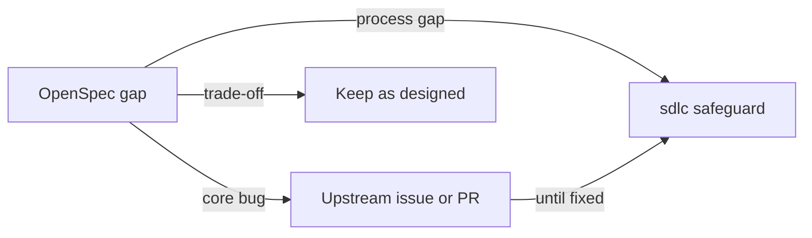

# OpenSpec gaps and upstream proposals

Use this page to decide where an OpenSpec gap belongs. sdlc keeps OpenSpec as a pinned, unmodified dependency. It
handles process gaps around OpenSpec and sends core bugs upstream.

Compatibility matters because OpenSpec changes quickly. A fork would need to keep up with its merge fixes.

## On this page

- [Three kinds of gaps](#-three-kinds-of-gaps)
- [Course of action](#-course-of-action)
- [Terms](#-terms)
- [See also](#-see-also)

## 🧭 Three kinds of gaps

Use the categories below to choose between an sdlc safeguard, an upstream report and a design trade-off.

This diagram shows where each kind of gap goes:

### Process gaps handled by sdlc

The process layer supplies gates and evidence around OpenSpec's artifact model.

- **Gates and approvals:** `archive --yes` archives unfinished work (verified), consistent with OpenSpec's "fluid not
  rigid" philosophy. sdlc binds approvals to digests; `sdlc archive` checks every required gate.
- **Phase boundaries:** OpenSpec relies on prompts (#1577, #405) because it does not control agent permissions.
  Claude Code hooks, the OpenCode plugin and hooks or rules in Cursor, Codex CLI, Qwen Code and GigaCode block code
  writes without an approved plan (`block`).
- **Spec and code drift:** OpenSpec has no evidence model (#169, #880). `sdlc verify` records a worktree fingerprint
  and scenario coverage (`verify --check`); review checks plan drift.
- **Testing and TDD:** these sit outside OpenSpec's artifact model (#900, #1760). sdlc adds a verify gate and a
  bug-fix protocol with `tests lock`.
- **Review and release:** these sit outside OpenSpec's model. sdlc adds `review.md`, a reviewer and code-owner gate.
  A release gate blocks production commands until approval.
- **Parallel changes:** OpenSpec's deltas lack a base version (#1669). sdlc warns about overlap and base drift after
  spec approval.
- **Visibility:** OpenSpec has no reporting for non-technical roles. sdlc provides `status --markdown`, `audit` and
  playbook metrics.
- **Small changes:** OpenSpec's model adds ceremony. sdlc offers the lite track and `--skip-specs`.
- **Heavy prompts:** OpenSpec's prompt choice draws complaints (#749, #611). sdlc uses short workflows (3–5 KB),
  with the CLI supplying state; `/opsx` workflows are not installed by default.
- **Local installs:** OpenSpec hard-codes its binary (#1624). sdlc's generated files use the `cli:` prefix
  (`npx --no-install sdlc`); sdlc calls OpenSpec internally.

### Core gaps to send upstream

The harness keeps a safeguard for each issue while it is unresolved upstream.

1. **Duplicate skills with Claude and OpenCode.** OpenSpec writes `openspec-*` to `.claude/skills/` and
   `.opencode/skills/`; OpenCode reads both. The OpenCode `1.18.32` source (`packages/opencode/src/skill/index.ts`)
   confirms that discovery collects `.claude`/`.agents` and `.opencode` matches. `loadSkills` reads them with
   `concurrency: "unbounded"`. A duplicate emits `duplicate skill name`, then the last asynchronous read wins.
   The copies are identical until someone edits one or updates only one tool. This was not reproduced by running
   OpenCode. The upstream proposal is to write only commands for `opencode` when `claude` is selected, or to make
   `.opencode/skills` optional. The harness writes skills once, to `.claude/skills/`.
2. **MODIFIED with a nonexistent header (#1918, closed as not planned).** Sync can turn a missing main-spec target
   into an ADD and leave a duplicate. `sdlc validate`/`archive` reject nonexistent MODIFIED and RENAMED targets,
   plus an ADDED target that already exists, before `openspec archive` runs.
3. **No "base version" for MODIFIED.** A delta does not remember the requirement text it was written against.
   The proposal is to store a hash of that text. The harness records the main spec digest at spec approval and warns
   about drift.
4. **Headless permissions (#1642).** `allowed-tools: Bash(openspec:*)` cannot write artifacts in `claude -p`.
   The harness documents `--allowedTools`.

### Design trade-offs and other scope

These areas remain OpenSpec choices or separate product work.

- Stores and multi-repository (beta in OpenSpec): wait until they stabilize, then pass `--store` through.
- Generating specs from existing code (#739, #199): a separate product; the maintainers deliberately declined it.
- Support for 40 agents: the harness supports Claude Code, OpenCode, Cursor, Codex CLI, Qwen Code and GigaCode
  through their adapters.
- Different invocation syntax in different tools: the harness documents `/sdlc:x` for Claude and `/sdlc-x` for
  OpenCode and Claude skills. Cursor, Qwen Code and GigaCode use `/sdlc-x`; Codex CLI uses `$sdlc-x`.

## 🛠️ Course of action

Follow these steps when considering an upstream change:

1. Keep OpenSpec pinned (`^1.13.2`) and run the harness e2e tests (`npm test`) on every new version before upgrading.
2. Send the first three core gaps upstream as issues with a reproduction. Drafts can use this document and the tests
   `test/deltas-config.test.ts` and `test/integrations.test.ts`.
3. When OpenSpec fixes a core gap, remove the corresponding safeguard if it duplicates the core check.

## 📚 Terms

The [glossary](glossary.md) defines [delta](glossary.md#-ad), [gate](glossary.md#-eh) and
[living spec](glossary.md#-ip).

## 📚 See also

- [OpenSpec analysis](01-openspec-analysis.md) explains the dependency's internals.
- [Landscape and reviews](03-landscape-and-reviews.md) gives the source reviews behind these choices.
