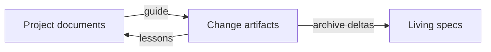

# 7. The AI-ready project

Use this page to give people and agents the same map of a project. It covers the document layout, ways to adopt it,
and the commands that report progress.

## On this page

- [Target structure](#72-target-structure)
- [New and existing projects](#75-new-project-scaffold)
- [Progress](#79-progress-report-and-dashboard)
- [Limits](#710-limits-and-next-steps)
- [Terms](#-terms)
- [See also](#-see-also)

## 7.1. Why a layout

An agent needs a stable map of the system, its rules, and the commands that prove a change works. The AI-ready layout
gives people and every agent tool the same entry points. OpenSpec keeps change artifacts and living specifications;
these project documents provide the context around them. Run `sdlc init` before any layout or reporting command.

## 7.2. Target structure

The files below give each kind of project context a predictable home.

```text
AGENTS.md                 CLAUDE.md               README.md
REVIEW.md
docs/
  architecture.md         conventions.md          glossary.md
  runbook.md              security.md
  decisions/
openspec/
  config.yaml             sdlc.yaml
  changes/                specs/
```

| Role | Canonical path | Required? | Purpose | Common aliases |
|---|---|---|---|---|
| agents-guide | `AGENTS.md` | Yes | Main coding-agent guide, read by OpenCode and imported by Claude Code. | `AGENT.md` |
| claude-guide | `CLAUDE.md` | No | Thin Claude Code entry point with Claude-only notes. | `.claude/CLAUDE.md` |
| readme | `README.md` | Yes | What the project is and how a person starts. | `README`, `README.txt`, `README.rst` |
| review-policy | `REVIEW.md` | No | Review passes and severities for `/sdlc:review`. | `docs/REVIEW.md`, `.github/REVIEW.md` |
| architecture | `docs/architecture.md` | Yes | Modules, boundaries, data flows, and external dependencies. | `ARCHITECTURE.md`, `docs/ARCHITECTURE.md`, `doc/architecture.md`, `docs/architecture/README.md` |
| conventions | `docs/conventions.md` | Yes | Code style, naming, error handling, and testing rules. | `CONVENTIONS.md`, `docs/CONVENTIONS.md`, `docs/coding-standards.md`, `docs/style-guide.md`, `STYLEGUIDE.md`, `CONTRIBUTING.md` |
| glossary | `docs/glossary.md` | No | Domain vocabulary shared by people, specs, and code. | `GLOSSARY.md`, `docs/GLOSSARY.md`, `docs/ubiquitous-language.md`, `docs/terminology.md` |
| runbook | `docs/runbook.md` | Yes | Build, run, test, debug, and environment commands. | `RUNBOOK.md`, `docs/RUNBOOK.md`, `DEVELOPMENT.md`, `docs/development.md`, `docs/operations.md` |
| security | `docs/security.md` | No | Threat model, sensitive zones, and rules agents must preserve. | `SECURITY.md`, `docs/SECURITY.md`, `docs/threat-model.md` |
| decisions | `docs/decisions/` | No | Architecture decision records, one file per decision. | `docs/adr/`, `docs/adrs/`, `doc/adr/`, `adr/`, `docs/architecture/decisions/`, `decisions/` |

`sdlc layout check [--json]` reports each role as canonical, mapped, alias, or missing. A path is a candidate only when
it matches the canonical path, a configured mapping, or an exact alias (case-insensitively). `ready` means every
required role is present. `score` is the rounded percentage of all ten roles present, from 0 to 100; optional roles
affect the score but not readiness. A configured mapping takes precedence, and a mapping to a missing path produces a
warning and a missing role.

`sdlc layout scaffold` fills the project name in generated documents from `package.json` (without its scope),
`pyproject.toml` `[project]`, `Cargo.toml` `[package]`, or the final segment of a `go.mod` module. If no manifest
supplies a name, it uses the folder name.

## 7.3. AGENTS.md and CLAUDE.md

These two files give tools a shared starting point.

`AGENTS.md` is the main agent file, with links to the actual project documents. OpenCode reads it directly. `CLAUDE.md`
is a thin Claude Code wrapper: its first line is `@AGENTS.md`, followed only by Claude-specific notes. Keep shared rules
in the main guide so every agent follows the same project policy.

## 7.4. OpenSpec and the lifecycle

The project documents support each change as it moves through the lifecycle.

Put stable project context and artifact rules in `openspec/config.yaml`. Its `context:` can point authors toward the
architecture, conventions, glossary and runbook. OpenSpec changes move through these stages:

- intent, spec and plan;
- build and verify;
- review, release and archive.

A change's `design.md` can cite ADRs in `docs/decisions/`; archive merges spec deltas into living specs. Feed repeated
lessons from archived changes into `AGENTS.md` and the relevant project documents.



The role mapping belongs in `openspec/sdlc.yaml`, separate from OpenSpec's `context:`. The layout commands write their
actions to `openspec/.sdlc/log.jsonl` as `layout.scaffolded`, `layout.adapted`, or `layout.converted` when applied.

## 7.5. New project: scaffold

Scaffold the layout after initialization.

In an empty folder the `sdlc init` wizard does this for you; with flags, `sdlc init --layout scaffold`. By hand:

```bash
sdlc init
sdlc layout scaffold --dry-run
sdlc layout scaffold
sdlc layout check --json
```

`sdlc layout scaffold [--dry-run] [--json]` renders templates at canonical paths for missing roles, including a starter
ADR in `docs/decisions/`. It never overwrites an existing file. The dry run lists what would be created without writing
it; JSON gives the created and kept paths. Review the starter text and replace placeholders with the project's actual
facts.

## 7.6. Existing project: adapt

Adapt keeps existing documents in their current locations.

`sdlc init` in an existing project shows the differences first and offers adapt or a worktree (`--layout adapt`,
`--layout worktree --worktree <path>`).

Use `sdlc layout adapt [--dry-run] [--json]` when existing documents should stay where they are. It detects aliases
such as `ARCHITECTURE.md`, `docs/adr/` and `CONTRIBUTING.md`. It records noncanonical role paths under `layout:` in
`openspec/sdlc.yaml` and creates only missing roles at canonical paths. It writes `AGENTS.md` with links to the real
locations and moves nothing. Preview first, then apply and check:

```bash
sdlc layout adapt --dry-run
sdlc layout adapt
sdlc layout check
```

For example, the resulting configuration can include:

```yaml
layout:
  architecture: ARCHITECTURE.md
  conventions: CONTRIBUTING.md
  decisions: docs/adr/
```

Mappings use role ids as keys and project-relative paths as values. A stale mapping reports missing even if another
candidate exists; correct the mapping or rerun adaptation after fixing the file.

## 7.7. Existing project: convert

Convert moves documents to the canonical paths after you review its plan.

Use `sdlc layout convert [--apply] [--in-place] [--worktree <path>] [--branch <name>] [--json]` when documents should
move to canonical paths. Without `--apply`, the command gives a read-only plan of the current project: proposed moves,
relative Markdown link rewrites, pinned paths skipped, and conflicts. Inspect the plan before applying.

By default, `--apply` creates a worktree on a new `sdlc/layout-convert` branch at
`<parent of project>/<project name>-layout-convert`. You can choose another location and branch with `--worktree` and
`--branch`; a relative worktree path resolves from the current directory. Only committed content is copied. Uncommitted
tracked and untracked changes in the main copy are left there and reported as a warning. The conversion uses `git mv`,
updates links and configuration, writes `layout.converted` in the worktree log, and commits with your configured git
identity. The main copy stays untouched. Review with `git diff <current branch>...<conversion branch>`, then merge or
open a PR. To discard it, run `git worktree remove <path>` and `git branch -D <branch>`.

Use `--apply --in-place` to convert the current working copy directly; it requires a clean working copy. Agent sessions
may run the dry plan, but cannot run worktree `--apply` because the command would commit on a person's behalf. Run that
command yourself in a terminal.

> [!IMPORTANT]
> Review the conversion plan before applying it. Worktree conversion commits with your git identity.

Conversion never moves these pinned paths:

- `README.md`, `README`, `README.txt`, `README.rst`;
- `CONTRIBUTING.md`, `SECURITY.md` or anything under `.github/`.

It never reads, rewrites or moves these directories:

- `openspec/`, `node_modules/`, `.git/`;
- `dist/`, `build/`, `vendor/`.

For in-place conversion, review the resulting diff and use git to restore it if needed.

## 7.8. Existing project: settings and documents (adopt)

Adopt drafts settings from the repository and its history.

`sdlc adopt [--json]` analyses the repository and drafts the settings; it writes nothing. It reports:

- the stack from `package.json`, `go.mod`, `pyproject.toml`, `Cargo.toml`, `pom.xml`, `*.csproj` and similar files;
- CI files and people found in git history and CODEOWNERS. Email owners are included. `@handles` without an email
  are unresolved, and bots are skipped.

The draft proposes verify commands and protected paths absent from the configuration (CI configuration, CODEOWNERS).
It drafts `openspec/roles.yaml` with a holder for every role a gate needs. Owners of catch-all CODEOWNERS patterns
become `code-owner`; owners of narrower patterns are listed to check. Every other role and `maintainer` go to the
person running adopt for later handover. When `sdlc.yaml` still keeps `roles:`, the draft leaves them alone and
points to `sdlc roles migrate`.

`sdlc adopt --apply` writes the draft: it adds the proposed commands and paths to `openspec/sdlc.yaml`, keeping
everything already there, and writes `openspec/roles.yaml` only when the file does not exist. Applying is a person's
decision: agents are refused by the CLI and the hook. A second run with nothing new writes nothing.

The adopt workflow is `/sdlc:adopt` in Claude Code, `/sdlc-adopt` in OpenCode, Cursor, Qwen Code and GigaCode, and
`$sdlc-adopt` in Codex CLI. It prepares the project in this order:

1. Run `sdlc layout check`, then `layout adapt` for existing documents (conversion is only proposed).
2. Run `layout scaffold` for missing documents.
3. Fill architecture, conventions, build and test commands, glossary, sensitive areas and decisions from the code.
   Give a file reference for every statement and mark uncertainty "to check".
4. End with the `sdlc adopt` draft and the command for a person to apply it.

`sdlc init` suggests this workflow for an existing project.

## 7.9. Progress: report and dashboard

Reports and the dashboard use the same progress model.

`sdlc report [--format md|json|html] [--since YYYY-MM-DD] [--change <id>] [--out <file>]` summarizes:

- the reporting period and active changes by lifecycle stage;
- blocked changes and changes awaiting a person;
- median lead times and verification first-pass rate;
- project-log events and layout readiness.

The change filter selects one active or archived change. The date filters events and changes moved during the period.
An output file must stay inside the project.

`sdlc dashboard [--since YYYY-MM-DD] [--change <id>] [--out <file>]` writes the same model as one self-contained HTML
page. `sdlc report --format html` renders the same page. Each change has its own section (anchor `#change-<id>`, linked
from the list) with:

- the timeline and how long each gate waited for a person;
- reworks with reasons and gaps from `sdlc trace`;
- the name of the person who acts now.

It uses no network assets and supports light and dark display, so it can be attached to a PR or kept as a CI artifact.

```yaml
# Example GitHub Actions steps after checkout and CLI setup
- run: sdlc report --format html --out artifacts/sdlc-dashboard.html
- uses: actions/upload-artifact@v4
  with:
    name: sdlc-dashboard
    path: artifacts/sdlc-dashboard.html
```

## 7.10. Limits and next steps

Check the generated documents against the actual project before relying on them.

The layout describes a small set of exact paths and aliases; it does not infer a role from arbitrary files. Review
generated templates and mappings before relying on them. `sdlc import bmad` imports BMAD planning artifacts; broader
convention imports from frameworks such as Spec Kit and Kiro remain a later step.

## 📚 Terms

The [glossary](glossary.md) explains changes, living specs, gates and evidence.

## 📚 See also

- [User guide](05-guide.md) — follow a change through the lifecycle.
- [Architecture](04-architecture.md) — see how the layout supports the process layer.
- [Roles and signing](08-roles-and-signing.md) — assign decisions to people.
