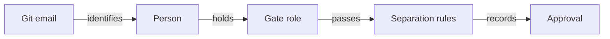

# 8. Roles, separation of duties and signed approvals

Use this page to name who may approve each gate and how signed commits prove those decisions. It also explains how to
check an approval and protect changes to the roles file.

## On this page

- [The roles file](#81-openspecrolesyaml)
- [Approval checks](#82-what-sdlc-approve-checks)
- [Signed approvals](#83-signed-approvals)
- [Protection and limits](#84-what-this-protects-against-and-what-it-does-not)
- [Terms](#-terms)
- [See also](#-see-also)

A gate approval is only worth something if the right person gave it. sdlc ties approvals to people named in a file
that lives in git. It refuses approvals that break separation of duties and checks the signer of each approval commit.

Without `openspec/roles.yaml`, nothing changes: the `roles:` allow-lists in `openspec/sdlc.yaml` apply.

## 8.1. `openspec/roles.yaml`

A person can run `sdlc init --roles` to create a starter file from the current git identity.
That identity holds every role until the team edits the file. An existing file is kept; text and JSON report
whether it was created or kept. In an agent session the CLI refuses with `agent_cannot_edit_roles`, and the hook
denies the command, as it does `sdlc roles migrate`.

```yaml
version: 1
signing: warn                 # off | warn | required
signing_since: abc123         # optional commit; earlier approvals are pre-signing
people:
  alice: { name: Alice Walker, emails: [alice@corp.example], signing_key: "ssh-ed25519 AAAA… alice@corp" }
  bob:   { name: Bob Turner,   emails: [bob@corp.example],   signing_key: "ssh-ed25519 AAAA… bob@corp" }
  carol: { name: Carol Hughes, emails: [carol@corp.example], handles: [carol-s] }
roles:
  product-owner: [alice]
  release-manager: [alice]
  maintainer: [alice]         # may change this file
  engineer: [bob, carol]
  tech-lead: [bob]
  code-owner: [bob, carol]
  qa: [carol]                 # the optional qa gate (0.18.0)
separation:
  author_cannot_approve: [review, release]
  distinct_approvers: [[spec, review], [plan, review]]
  max_gates_per_person: 3
```

- **people**: a stable id, a name, one or more emails (matched case-insensitively), and optionally the public SSH key
  the person signs commits with. An email belongs to one person only.
- `handles` lists GitHub personal handles, with or without `@` and matched case-insensitively.
  CODEOWNERS `@carol-s` then resolves to Carol in `sdlc review suggest` and the adoption draft. A handle equal
  to the person id also matches. Team handles such as `org/team` are refused. `sdlc adopt` text and JSON both
  list handles it could not resolve.
- **roles**: role names from the gates in `sdlc.yaml` (`approvers`, `high_risk_approvers`) and their holders.
  `maintainer` may change this file and accepts agent roles. `qa` approves the optional `qa` gate.
  A role name is a plain token: a letter, then letters, digits, `.`, `_` or `-` (`product-owner`, `tech_lead`).
  Role names go into the approval commands sdlc suggests, so any other name is refused when the file is read, and the
  message names the file, the field and the role.
- **separation** (the defaults are shown):
  - `author_cannot_approve`: gates the authors of the change's code may not approve. Authors are the commit authors and
    `Co-authored-by` trailers on the branch since the review base, counting only files outside `openspec/`.
  - `distinct_approvers`: pairs of gates that need two different people.
  - `max_gates_per_person`: how many gates of one change one person may approve (0 = no limit).

Agents cannot edit the file: the guard of every supported tool (the hooks, or the OpenCode plugin) denies writes to it,
like `.sdlc.yaml`.

For later changes to `roles.yaml`, an agent or person can run `sdlc config propose --target roles --set <key>=<yaml>
--reason <text>` and `sdlc config show <id>`. A person holding `maintainer` reviews the diff and runs
`sdlc config apply <id>` in their terminal. If `roles.yaml` changed meanwhile, the proposal is stale. Weaker
signing or an emptied role raises a warning and requires `--yes`.

## 8.2. What `sdlc approve` checks

Approval checks identify the person, their role and the separation rules.



With the file present, `sdlc approve <gate> --change <id>`:

1. Identifies the person by the git identity's email. An unknown email is refused (`unknown_person`). `--by` may only
repeat the same email (`by_mismatch` otherwise). The record keeps `by: Name <email>` and adds `person: <id>`.
2. Requires a role the gate accepts (`missing_role` names the people who hold it).
3. Applies the separation rules (`author_cannot_approve`, `distinct_approvers`, `max_gates_per_person`) against the
approvals already recorded in the change.

`reject` and `waive` check the person and the role, not the separation rules.

The file also decides who takes these team decisions:

| Command | Role needed |
|---|---|
| `sdlc team accept` | `maintainer` |
| `sdlc backlog move`, `sdlc backlog drop` | `product-owner` |

A person without the role is refused with `missing_role`, and the message names who may. Without the file any person may
run these commands, as before. An agent never may.

The optional `qa` gate (`gates.qa: { required: true }`) sits between verify and review. Its default approver role is
`qa`: add your testers to `qa` in `roles.yaml`. After verification passes, a person with the role accepts the evidence
with `sdlc approve qa --change <id>`. They can send the change back with
`sdlc reject qa --change <id> --note "…"`. An agent can never approve it.

Ask before trying:

```bash
sdlc roles who review --change add-calc      # required roles, who may approve, and why others may not
sdlc roles check --change add-calc           # the same for every gate
sdlc roles check                             # people and their roles
```

On a high-risk change, `roles who` and `approve --preview` list the extra required roles and the roles
still missing. `sdlc status` and `sdlc next` warn when no person may approve a remaining required gate;
use the named `roles who <gate> --change <id>` command to inspect role and separation rules.

Move from the allow-lists in `sdlc.yaml` with `sdlc roles migrate` (a person runs it; it writes `roles.yaml` with
`signing: off` and the default separation, and never overwrites an existing file).

## 8.3. Signed approvals

Signing ties the approval record to the approver's key.

A git email is easy to fake. Signing closes that gap: every approval must arrive in a commit signed by the key of the
person who approved, and every change to `roles.yaml` must be signed by a maintainer.

| Mode | `sdlc approvals verify` |
|---|---|
| `off` | checks nothing (the mode without signatures) |
| `warn` | reports problems, exits 0 |
| `required` | reports problems, exits 1 — use it in CI |

`--mode` overrides the file, so CI can require signatures while local work only warns:
`sdlc approvals verify --mode required`.

With `signing: off`, signatures are not checked. Set `signing: warn` or `signing: required` in
`openspec/roles.yaml` to turn signing on. In a project with history, `signing_since` may name a full or short
SHA or any reference Git resolves to a commit. Approvals recorded in that commit or its ancestors pass as
`pre-signing`; later approvals follow the configured signing mode. `sdlc approvals verify`, evidence export, and
roles.yaml config proposals resolve the reference and refuse an unknown commit. `sdlc doctor` reports an invalid
reference with a fix; ordinary roles reads and approval recording do not resolve it. This cutoff
applies to approval records; the existing rules for `roles.yaml` commits still apply. Moving the cutoff later
or adding it is a weakening warning on a config proposal. Keep `roles.yaml` under maintainer review.

Statuses of an approval: `valid`, `unsigned`, `wrong-signer`, `bad-signature`, `not-committed`.
For `roles.yaml` commits, the statuses are:

- `valid`, `unsigned`, `not-maintainer`, `pre-signing`;
- `bootstrap`, `merge`, `bootstrap-conflict`.

Each commit is checked against the version before it once that version
has keys. A person cannot add themselves as maintainer and sign that change with their own key.

After `sdlc archive`, committed approvals retain their status even before you commit the archive move.

Set up signing once per person (git ≥ 2.34):

```bash
git config gpg.format ssh
git config user.signingkey ~/.ssh/id_ed25519.pub
git config commit.gpgsign true
```

Then put the public key into `signing_key` in `roles.yaml` (a maintainer commits that change).
`signing_key` must be a single OpenSSH public key line. A path to a key file is invalid, and the roles parser
rejects it for proposals, applies, verification and doctor. When enabling signing on an existing project, include
`signing_since` in the same proposal if earlier approvals should remain pre-signing. Otherwise `config show` warns
how many unsigned approvals will fail `sdlc approvals verify`.

A commit before any key exists passes as `pre-signing` if it adds no key. The first key-adding
commit is checked against its own version. It passes as `bootstrap` when signed by a maintainer listed there.
Only one bootstrap is allowed: if history has more than one, every bootstrap gets `bootstrap-conflict` and fails.
Removing all keys and adding new ones cannot start a new bootstrap.

Verification reads `git log --full-history`. A merge whose `roles.yaml` matches a parent's version passes as
`merge` only if the branch it takes grew from a base that already had keys. Otherwise the merge is checked
against a parent with keys. An unsigned merge that drops keys fails; normal pull-request merges of signed
changes pass. If `roles.yaml` is deleted at HEAD, `--mode required` still checks its history, so an unsigned
deletion fails.

To bootstrap an existing `roles.yaml`:

1. Add every maintainer's and approver's `signing_key` in one commit signed by a maintainer listed in that
   new version. The earlier keyless commits pass as `pre-signing`; this commit passes as `bootstrap`.
2. Switch to `signing: warn`, then `signing: required`, in signed commits.
3. Run `sdlc approvals verify --mode required` in CI on a full clone:

   ```yaml
   - uses: actions/checkout@v4
     with:
       fetch-depth: 0
   - run: sdlc approvals verify --mode required
   ```

A shallow clone is refused as `shallow_history`; grafts are refused as `rewritten_history`. Both are warnings
in warn mode. Replace objects are ignored. A git error is `history_unreadable`, never an empty history.

> [!TIP]
> Run `sdlc approvals verify --mode required` on a full clone in CI.

A force-pushed history is a different history. Verification cannot know which keys were first in the history
you lost. Protect the main branch against force pushes and keep `roles.yaml` under CODEOWNERS.

The approver commits their own approval: `sdlc approve …`, then `git commit -S`.

Protect the file in code review too. With GitHub or GitLab code owners, one line makes every change to it need a
maintainer's review (use your maintainers' handles or a team):

```text
# .github/CODEOWNERS (or CODEOWNERS / docs/CODEOWNERS)
/openspec/roles.yaml @your-org/maintainers
```

## 8.4. What this protects against, and what it does not

These controls make approval and role changes accountable. Branch protection and CI are part of that protection.

- **Protects**: one person approving their own code; one person carrying a change through every gate; an agent
  approving; a person approving under someone else's email (with signing); quietly widening roles (with signing).
- **Does not protect**: a person with write access who disables the checks in CI, or a compromised signing key. Protect
  the default branch and require the CI check that runs `sdlc approvals verify --mode required`.

## 📚 Terms

The [glossary](glossary.md) explains approval, gate, digest and rework.

## 📚 See also

- [Architecture](04-architecture.md) — see how gates and guards enforce decisions.
- [Process health](13-process-health.md) — inspect approval evidence and participation.
- [Traceability and audit](14-traceability.md) — export the recorded trail.
