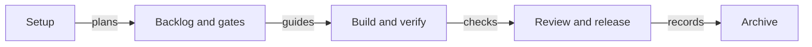

# The calculator demo and dashboard automation

Use the calculator demo to follow a complete sdlc change with real commands and output. Then choose how to keep a
local dashboard current as the project changes.

## On this page

- [Follow the calculator demo](#-follow-the-calculator-demo)
- [Build the demo deck](#-build-the-demo-deck)
- [Keep the dashboard current](#-keep-the-dashboard-current)
- [Terms](#-terms)
- [See also](#-see-also)

## 💡 Follow the calculator demo

`test/e2e-calculator.test.ts` is both an acceptance test and the demo script. Three people build a till calculator with
AI agents:

- **Alice:** product owner, release manager and maintainer of `roles.yaml`.
- **Bob:** engineer and tech lead who writes the code.
- **Carol:** engineer and code owner who reviews it.

The story follows a change from setup to archive. This diagram shows its main path:



The scenario includes these parts:

- **Setup:** `init` for Claude Code and OpenCode, the demo's two tools. It also runs `doctor`, `health`, `license`,
  `help`, the `layout` commands and `update`.
- **Roles:** `roles.yaml` uses signing in `warn` mode.
- **Planning:** exploration and a backlog with an epic, dependencies and priorities.
- **OpenSpec:** the change is a plain OpenSpec change. The demo runs `openspec list`, `status` and `show`.
  Strict validation refuses a delta requirement without a scenario until it is fixed. The `sdlc` schema validates
  as an OpenSpec schema. After archive, `openspec list --specs` and `openspec show calculator` show the requirement.
- **The change:** a backlog item starts it. Alice answers the intent's open question with `answer`.
  After rework, `explain` shows why it returns to spec. The agent builds the changelog from delta specs with
  `changelog` before release. Bob cannot act as product owner or review his own code.
- **Later gates:** verification records evidence. Review uses lenses and defers a finding. Release is followed by
  `approvals verify` and archive.
- **Other flows:** a bug fix with locked tests, a rejected idea, a waiver, deferred work and backlog closure,
  and a BMAD import.
- **Visibility:** `status`, `report`, `dashboard`, `audit`, `log`, `statusline`, the session hook, the plugin
  and `uninstall`.

The test fails if any CLI command is missing from the story.

## 🛠️ Build the demo deck

Each step records who ran it, the command, the exit code, an output excerpt and a note. The deck uses that transcript,
so its slide output comes from the scenario itself.

```bash
npm run demo:deck                  # per language: runs the scenario, then builds the deck
node scripts/demo/build-deck.mjs --transcript docs/demo/calculator-transcript.en.json --lang en --out deck.pptx
```

`SDLC_DEMO_PEOPLE` selects the team's surnames for the deck. `npm run demo:deck` runs the scenario once per language.
The slide steps and words are in `scripts/demo/deck-content.mjs`. `scripts/demo/build-deck.mjs` renders them with
pptxgenjs. The 20-slide English deck is `docs/demo/sdlc-calculator-demo.en.pptx`, built from
`docs/demo/calculator-transcript.en.json`.

## 🔁 Keep the dashboard current

`sdlc dashboard --out reports/dashboard.html` writes a self-contained page. You can refresh it with the CLI or with
`scripts/examples/dashboard-watch.mjs`. Both watch `openspec/` and rebuild after changes. With `--serve`, the page is
available on localhost with auto-refresh.

### Use the CLI

`sdlc dashboard --watch [--serve <host:port>]` builds the page and rebuilds it when `openspec/` changes. Use
`--serve` when you want the local auto-refresh view.
See [keeping the dashboard current](05-guide.md#56-keeping-the-dashboard-current).

### Use the watcher script

The script debounces rebuilds, runs one at a time and spaces them by a minimum interval. These commands let you
build once, watch continuously or serve the page:

```bash
node scripts/examples/dashboard-watch.mjs --once                     # build once
node scripts/examples/dashboard-watch.mjs                            # watch and rebuild
node scripts/examples/dashboard-watch.mjs --serve 127.0.0.1:8123     # and serve with auto-refresh
node scripts/examples/dashboard-watch.mjs --cli "npx --no-install sdlc" --debounce 2000 --min-interval 10000
```

[`scripts/examples/README.md`](../../scripts/examples/README.md) explains background runs with:

- Windows Task Scheduler through `register-dashboard-task.ps1`;
- a `systemd --user` service;
- a `launchd` agent;
- a CI step that keeps the page as a build artifact.

> [!NOTE]
> The dashboard and watcher stay local. Neither publishes the page.

## 📚 Terms

The [glossary](glossary.md) explains [gates](glossary.md) and other sdlc terms used in the demo.

## 📚 See also

- [User guide](05-guide.md) — follow a change through its gates.
- [Process health](13-process-health.md) — understand the health command used in the demo.
- [Dashboard example](21-dashboard-health-example.md) — read a dashboard in a team run.
