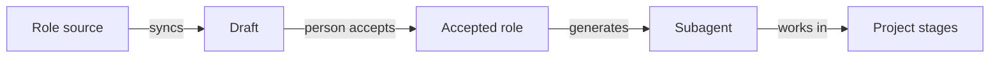

# 12. The agent team

A project can give agents defined roles that the team reads and edits. sdlc turns an accepted role into a subagent
for each supported tool, connects it to its stages and adds project facts. Use this page to draft, accept and
protect your team's roles.

## On this page

- [What a role is](#121-what-a-role-is)
- [Starting on an empty project](#122-starting-on-an-empty-project)
- [Starting on an existing project](#123-starting-on-an-existing-project)
- [The team's registry](#124-the-teams-registry)
- [Packs from git or npm](#125-packs-from-git-or-npm)
- [Skills that reach the agents](#126-skills-that-reach-the-agents)
- [Accepting, changing and protecting roles](#127-accepting-changing-and-protecting-roles)
- [Commands](#128-commands)
- [Limits we accept](#129-limits-we-accept)
- [Terms](#-terms)
- [See also](#-see-also)

This diagram shows how a role becomes an agent the team can use:



## 12.1. What a role is

A role lives in `docs/agents/<role>.md`. The built-in roles are:

- analyst;
- architect;
- developer;
- tester;
- reviewer.

sdlc generates subagents for Claude Code, OpenCode, Cursor, Codex CLI, Qwen Code and GigaCode.
This example shows the role file:

```markdown
---
id: tester
title: Tester
description: Independently verifies a change against its specs ...
stages: [test]
tools: [read, grep, glob, bash]
readonly: true
---
# Role: tester
... responsibilities, how to work, the verdict rules, boundaries ...
```

The **body** says *how* the role works. sdlc adds two blocks:

- **Where to write.** The artifacts of the role's stages:

  | Role | Writes |
  |---|---|
  | analyst | intent, proposal and spec scenarios |
  | architect | `design.md` |
  | developer | plan, tasks and code |
  | tester | the behavioural table and the verdict in `verification.md` |
  | reviewer | findings in `review.md` |

- **This project.** The facts sdlc knows:
  - the verify commands;
  - protected paths and test paths;
  - who holds which role in `roles.yaml`, and the separation rules;
  - the project's language;
  - the AI-ready documents;
  - the context packs and MCP servers of the role's stages.

  Change a check, and the next `sdlc update` updates every role.

The built-in roles are rewritten from common role prompts to fit sdlc. For example:

- the developer writes a failing test first;
- the tester runs before it reads, and treats a case it could not run as NOT RUN, never PASS;
- the architect does not change an existing project's stack without a person's decision.

## 12.2. Starting on an empty project

Start with drafts when your new repository has only an idea.

```bash
sdlc init
sdlc team sync           # drafts of the five roles in docs/agents/drafts/, in the project's language
```

Then ask the agent to set up the team (`/sdlc:team`):

1. The agent reads the intent of the first change, or asks you for the idea and the chosen stack.
2. It adds a **Project rules** section to each draft, with only what is true for this project.

Read the drafts, then accept them in your own terminal:

> [!IMPORTANT]
> Review each draft's project rules before you accept the role.

```bash
sdlc team accept analyst
sdlc team accept tester
```

## 12.3. Starting on an existing project

Let `/sdlc:team` learn a codebase's conventions, CI and owners before it drafts roles.

`/sdlc:team` learns the project before it drafts:

- `sdlc adopt --json` gives the stack, the checks, the CI, CODEOWNERS and the git authors;
- AGENTS.md, the architecture and conventions documents;
- the code itself: error handling, how tests are written, generated or dangerous folders.

It writes rules into each role, naming the file each rule comes from. For example:

- the developer's logging convention;
- how the tester starts the app;
- the reviewer's recurring security risks.

## 12.4. The team's registry

Use a registry when your company keeps roles and skills in one place for its projects.

```yaml
# openspec/sdlc.yaml
mcp:
  servers:
    team-roles: { type: http, url: https://mcp.corp.example/roles, headers: { Authorization: "Bearer ${ROLES_TOKEN}" }, stages: [] }
team:
  registry: team-roles
```

The registry is an [MCP](glossary.md) server with four tools:

- `list_roles`;
- `get_role`;
- `list_skills`;
- `get_skill`.

- `sdlc team sync` takes roles from it first and fills the gaps from the built-ins. Each item is checked against its
  checksum, and a mismatch is refused.
- A draft records the server, the version and the checksum.
- A newer version of an accepted role arrives as a draft. It never replaces the accepted one silently.

## 12.5. Packs from git or npm

Use a [pack](glossary.md) when roles live in a repository or package instead of a registry server.

```yaml
packs:
  - { name: corp, git: https://git.corp.example/sdlc-pack.git, ref: v1.2.0 }
  - { name: corp-npm, npm: "@corp/sdlc-pack@1.2.0" }
```

A pack holds `roles/<id>.md` (or `roles/<locale>/<id>.md`) and `skills/<id>/…`.

- `sdlc team sync` reads the registry first, then the packs, then the built-ins.
- **Pin the version.** For git, prefer a commit or a tag; for npm, an exact version.
- No code of a pack runs: no git hooks or submodules, no npm scripts.
- An npm pack is a registry package (`@corp/sdlc-pack@1.2.0`) or a `.tgz` (a path or an `https://` URL). A
  folder or a repository is refused for `npm:` — npm 10 runs a package's `prepare` script for those even with
  `--ignore-scripts` — so put a repository in a `git:` pack.
- An unreachable pack is reported, and sync goes on with the next source.

### Lenses, workflows and checks

A pack may also hold:

- `lenses/<id>.md` — a review lens, named `<pack>-<id>` in the project. `sdlc review context` gives its text, and
  `sdlc review check` requires its coverage line in review.md like a configured lens.
- `workflows/<id>.md` — a workflow (front matter `description`), generated as the skill `sdlc-<pack>-<id>` for the
  project's tools. A pack workflow never replaces a built-in one: `sdlc-build` stays the harness's.
- `checks.yaml` — `verify:` checks in the format of `verify.commands`, named `<pack>/<name>`. `sdlc verify --list`
  lists them and `sdlc verify` runs them as an agent (`SDLC_AGENT=pack-<name>`), never as the person who runs verify.

Rules for these:

- **A person accepts the pack.** Nothing of the above is in effect before `sdlc team accept --pack <name>` (a person;
  with `openspec/roles.yaml`, the maintainer). The acceptance is bound to the digest of the pack's lenses, workflows
  and checks: a new version, a changed entry in `sdlc.yaml` or an edited cache puts none of them in effect until a
  person accepts again. An agent can never accept.
- **Pinned.** A pack with workflows or checks must point at a git commit (40 hex digits) or an exact npm version.
  Otherwise `sdlc team sync` reports `pack_not_pinned` and the pack cannot be accepted. A pack with roles, skills or
  lenses only keeps the warning.
- **No person's command.** A check or a workflow that calls a human-only sdlc command (approve, reject, waive, tests
  unlock, license set and the others) is refused with `pack_forbidden_command`.

## 12.6. Skills that reach the agents

The skills a role lists are installed when the role is accepted, and only with a matching checksum.
Check where they go and what a person must accept separately.

- **Where they go.** Into the skills folder of every tool the project is set up for: `.claude/skills/<id>/` (Claude
  Code; OpenCode reads it too, so with Claude Code there is no `.opencode` copy), `.opencode/skills/<id>/` (a project
  with OpenCode but without Claude Code), `.cursor/skills/<id>/` (Cursor), `.agents/skills/<id>/` (Codex CLI),
  `.qwen/skills/<id>/` (Qwen Code) and `.gigacode/skills/<id>/` (GigaCode). The hook guards every copy, and
  `sdlc team check` checks every copy. `openspec/.sdlc/team.json` records all the folders of a skill (`dirs`); an
  older record with only `dir` is still read.

- **A skill that carries more than Markdown** (scripts, binaries) waits for a person: `sdlc team accept --skill <id>`.
- **`sdlc team check`** lists every skill with:
  - its source and version;
  - whether the checksum matches;
  - its scripts;
  - its allowed tools, with a warning when they grant unrestricted shell or file writes.

Take only what the team needs, from sources it trusts. A skill is instructions and code your agents will follow.

## 12.7. Accepting, changing and protecting roles

Acceptance controls which role text becomes a subagent. A person reviews drafts and changes before accepting them.

- **Accepting is a person's command.** `sdlc team accept <role>` is refused in an agent session, and the hook blocks
  it. It moves the draft into place, records it in `openspec/.sdlc/team.json` and generates the subagent. It also says
  whether the draft differs from its source, so you see what an agent changed.
- **Agents cannot edit what is accepted.** Agents cannot change:
  - the accepted roles;
  - the team record;
  - the installed team skills;
  - the generated `sdlc-*` subagents, skills and commands.

  Otherwise an agent could make the tester pass anything.
- **A person may edit a role.** `sdlc team list` then shows it as `changed`. Like an approval bound to content, a
  changed role is not generated until it is accepted again. Meanwhile verify and review fall back to the built-in
  subagents.
- **Two roles replace built-ins.** The accepted tester and reviewer take the place of `sdlc-verifier` and
  `sdlc-reviewer` in the verify and review workflows. Generated subagents append
  the built-in verification and review instructions after the team's role text, including the review.md finding format.

## 12.8. Commands

Use these commands to sync, inspect and accept team roles and skills.

| Command | Who | What |
|---|---|---|
| `sdlc team sync [--json]` | anyone | drafts from the registry, packs and built-ins |
| `sdlc team list [--json]` | anyone | roles, sources, status: draft, accepted, changed |
| `sdlc team check [--json]` | anyone | the skills of the accepted roles, vetted |
| `sdlc team accept <role>` / `--skill <id>` | a person | accept a role or a skill with scripts |
| `sdlc team accept --pack <name>` | a person | accept the lenses, workflows and checks of a pack |
| `/sdlc:team` (`/sdlc-team`) | the agent | sync, learn the project, draft the project's rules |

## 12.9. Limits we accept

Keep these limits in mind when reviewing a role or its source.

- **Project facts follow the project only through `sdlc update`.** A role reflects the last update, not the live state.
- **A Project rules section is as good as what the agent found.** A person reads it before accepting.
- **The registry and packs are trusted sources the team chose.** The checksum proves that the content did not change
  on the way, not that the content is good.

## 📚 Terms

The [glossary](glossary.md) explains [stage](glossary.md), [pack](glossary.md), [lens](glossary.md) and
[MCP](glossary.md).

## 📚 See also

- [User guide](05-guide.md) — follow a change through its stages.
- [Integrations](10-integrations.md) — connect the team's MCP servers.
- [Roles and signing](08-roles-and-signing.md) — see who makes each decision.
