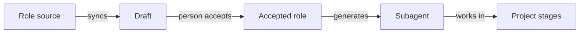

# 12. The agent team

A project can give agents defined roles that the team reads and edits. sdlc turns an accepted role into a subagent
for each supported tool, connects it to its stages and adds project facts. Use this page to draft, accept and
protect your team's roles.

## On this page

- [What a role is](#121-what-a-role-is)
- [Starting on an empty project](#122-starting-on-an-empty-project)
- [Starting on an existing project](#123-starting-on-an-existing-project)
- [The team's registry](#124-the-teams-registry)
- [Packs from git or npm](#125-packs-from-git-or-npm)
- [Skills that reach the agents](#126-skills-that-reach-the-agents)
- [Accepting, changing and protecting roles](#127-accepting-changing-and-protecting-roles)
- [Commands](#128-commands)
- [Limits we accept](#129-limits-we-accept)
- [Terms](#-terms)
- [See also](#-see-also)

This diagram shows how a role becomes an agent the team can use:



## 12.1. What a role is

For a solo project, explicitly choose `sdlc init --team-mode solo`. The wizard also offers this execution profile.
`team.mode: solo|team` is additive: leaving it absent preserves the existing team behavior. It changes execution
guidance only; `openspec/roles.yaml`, human membership, signing, approval separation and registry acceptance stay
under their existing rules.

Solo mode installs five discoverable bundled skills: `sdlc-role-analyst`, `sdlc-role-architect`,
`sdlc-role-developer`, `sdlc-role-tester` and `sdlc-role-reviewer`. They use the selected tool's normal skill folder:
`.claude/skills`, `.opencode/skills`, `.cursor/skills`, `.agents/skills`, `.qwen/skills` or `.gigacode/skills`.
When Claude Code and OpenCode are both selected, OpenCode reads the Claude skill copy. User-edited generated
skills are preserved under the usual manifest rules.

Each workflow names one active execution role:

- analyst: explore, intent, spec, backlog, archive and triage;
- developer: plan, build and release;
- tester: verify; reviewer: review;
- architect: team and adopt.

Announce a deliberate switch to architect for architectural work. The `next`
hint carries the role as guidance, never as permission to approve, change protected state or commit against
project policy. Editable answer and commit drafts retain literal arguments and required change/task trailers;
where a person reserves commit execution, that person runs or confirms the displayed commands.

A role lives in `docs/agents/<role>.md`. The built-in roles are:

- analyst;
- architect;
- developer;
- tester;
- reviewer.

sdlc generates subagents for Claude Code, OpenCode, Cursor, Codex CLI, Qwen Code and GigaCode.
This example shows the role file:

```markdown
---
id: tester
title: Tester
description: Independently verifies a change against its specs ...
stages: [test]
tools: [read, grep, glob, bash]
readonly: true
---
# Role: tester
... responsibilities, how to work, the verdict rules, boundaries ...
```

Each `tools` entry is a tool name with an optional pattern in parentheses, such as `read` or `Bash(git:*)`.
The name holds letters, digits, `_` and `-`. The pattern holds no parentheses and no line break.
Control and format characters are refused too.
A role lists at most 64 entries, each at most 200 characters long.
A registry role is checked by the same rule before its draft is written.

An accepted role file that sdlc refuses stops the commands that rewrite the generated files before they write.
Such commands are `sdlc update`, `sdlc init`, `sdlc doctor --fix`, `sdlc license set` and `sdlc team accept`.
The error names the file. Fix it, then a person accepts the role again with `sdlc team accept <role>`.
`sdlc team check` and `sdlc team skills` list such a role as refused and go on with the others.
An edited or unrecorded file in `docs/agents/` never blocks a command: sdlc does not read it until it is accepted.

The **body** says *how* the role works. sdlc adds two blocks:

- **Where to write.** The artifacts of the role's stages:

  | Role | Writes |
  |---|---|
  | analyst | intent, proposal and spec scenarios |
  | architect | `design.md` |
  | developer | plan, tasks and code |
  | tester | the behavioural table and the verdict in `verification.md` |
  | reviewer | findings in `review.md` |

- **This project.** The facts sdlc knows:
  - the verify commands;
  - protected paths and test paths;
  - who holds which role in `roles.yaml`, and the separation rules;
  - the project's language;
  - the AI-ready documents;
  - the context packs and MCP servers of the role's stages.

  Change a check, and the next `sdlc update` updates every role.

The built-in roles are rewritten from common role prompts to fit sdlc. For example:

- the developer writes a failing test first;
- the tester runs before it reads, and treats a case it could not run as NOT RUN, never PASS;
- the architect does not change an existing project's stack without a person's decision.

## 12.2. Starting on an empty project

Start with drafts when your new repository has only an idea.

```bash
sdlc init
sdlc team sync           # drafts of the five roles in docs/agents/drafts/, in the project's language
```

Then ask the agent to set up the team (`/sdlc:team`):

1. The agent reads the intent of the first change, or asks you for the idea and the chosen stack.
2. It adds a **Project rules** section to each draft, with only what is true for this project.

Read the drafts, then accept them in your own terminal:

> [!IMPORTANT]
> Review each draft's project rules before you accept the role.

```bash
sdlc team accept analyst
sdlc team accept tester
```

## 12.3. Starting on an existing project

Let `/sdlc:team` learn a codebase's conventions, CI and owners before it drafts roles.

`/sdlc:team` learns the project before it drafts:

- `sdlc adopt --json` gives the stack, the checks, the CI, CODEOWNERS and the git authors;
- AGENTS.md, the architecture and conventions documents;
- the code itself: error handling, how tests are written, generated or dangerous folders.

It writes rules into each role, naming the file each rule comes from. For example:

- the developer's logging convention;
- how the tester starts the app;
- the reviewer's recurring security risks.

## 12.4. The team's registry

Use a registry when your company keeps roles and skills in one place for its projects.

```yaml
# openspec/sdlc.yaml
mcp:
  servers:
    team-roles: { type: http, url: https://mcp.corp.example/roles, headers: { Authorization: "Bearer ${ROLES_TOKEN}" }, stages: [] }
team:
  registry: team-roles
```

The registry is an [MCP](glossary.md) server with four tools:

- `list_roles`;
- `get_role`;
- `list_skills`;
- `get_skill`.

- `sdlc team sync` takes roles from it first and fills the gaps from the built-ins. Each item is checked against its
  checksum, and a mismatch is refused.
- A registry that does not answer leaves the team to the built-ins, and sync says so. A server that answers without
  `list_roles` or `get_role` is not a registry: `team sync`, `team accept` and `team check` stop with exit code 1 and
  write nothing. On SkillForge this means its plugin `sdlc-registry` is off. The
  [SkillForge page](35-sdlc-and-skillforge.md) shows the setup.
- A skill has at most 64 files. A larger skill is refused, even when a person accepts it.
- A draft records the server, the version and the checksum.
- A registry role's optional description (up to 500 characters) becomes the draft description. Without one, its title
  is used.
- A newer version of an accepted role arrives as a draft. It never replaces the accepted one silently.
- After sync, `sdlc team check --json` reports each draft role's skills as installable, waiting for a person, or
  refused. It does not install them.
- `get_role` may also return `marker: { key, value }`. It is one front matter line that names the role's source in the
  registry, such as `skillforge-source: agent/analyst@1.2.0`. sdlc writes it into the role's subagent for OpenCode,
  Claude Code, Cursor, Qwen Code and GigaCode. A new accepted version updates it. Codex gets no marker, and neither
  does a built-in or pack role.
- A role accepted without the registry's marker, or with another one, gets a draft that carries the marker, even when
  version and checksum are the same. `sdlc team sync` names the role and the command `sdlc team accept <role>`. Only
  that person's command records the marker.
- sdlc checks the marker before it writes it. The key must be lowercase kebab-case and end in `-source`, such as
  `skillforge-source`, so it can never set up the agent. The value must be one plain line of at most 200 characters.
  A marker that fails is not written. The role is still accepted, and `sdlc team sync` warns.

### Rules from the registry

A registry may also serve the team's rules. A rule is a short Markdown text that agents follow on every turn, or only
for some files.

- The two tools are `list_rules` and `get_rule`. `get_rule { id }` returns `{ id, version, description, paths?, tags,
  body, checksum }`. The checksum is `sha256:` of the body, and a rule whose checksum does not match is refused. A
  registry without these tools simply has no rules.
- `sdlc team sync` lists every rule with its version and paths, and says which fit the project. A rule fits when it
  has the tag `sdlc`, when one of its tags is a stack that `sdlc adopt` finds, or when one of its `paths` matches a
  file of the project. The JSON answer has `rules: { rules, proposed, other, install, installAll,
  codexServesOpenCode }`.
- `sdlc team check` reads each rule and shows whether its checksum matches. It writes nothing.
- `sdlc team check` also reads SkillForge's lock files (`.claude`, `.cursor`, `.opencode`, `.codex`, `.qwen`). It
  names each installed rule that the registry lists and the fit notes do not propose, with the line that removes it:
  `skillforge uninstall rule/<id> --runtime <agent>`. An installed rule the registry does not list is not named. The
  JSON answer has `rulesInstalledNotFitting`.

### Who installs registry rules

SkillForge installs registry rules, and sdlc writes no rule text anywhere. If both placed them, an agent would read
every rule twice.

- **SkillForge installs them.** `team sync` prints one line per rule that fits and per configured agent SkillForge
  serves: `skillforge install rule/<id> --runtime <agent>`. The agent ids are SkillForge's: `claude-code`, `cursor`,
  `opencode`, `codex` and `qwen`. A rule that does not fit gets no line. One more line per agent is the alternative:
  `skillforge sync --type rule --runtime <agent>` installs every active rule, fitting or not. SkillForge keeps a lock
  file, updates and removes its rules, and checks local edits.
- **OpenCode with Codex.** OpenCode reads `AGENTS.md` too, where SkillForge puts the Codex rules. So `team sync` prints
  the Codex lines only, and says why; an OpenCode line on top would show OpenCode every rule twice.
- **`sdlc team accept --rule <id>` is refused** for everyone, with exit code 1 and that hint. Nothing is written.
- **Rules sdlc placed earlier.** `sdlc update` empties the rules block of `AGENTS.md`, drops the rules section from
  the role subagents and removes the `.claude/rules/<id>.md` files sdlc wrote. A file changed since sdlc wrote it
  stays.
  Run `skillforge sync --type rule` once after that update. team.json `rules` is kept, so a downgrade restores them.
- **The block between `<!-- sdlc:rules:start -->` and `<!-- sdlc:rules:end -->` stays sdlc's** and holds no registry
  rule. `sdlc doctor` names each rule still in it. sdlc never changes the text outside the markers.
- **Codex and Qwen Code** get registry rules from SkillForge too: a block in `AGENTS.md` or `QWEN.md`, and copies
  in `.codex/skillforge/rules/` or `.qwen/skillforge/rules/`. `sdlc doctor` sees both.
- **GigaCode** gets no registry rules from SkillForge yet. With a team registry, `sdlc doctor` says so. sdlc has no
  Gemini CLI integration, so doctor does not name it.

## 12.5. Packs from git or npm

Use a [pack](glossary.md) when roles live in a repository or package instead of a registry server.

```yaml
packs:
  - { name: corp, git: https://git.corp.example/sdlc-pack.git, ref: v1.2.0 }
  - { name: corp-npm, npm: "@corp/sdlc-pack@1.2.0" }
```

A pack holds `roles/<id>.md` (or `roles/<locale>/<id>.md`) and `skills/<id>/…`.

- `sdlc team sync` reads the registry first, then the packs, then the built-ins.
- **Pin the version.** For git, prefer a commit or a tag; for npm, an exact version.
- No code of a pack runs: no git hooks or submodules, no npm scripts.
- An npm pack is a registry package (`@corp/sdlc-pack@1.2.0`) or a `.tgz` (a path or an `https://` URL). A
  folder or a repository is refused for `npm:` — npm 10 runs a package's `prepare` script for those even with
  `--ignore-scripts` — so put a repository in a `git:` pack.
- An unreachable pack is reported, and sync goes on with the next source.

### Lenses, workflows and checks

A pack may also hold:

- `lenses/<id>.md` — a review lens, named `<pack>-<id>` in the project. `sdlc review context` gives its text, and
  `sdlc review check` requires its coverage line in review.md like a configured lens.
- `workflows/<id>.md` — a workflow (front matter `description`), generated as the skill `sdlc-<pack>-<id>` for the
  project's tools. A pack workflow never replaces a built-in one: `sdlc-build` stays the harness's.
- `checks.yaml` — `verify:` checks in the format of `verify.commands`, named `<pack>/<name>`. `sdlc verify --list`
  lists them and `sdlc verify` runs them as an agent (`SDLC_AGENT=pack-<name>`), never as the person who runs verify.

Rules for these:

- **A person accepts the pack.** Nothing of the above is in effect before `sdlc team accept --pack <name>` (a person;
  with `openspec/roles.yaml`, the maintainer). The acceptance is bound to the digest of the pack's lenses, workflows
  and checks: a new version, a changed entry in `sdlc.yaml` or an edited cache puts none of them in effect until a
  person accepts again. An agent can never accept.
- **Pinned.** A pack with workflows or checks must point at a git commit (40 hex digits) or an exact npm version.
  Otherwise `sdlc team sync` reports `pack_not_pinned` and the pack cannot be accepted. A pack with roles, skills or
  lenses only keeps the warning.
- **No person's command.** A check or a workflow that calls a human-only sdlc command (approve, reject, waive, tests
  unlock, license set and the others) is refused with `pack_forbidden_command`.

## 12.6. Skills that reach the agents

The skills a role lists are installed when the role is accepted, and only with a matching checksum.
Check where they go and what a person must accept separately.

- **Where they go.** Into the skills folder of every tool the project is set up for: `.claude/skills/<id>/` (Claude
  Code; OpenCode reads it too, so with Claude Code there is no `.opencode` copy), `.opencode/skills/<id>/` (a project
  with OpenCode but without Claude Code), `.cursor/skills/<id>/` (Cursor), `.agents/skills/<id>/` (Codex CLI),
  `.qwen/skills/<id>/` (Qwen Code) and `.gigacode/skills/<id>/` (GigaCode). The hook guards every copy, and
  `sdlc team check` checks every copy. `openspec/.sdlc/team.json` records all the folders of a skill (`dirs`); an
  older record with only `dir` is still read.

- **Any file other than Markdown waits for a person:** `sdlc team accept --skill <id>`. JSON and YAML are reported as
  data, not scripts, but still wait for acceptance. A file such as `data.json.sh` is reported as a script. Binary
  refusal remains in force.
- **Installed role skills reach the work.** The role's generated subagent names them, and workflows for stages the
  role owns list them after configured stage skills. Skills waiting for acceptance, refused, or missing are omitted.
- **A stage command carries its skills.** In Claude Code and OpenCode, the command of a stage with skills, such as
  `/sdlc-build`, runs `sdlc team skills --stage <stage>` when it starts. The texts of the stage's SKILL.md files are
  then part of the command, at its start and without their front matter. The command is read-only and prints the
  texts up to 48 KiB. The skill that does not fit and every skill after it are only named, and so is a skill that is
  not installed, so the agent loads them by name. A SKILL.md that resolves outside the project is not read. A skill
  whose text changed is current at the next command, without `sdlc update`.
- **Other surfaces ask for the skills first.** Codex, Cursor, Qwen Code, GigaCode and the Claude Code skills tell the
  agent to load the skills by name before any stage work. Every surface asks the final report to name the skills
  loaded, and why any was not. A stage without skills gets neither step. A stage started in plain words, without its
  command, gets no printed texts either.
- **`sdlc team check`** lists every skill with:
  - its source and version;
  - whether the checksum matches;
  - its scripts and data files;
  - its URLs (at most five in text, with the total when there are more; all in JSON with `urlCount`);
  - its allowed tools, with a warning when they grant unrestricted shell or file writes.

Take only what the team needs, from sources it trusts. A skill is instructions and code your agents will follow.

## 12.7. Accepting, changing and protecting roles

Acceptance controls which role text becomes a subagent. A person reviews drafts and changes before accepting them.

- **Accepting is a person's command.** `sdlc team accept <role>` is refused in an agent session, and the hook blocks
  it. It moves the draft into place, records it in `openspec/.sdlc/team.json` and generates the subagent. It also says
  whether the draft differs from its source, so you see what an agent changed.
- **Agents cannot edit what is accepted.** Agents cannot change:
  - the accepted roles;
  - the team record;
  - the installed team skills;
  - the generated `sdlc-*` subagents, skills and commands.

  Otherwise an agent could make the tester pass anything.
- **A person may edit a role.** `sdlc team list` then shows it as `changed`. Like an approval bound to content, a
  changed role is not generated until it is accepted again. Meanwhile verify and review fall back to the built-in
  subagents.
- **Two roles replace built-ins.** The accepted tester and reviewer take the place of `sdlc-verifier` and
  `sdlc-reviewer` in the verify and review workflows. Generated subagents append
  the built-in verification and review instructions after the team's role text, including the review.md finding format.

## 12.8. Commands

Use these commands to sync, inspect and accept team roles and skills.

| Command | Who | What |
|---|---|---|
| `sdlc team sync [--json]` | anyone | drafts from the registry, packs and built-ins |
| `sdlc team list [--json]` | anyone | roles, sources, status: draft, accepted, changed |
| `sdlc team check [--json]` | anyone | the skills of the accepted roles, vetted |
| `sdlc team skills --stage <stage> [--json]` | anyone | the texts of a stage's skills, as its commands print them |
| `sdlc team accept <role>` / `--skill <id>` | a person | accept a role, or a skill with any file other than Markdown |
| `sdlc team accept --pack <name>` | a person | accept the lenses, workflows and checks of a pack |
| `sdlc team accept --rule <id>` | nobody | refused: SkillForge installs registry rules |
| `/sdlc:team` (`/sdlc-team`) | the agent | sync, learn the project, draft the project's rules |

## 12.9. Limits we accept

Keep these limits in mind when reviewing a role or its source.

- **Project facts follow the project only through `sdlc update`.** A role reflects the last update, not the live state.
- **A Project rules section is as good as what the agent found.** A person reads it before accepting.
- **The registry and packs are trusted sources the team chose.** The checksum proves that the content did not change
  on the way, not that the content is good.
- **Registry rules depend on SkillForge.** Codex, Qwen Code and GigaCode get none until SkillForge installs rules
  for them. A `.claude/rules/<id>.md` that SkillForge wrote with exactly the text sdlc once wrote there is removed by
  the next update; `skillforge sync --type rule` puts it back.
- **The source marker is the registry's claim.** sdlc checks its form, not whether the role really came from there.

## 📚 Terms

The [glossary](glossary.md) explains [stage](glossary.md), [pack](glossary.md), [lens](glossary.md) and
[MCP](glossary.md).

## 📚 See also

- [User guide](05-guide.md) — follow a change through its stages.
- [Integrations](10-integrations.md) — connect the team's MCP servers.
- [Roles and signing](08-roles-and-signing.md) — see who makes each decision.
