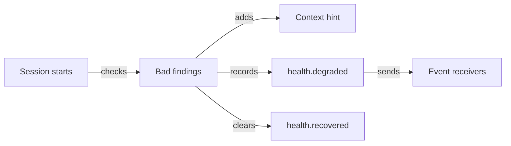

# Process health and project hygiene

Use this page to see where your team's process needs attention and what each finding means.
You can inspect one stuck change, review project health and choose improvements with the people who own them.

## On this page

- [What the team gets](#-what-the-team-gets)
- [Decisions and evidence](#-decisions-and-evidence)
- [Health findings](#-health-findings)
- [Questions and guidance](#-questions-and-guidance)
- [Commands](#-commands)
- [Limits](#-limits)
- [Terms](#-terms)
- [See also](#-see-also)

## 🧭 What the team gets

Gates protect decisions, but the team also needs to see friction around them. Use these views to find it:

| Need | What sdlc does |
|---|---|
| Rework with no revision | Re-approval of unchanged content after rework needs `--note`. |
| Rework loops | After `rework.max_cycles`, `next` asks a person to take over or review scope. |
| Approval trace | `sdlc approve` proposes an `SDLC-Approval` commit trailer; `approvals verify` finds it. |
| Evidence limits | `verification.md` names "Not run / limits", untouched planned files and attachments. |
| Policy waiver | `auto_waive` matches kind or track for intent, spec or plan. |
| Project friction | `sdlc health` gives facts and recommendations without a score. |
| Improvements | `/sdlc:health` drafts backlog items; a person orders them. |
| Bad health | Session start, `health.degraded` and the dashboard surface it. |
| A stuck change | `sdlc explain --change <id>` gives the reason and next steps. |
| Open questions | `sdlc answer` records a person's answers before intent or spec approval. |
| Participation | Audit and dashboard compare planned and actual decisions. |
| Newcomer guidance | `sdlc guide tour` walks through seven calculator demo steps. |
| Gate rejections | `quality.rejections` warns at two; `health.rejections` tunes it. |
| Other branches | `next --me`, health, report and dashboard show hints. |
| Log gaps | `discipline.log-gaps` compares change decisions with the shared log and local queue. |
| Judge verdict | `gates.<gate>.judge` and `sdlc judge` check the rubric before approval. |

## 🔁 Decisions and evidence

These examples show what happens when a decision needs revision or supporting evidence.

### A rework answered by the same "yes"

The next action after rework is the agent's revision of that gate's artifacts. Once their digest changes, the
person approves. Repeating the same approval before any change records no extra approval event.

Alice sends the spec back: "Say what 10 / 0 shows on the till". Later she runs `sdlc approve spec` again without
anyone touching the spec. sdlc refuses with `unchanged_after_rework`: nothing the gate covers changed since the
approval before the rework. Either the author changes the spec, or Alice says why nothing had to change:

```bash
sdlc approve spec --change basic-arithmetic --preview      # unchangedSinceRework: true
sdlc approve spec --change basic-arithmetic --note "The rework was a mistake: the design already covers it"
```

Every approver who signs the unchanged content gives their own note.

> [!IMPORTANT]
> If the artifact did not change after rework, explain why another approval is appropriate with `--note`.

### A change that bounces back and forth

The plan of `add-export` has been sent back three times. Instead of a fourth agent round, `sdlc next` now names a
person's step (`action: review-scope`): take the change over or review its scope, with the people from `roles.yaml`.

```bash
sdlc next --change add-export
sdlc takeover --change add-export --note "Splitting the export into two changes"
```

The limit is `rework.max_cycles` (default 3). It is a hint, not a ban: approving the gate moves the change on as usual.

### Which commit carries this approval?

After `sdlc approve review`, the CLI prints a ready commit command:

```text
$ git commit -m "chore(add-export): approve the review gate" -m "SDLC-Approval: add-export:review:3f2a9c41d07e"
```

Committed this way, the approval can be found by its trailer. With `roles.yaml` and signing on, `sdlc approvals
verify` reports for every approval `trailer: found | missing` next to the signature check. It is information, never a
failure.

### Evidence that says what it does not cover

The tester could not try the payment flow on a real terminal. They write it under `## Not run / limits` in
`verification.md`. Screenshots and browser results go to `openspec/changes/<id>/verification/`; the next `sdlc verify`
lists them as links in the evidence. If the plan names `src/export/csv.ts` under "Files that change" and the change
never touched it, `sdlc verify` warns (`planDrift.untouched`) — the gate still passes, and the reviewer decides.

### Documentation changes without a spec gate

The team decides that documentation changes do not need the spec gate. A person adds to the protected
`openspec/sdlc.yaml`:

```yaml
gates:
  spec:
    auto_waive: { kinds: [docs] }
```

A change created with `--kind docs` by a person has the spec gate waived; the log records `gate.spec.auto_waived` once
and the audit counts it as a policy waiver, not a person's. A kind an agent chose does not count, and verify, review
and release can never be waived by policy.

CI can run `sdlc validate --all` before this stage: an undecided intent and a change without a spec gate do not
raise `No delta specs`. When a full-track change reaches its spec stage, missing deltas are an error, and the spec
approval still refuses them.

`auto_waive` matches the kind **or** the track. `tracks: [lite]` waives that gate for every lite
change, including features; `sdlc doctor` warns about this broad policy.

## 📊 Health findings

Health findings tell you what happened and recommend a next step. They do not collapse your process into one score.

### What health looks at

The findings cover four areas. A bad finding can add a session-start hint; a warning stays in the health report.

- **Flow:** overdue gates (bad), long waits on people, inactive changes and old deferred work.
- **Quality:** first-pass verification, the dominant rework reason and plan drift.
  It also checks open blocking review findings and scenarios without a verification row.
- **Discipline:** frequent waivers, the lite track on behaviour changes and forced archives.
  It checks repeated gate approvals, repeated hook denials of one rule (with the guide article) and long test locks.
- **Configuration:** no verification commands (bad), enforcement off (bad) or warn, and one person holding every role.
  It also checks signing off, stale context packs and `sdlc doctor` problems.

The session start looks only at findings that can be bad because that check is cheap.
The dashboard skips expensive doctor, plan drift and trace checks. `sdlc health` looks at everything.

### A monthly look at the process

The team lead runs `sdlc health` before the retrospective:

Use `sdlc health --since <date>` or `sdlc health --days <n>` for a different window in one run.
JSON names the window as `window: { since, days }`. A windowed run records no `health.degraded` or
`health.recovered` signals.

```text
Project health: 0 bad, 2 warn, 0 info
! warn Gates wait for people longer than 48 h (flow.wait)
    - add-export: the plan gate waited 71.5 h for an approval
    Recommendation: Set `overdue_hours` on the gates, send the waits to a receiver with `events`, or rotate the approvers.
! warn 71% of reworks have one reason: missing-requirement (quality.rework_reason)
    - missing-requirement: 5 of 7 reworks
    - design-flaw: 2 of 7 reworks
    Recommendation: Most work comes back for a missing requirement: make the intent and the spec stronger; explore first and settle the open questions before the spec is written.
```

They ask the agent `/sdlc:health`; it explains the findings in plain words and, for the improvements they choose,
drafts backlog items (`--source-type health --source-ref quality.rework_reason`). Ordering them is their decision:

```bash
sdlc backlog move <item-id> --top
```

Thresholds live under `health` in `openspec/sdlc.yaml` (for example `rework_share: 0.6`, `wait_hours: 24`).

> [!TIP]
> Use a windowed health run for a retrospective. It does not record a health state signal.

### Someone switched the checks off

A refactoring removed `verify.commands`. At the next session the agent's context starts with one extra line: a bad
finding (`config.no_verify`), run `sdlc health`. `health.degraded` is logged and sent to the team's event receivers;
when the commands are back, `health.recovered` follows. Warnings never add a line: the session start stays quiet while
nothing is bad.

This diagram shows how the health signal follows a bad finding:



### Missing decisions in the log

`discipline.log-gaps` counts approved, rejected and waived gate decisions in each change's history.
It compares them with the project log and its local queue. Each fact names the change, gate and missing count.
A missing or malformed log is a separate integrity concern. Health reports gaps without failing the command.

Wait observations from `status`, `next` and other reading commands go to the ignored local queue first.
The queue keeps their first-seen time for audit. The next project log write drains it into the shared log.
Policy auto-waives also update the change record, so reading a change can record that decision there.
Health state signals from `sdlc health` and session start use the same queue. `sdlc log` includes queued entries.

### "Why is my change stuck?"

```bash
sdlc explain --change basic-arithmetic
```

The answer gives you:

- the stage, open gate and its reason, including any rework note;
- who or what it waits for;
- steps and commands that unblock it;
- the five latest decisions.

It writes nothing, so an agent can ask it as often as it likes.

## 👥 Questions and guidance

People answer open questions, and sdlc shows them where a change waits. These examples cover both jobs.

### Open questions only a person can answer

The agent drafts the intent of `add-export` and lists two open questions: "Which formats do accountants need?" and
"Is the export limited to one month?". It does not answer them — the intent workflow tells it to leave them to people
— and `sdlc next` names a person's step, `answer-questions`. Alice answers in her terminal:

```bash
sdlc answer --change add-export --list
sdlc answer 1 --change add-export --text "CSV and XLSX"
sdlc answer 2 --change add-export --text "Any period up to a year"
sdlc approve intent --change add-export
```

Each answer lands under its question in intent.md and in the change record. Until both are recorded, `sdlc approve
intent` refuses with `open_questions`. If the agent had typed "Answer: CSV" into the file, it would not count; if
someone rewords a question, it needs a new answer. Open questions in proposal.md and design.md hold the spec gate the
same way.

### How much did people take part?

At the end of the quarter the team lead uses `sdlc audit` to compare planned and actual participation.
The full track plans four approvals: intent, spec, plan and review. `min_approvals` can increase the number.

```text
add-export: gates intent, spec, plan, review; approvals 4 / 7; reworks 2, takeovers 1, waivers 0, answers 2; waits 31.5 h
fix-rounding: gates plan, review; approvals 2 / 2; reworks 0, takeovers 0, waivers 0, answers 0; waits 2 h
```

Seven approvals where four were planned, two reworks and a takeover say that `add-export` was hard to pin down;
`sdlc health` and the retrospective take it from there. The same lines are on each change's dashboard page.

### A newcomer's first hour

A new engineer joins. Instead of reading every article, they run:

```bash
sdlc guide tour          # the steps, and step 1
sdlc guide tour 3        # intent, spec and plan
```

Seven short steps follow the calculator demo:

- setup and the backlog;
- the three planning gates;
- build and verify;
- review;
- release and archive;
- keeping an eye on the process.

Each step names the real commands.

## 🛠️ Commands

Use these commands to inspect health, answer questions and follow up on findings.

| Command | Who | What |
|---|---|---|
| `sdlc health [--since <date> \| --days <n>] [--json]` | anyone | findings and health state signals |
| `sdlc judge --gate <gate> --change <id>` | anyone, the agent too | runs the gate's judge and records its verdict |
| `/sdlc:health` (`/sdlc-health`) | agent with a person | explains the findings, drafts backlog items |
| `sdlc explain --change <id> [--json]` | anyone | why a change is where it is; writes nothing |
| `sdlc answer <n> --change <id> --text "…"` | person | answers an open question; `--list` shows them |
| `sdlc audit [--change <id>]` | anyone | includes the planned vs actual participation of people |
| `sdlc guide tour [step]` | anyone | the tour for newcomers |
| `sdlc approve <gate> --note "…"` | person | a re-approval after a rework with nothing changed |
| `sdlc approvals verify` | anyone | signatures and approval trailers |
| `sdlc backlog move` | person | orders the drafted improvements |

The `--since` or `--days` option replaces `health.window_days` for one run.
An unwindowed health run records `health.degraded` or `health.recovered` in the log.

## 🛡️ Limits

These limits matter when you interpret health and decide whether a gate can move.

- A policy waiver is recorded on the change the first time it applies: removing the policy later does not
  undo it, and archived changes are never waived by a policy. The health thresholds are read from the current
  configuration.
- An agent can still delete an open question from the artifact before anyone answers it; the approver sees the
  artifact they approve, so the deletion is in plain view.
- `sdlc waive` does not ask for answers: waiving a gate is itself a person's decision. Answering a question after the
  gate was approved changes the artifact, so that approval goes stale and the gate needs approving again.
- A change record with answers uses format version 3. Keep the team on a compatible sdlc installation.
- Health has no single score on purpose: a number hides what to do.
- A tool that answers `--version` very slowly is still found, but its version may stay unknown in `sdlc doctor`.

## 📚 Terms

The [glossary](glossary.md) explains [gate](glossary.md), [rework](glossary.md),
[evidence](glossary.md) and [waiver](glossary.md) in plain words.

## 📚 See also

- [User guide](05-guide.md) — follow stages and gates from the first intent.
- [Roles and signed approvals](08-roles-and-signing.md) — see who can decide.
- [Traceability and audit](14-traceability.md) — inspect the recorded trail.
- [Dashboard example](21-dashboard-health-example.md) — read health findings in a team run.
