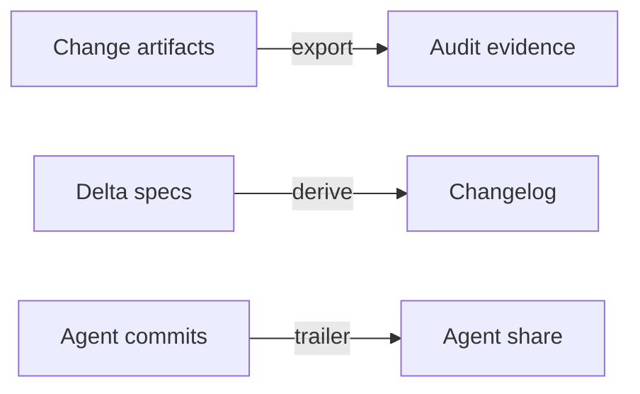

# 14. Traceability and audit: use cases

Use this page to find the evidence behind a change, prepare release notes and inspect agent contributions. It also
shows how a team can record both sides of a design decision and send a daily summary.

## On this page

- [What the team gets](#141-what-the-team-gets)
- [Use cases](#142-use-cases)
- [Limits](#143-limits-we-accept)
- [Trace gaps](#144-trace-gaps-without-task-trailers)
- [Terms](#-terms)
- [See also](#-see-also)

## 14.1. What the team gets

These commands connect process records with the questions people ask about a change.



| Need | What sdlc does |
|---|---|
| Evidence for an auditor | `sdlc audit --export <folder>`: approvals with signature and trailer status, change folders, the log |
| Release notes that match the specs | `sdlc changelog`: requirements added, changed and removed by the delta specs |
| Know which commits agents made | a git hook marks them `SDLC-Agent: <agent>`; the audit shows the share |
| Both sides of a key design decision on record | the debate lens: two advocates argue it before the spec gate |
| A short morning digest | `sdlc events summary` sends the daily summary to the team's receivers; an example script writes done, next, blocked and waiting on people to a file |

## 14.2. Use cases

Each example starts with a question and follows the evidence that answers it.

### The quarterly audit

The compliance officer asks for the evidence of the third quarter. The team lead runs, in their own terminal:

```bash
sdlc audit --export evidence-q3 --since 2026-07-01
```

`evidence-q3/` holds:

> [!NOTE]
> The export contains process evidence from `openspec/`. It does not include source code or secrets.

- `index.md`, a readable table per change, and `index.json`, the same data for tools;
- each change's intent, specs, design, plan, verification evidence, review and change record;
- `log.jsonl` with the decisions of the period.

Each approval shows the person and role, the digest of the signed content, and whether its commit has an
`SDLC-Approval` trailer. With `roles.yaml` and signing on, it shows `valid`, `unsigned`, `wrong-signer` or another
signature status; otherwise it shows `not-checked`. With `signing_since` in `roles.yaml`, approvals recorded through
a chosen commit are `pre-signing`; later approvals use the configured mode. With `signing: off`, no signatures are
checked. Nothing from outside openspec/ goes in — no source code, no
secrets — and an existing folder with files in it is refused, so the export never mixes into something else.

### Release notes that match the specs

Before the release, the agent writes release.md (`/sdlc:release`). Its changelog is not written from memory:

```bash
sdlc changelog --change add-export
```

```markdown
### Added
- CSV export (reporting, add-export)
### Changed
- Report period (reporting, add-export)
```

For a whole release made of several changes, `sdlc changelog --since 2026-10-01` lists everything archived since that
date. A change without delta specs adds nothing.

### How much did the agents write?

After `sdlc init` (or `sdlc update`), the project's git has a `prepare-commit-msg` hook. A commit made in an agent's
terminal (Claude Code, OpenCode, Cursor, Codex CLI, Qwen Code or GigaCode) gets a
trailer:

Any other tool that sets `SDLC_AGENT` is marked too.

```text
Add CSV export

SDLC-Agent: claude-code
```

A person's commit is never touched, and the hook works with `--no-verify` too. `sdlc audit` shows how many commits
there are and how many came from agents; the dashboard shows the share. If the project already has its own
prepare-commit-msg hook, sdlc leaves it and `sdlc doctor` shows the one line that calls sdlc's from it; a hooks folder
shared by every repository on the machine (`core.hooksPath` outside the project) is never written.

### A design decision with both sides on record

The team wants every key design decision argued before it is approved. A person sets, in `openspec/sdlc.yaml`:

```yaml
design:
  debate: true
  debate_sides: [simplicity and speed, robustness and safety]
```

During `/sdlc:spec`, the agent hands the decision with the most at stake to two read-only `sdlc-advocate` subagents,
one per priority, and writes the result into design.md:

```markdown
## Debate
### Position: simplicity and speed
...
### Position: robustness and safety
...
### Decision
...
```

Until both positions and the decision are there, `sdlc approve spec` refuses (`debate_required`).

### A summary every morning

`daily-summary.mjs` ships with sdlc (`assets/examples/` in the package). Scheduled every morning, it writes
`daily-summary-<date>.md`: what was approved or archived in the last day, what the agents do next, what is blocked,
what waits on people (with the commands). It never sends anything; mail it, post it or open it — the team decides.

```bash
schtasks /Create /SC DAILY /ST 08:00 /TN sdlc-daily /TR "cmd /c cd /d C:\work\shop && node daily-summary.mjs --out reports"
```

`sdlc events summary` sends the summary as the event `summary.daily` to the receivers whose `on` names
it, for example a Telegram bot ([Events and the daily summary](05-guide.md#events-and-the-daily-summary)). There is
one summary per project and day, so run it once a day from a scheduler or a CI job.

## 14.3. Limits we accept

Read these limits when interpreting the agent marker and the debate record.

- The agent marker comes from the environment of the agent's terminal; a commit made outside it (for example, a person
  committing what an agent wrote) is a person's commit.
- The debate is recorded text: sdlc checks that both positions and the decision are there, not how good they are.

## 14.4. Trace gaps without task trailers

`sdlc trace` reports missing task links and mismatched review coverage.

When a change has tasks but no commit names any of them with an `SDLC-Task` trailer, `sdlc trace` reports one
`tasks-without-trailers` gap with the task count. Once a commit names a task, unnamed tasks are listed individually.
Every checkbox task appears in the trace. A task without an `n.m` number has no id or linked commits and gets a
`task-without-number` gap because an `SDLC-Task` trailer cannot name it. If a review coverage count disagrees with
the findings under that pass, `review-coverage-mismatch` names the declared and actual counts.

The evidence bundle records `signing.mode` and the resolved full `signing.since` commit in `index.json`.
`index.md` explains that approvals recorded in or before `signing_since` are `pre-signing` and need no signature.

## 📚 Terms

The [glossary](glossary.md) explains audit, approval, evidence and digest.

## 📚 See also

- [Roles and signed approvals](08-roles-and-signing.md) — check who may decide and how signatures are verified.
- [Process health](13-process-health.md) — inspect waits, rework and approval evidence.
- [User guide](05-guide.md) — follow the change lifecycle.
