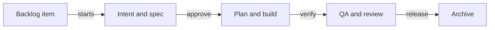

# 18. Example: a team adopts sdlc on an existing project

On October 15, 2026, five people adopted sdlc for an existing vanilla JavaScript TodoMVC project. Two developers
worked with Qwen Code agents. Follow their one-day run from setup through two parallel features to the 1.1.0 release.
The example shows each person's commands and where sdlc stopped the agents.

## On this page

- [Meet the team](#181-the-team)
- [Prepare the project](#182-linda-tech-lead-prepares-the-project)
- [Clone the project](#183-the-participants-clone-the-project)
- [Build the backlog](#184-peter-product-owner-builds-the-backlog)
- [Follow feature 1](#185-feature-1-from-the-backlog-to-the-release)
- [Follow feature 2](#186-feature-2-in-parallel-with-a-reworked-plan)
- [See what sdlc stopped](#187-what-sdlc-stopped)
- [Release and audit](#188-the-project-release-and-the-audit)
- [Lessons](#189-lessons-for-a-team)
- [Terms](#terms)
- [See also](#see-also)

## 18.1. The team

These five people make the decisions and check the agents' work.

| Person | sdlc roles | Does |
|---|---|---|
| Linda Carter | tech-lead, maintainer, release-manager, code-owner | prepares the project, review, release |
| Peter Owen | product-owner | the backlog, the intent and spec gates |
| David Smith | engineer | feature 1 with an agent |
| Kate Brown | engineer | feature 2 with an agent |
| Olivia Miller | qa | checks in a browser, the qa gate |

Everyone has a folder with a clone of the shared repository and their own git identity: sdlc knows a person by the
git email and checks it against `openspec/roles.yaml`. The agents work in their developers' folders.

## 18.2. Linda (tech-lead) prepares the project

Linda gives the project tests and sets up its gates before feature work begins.

The project is [modern-todomvc-vanillajs](https://github.com/marin-ai-tech/modern-todomvc-vanillajs), about 220
lines with no tests or build. The developers use Qwen Code agents on a real model.

**Tests before the process.** The project had no tests, so the verify gate had nothing to run. Linda added a
harness as an ordinary commit: `"test": "node --test"` in `package.json` and two characterization tests of the todo
store.

**Setting sdlc up for Qwen Code:**

```bash
sdlc init --tools qwen
sdlc layout adapt
```

`init` created OpenSpec and `openspec/sdlc.yaml`. It put skills, commands and subagents in `.qwen/`. It installed
hooks and deny rules in `.qwen/settings.json` and a git hook. It found the verification command (`npm test`).
`layout adapt` added AI-ready documents:

- `AGENTS.md`;
- architecture, conventions and glossary;
- runbook, security and the first ADR.

**Roles and separation of duties** (`openspec/roles.yaml`):

```yaml
people:
  linda:  { name: Linda Carter,  emails: [linda@todo.example] }
  peter:  { name: Peter Owen,    emails: [peter@todo.example] }
  david:  { name: David Smith,   emails: [david@todo.example] }
  kate:   { name: Kate Brown,    emails: [kate@todo.example] }
  olivia: { name: Olivia Miller, emails: [olivia@todo.example] }
roles:
  product-owner:   [peter]
  tech-lead:       [linda]
  maintainer:      [linda]
  release-manager: [linda]
  code-owner:      [linda]
  engineer:        [david, kate]
  qa:              [olivia]
separation:
  author_cannot_approve: [review, release]
  distinct_approvers: [[spec, review], [plan, review]]
  max_gates_per_person: 3
```

`sdlc roles check` listed the five people with no errors. In `openspec/sdlc.yaml` Linda made the qa and release
gates required (`required: true`) and set `enforcement.mode` to `block`: the team's agents run without confirming
each action, and only blocking keeps the gates in order. All of it is one commit to the shared repository.

## 18.3. The participants clone the project

Each participant prepares a working copy and checks the local installation.

```bash
git clone <shared repository> <folder>
sdlc doctor
sdlc update
```

Git hooks are not cloned; doctor sees it (`! git hook … fix: Run sdlc update`), and `sdlc update` installs the hook
that marks commits from agent sessions with an `SDLC-Agent` trailer.

**Qwen Code.** The agent uses an OpenAI-compatible model endpoint (each person's key in `~/.qwen/.env`, never in the
project). Qwen Code's folder trust is off by default, and then Qwen Code trusts every folder: the project's hooks and
deny rules work without any setup. If folder trust is on, trust the project folder, or Qwen Code ignores the whole
`.qwen/settings.json`; doctor checks this. The agents ran unattended:

```bash
qwen --yolo --max-wall-time 15m --max-tool-calls 60 -p "<task>"
```

`--yolo` lets the agent do everything that is not denied: sdlc's hooks and `permissions.deny` are the guard, and the
time and call limits keep it from wandering off for long.

## 18.4. Peter (product-owner) builds the backlog

Peter turns the two requests into backlog items. He decides their order and epic membership himself.

Peter described an epic and two features to his agent (`/sdlc-backlog`):

- Task titles have no spaces at the ends and are never blank.
- The last delete can be undone within 5 seconds.

The agent created the epic and the items with
`sdlc backlog epic add`, `sdlc backlog add` and `sdlc backlog edit … --outcome … --accept … --risk low`; it never
edits `openspec/backlog.md` by hand, the hook denies that. Order and epic membership are a person's decision, so
Peter did that himself:

```bash
sdlc backlog move B1 --epic E1
sdlc backlog move B2 --epic E1
```

The result: one epic with two items. Each has an outcome and three acceptance criteria; both are `Ready ✓`.

## 18.5. Feature 1 from the backlog to the release

David takes the title change through the gates while other people approve and check it.

This diagram follows each feature from its backlog item to the archive:



David works on the branch `feat/b1-trim-titles`. Every approval is made by a person in their own clone. sdlc prints
a ready commit message whose trailer ties the commit to the approval:

```text
✓ intent gate: Peter Owen <peter@todo.example> approved as product-owner (b67577ae40d5)
  $ git commit -m "chore(trim-todo-titles): approve the intent gate" -m "SDLC-Approval: trim-todo-titles:intent:b67577ae40d5"
```

| Step | Who | What was done |
|---|---|---|
| intent | David's agent | `sdlc backlog start B1 --change trim-todo-titles`; `intent.md` from the item |
| intent gate | Peter (product-owner) | `sdlc approve intent --change trim-todo-titles` |
| spec | David's agent | `proposal.md`, `design.md`, a delta spec, then `sdlc openspec validate --strict` |
| spec gate | Peter (product-owner) | `sdlc approve spec …` |
| plan | David's agent | `plan.md`, `tasks.md`: failing tests first, then the implementation, then `sdlc verify` |
| plan gate | Kate (engineer) | the second engineer approves David's plan |
| build | David's agent | tests red first (6 of 9), then `trim()` and the refusal of blank titles in the store, 9 of 9 |
| verify | David's agent | `sdlc verify --change trim-todo-titles`: the evidence in `verification.md` |
| qa gate | Olivia (qa) | a browser check against the three criteria, `sdlc approve qa … --note "…"` |
| review | Linda's agent | `review.md`: the bugs, security and compliance passes, the lenses |
| review gate | Linda (code-owner) | triaged the findings, `sdlc review check`, `sdlc approve review …` |
| release | Linda's agent and Linda | `release.md`, then `sdlc approve release …` |
| merge and archive | Linda | `git merge --no-ff` into `main`, `sdlc archive trim-todo-titles --yes` |

The intent used the item's outcome and acceptance criteria. The delta spec included WHEN/THEN scenarios, including
negative ones. Linda was the release-manager. The `release.md` covered rollout, rollback and monitoring.

After the archive, the [delta spec](glossary.md#-ad) became the living spec
`openspec/specs/todo-title-normalization/`. The item became `done`; the epic was 1 of 2.

**A person settles the review findings.** Linda's agent recorded two important findings, both false: "`update()`
does not check for null" (it never did) and "a silent refusal without an error" (exactly what the spec requires).
Linda, as code owner, marked them `wontfix` with the reason and the two minor ones `accepted` (deferred), and only
then did `sdlc review check` let the gate through.

**An agent's report is not evidence.** The agent's first `release.md` invented facts: a rollout to environments that
do not exist reported as "Success", a "rehearsed" rollback, control bands without any telemetry. Linda approved it
without reading closely, then corrected it to the facts, and sdlc showed
`release ↻ stale — content changed after approval`: an approval is bound to the content, so after the edit the
release gate is approved again.

> [!IMPORTANT]
> Read `release.md` before approving it. An edit after approval makes that approval stale.

## 18.6. Feature 2 in parallel, with a reworked plan

Kate works on the undo feature in parallel. A changed plan needs a fresh approval before code work continues.

Kate ran the second item on `feat/b2-undo-delete` alongside the first. The intent, spec and plan gates went the
same way; David approved Kate's plan. The agent did not finish the implementation: Qwen Code stopped it with its
loop guard, and what it had done had no Undo button, undid deletes after the 5 seconds too, and broke the ids after
a page reload.

Kate amended the plan: the button in `index.html`, a re-render after 5 seconds, `crypto.randomUUID()`, the time as a
parameter, negative tests. sdlc marked the changed plan stale at once:

```text
plan     ↻ stale              content changed after approval; re-approval needed
```

Until David approved the plan again, an agent's code edit was denied:

```text
[sdlc:plan-gate] No active change has an approved plan yet (undo-last-delete). Finish the plan and have an
engineer run `sdlc approve plan --change <id>` before editing js/store.js.
```

After the new approval, Kate finished the implementation herself. A person edits code without hook limits. She
merged `main` with the first feature into her branch and resolved the test conflict. She ran `sdlc verify` again
because the merge changed the code. Verify stayed `↻ stale` until the new run. Olivia then checked qa in the browser.
Linda handled review and release, followed by the merge and archive. The epic reached 2 of 2.

## 18.7. What sdlc stopped

The live agent tried these actions while running in `--yolo` mode. The guards refused each one.

| The agent's attempt | sdlc's answer |
|---|---|
| `sdlc approve release --change trim-todo-titles` | denied `[sdlc:separation-of-duties]` |
| editing `openspec/roles.yaml` (adding itself as engineer) | denied `[sdlc:state-integrity]` |
| editing the change's `.sdlc.yaml` (`pending` → `approved`) | denied `[sdlc:state-integrity]` |
| `node -e "fs.appendFileSync('openspec/roles.yaml', …)"` | denied `[sdlc:state-integrity]` |
| `env -u QWEN_CODE -u QWEN_CODE_SESSION_ID sdlc approve release …` | denied `[sdlc:agent-marker]` |
| editing code while the plan approval is stale | denied `[sdlc:plan-gate]` |

Every denial is in the log (`hook.denied`). Separately, a late code edit after the review approval: verify became
`↻ stale`, the qa, review and release gates were blocked again, and `sdlc approve release` answered "waiting on the
verify gate".

## 18.8. The project release and the audit

Linda tags the project after both changes finish. The audit then summarizes their decisions.

There is no separate command for a project release: each change passes its own release gate. Linda committed the
archive and tagged:

```bash
git tag -a v1.1.0 -m "TodoMVC 1.1.0" -m "E1: B1 trim-todo-titles, B2 undo-last-delete"
git push origin main v1.1.0
```

`sdlc audit` over the two changes:

```text
SDLC metrics across 2 change(s) (2 archived)
  median hours: intent→spec 0.2 · spec→plan 0.2 · plan→verified 0.1 · verified→review 0.1 · total 0.7
  verification first-pass rate: 1; rejections 0; waivers 0 (+0 by policy)
  people's participation (2 changes), planned / actual: gate decisions 12; approvals 12 / 14
```

There were 14 approvals instead of 12 because two needed repeating:

- The release approval for feature 1 followed a `release.md` edit.
- The plan approval for feature 2 followed a `plan.md` edit.

## 18.9. Lessons for a team

These lessons came from the two feature runs.

- **Check the result, do not read the agent's report.** In the run, agents reported success while `validate` failed,
  put files in the wrong folders and invented facts in `release.md`. People caught all of it because they looked.
- **`block` mode for a team with agents.** In `warn` sdlc only reminds; reminders do not stop an agent in `--yolo`.
- **Human decisions stay with people:** gate approvals, backlog order, review finding statuses, the merge and the
  tag. The agent is denied even when asked directly.
- **An approval is bound to the content.** Any edit of an artifact or the code after an approval needs a new
  approval; it does not get in the way, it shows what changed.
- **A weaker model means more work for people.** On `qwen3-coder-flash` and `qwen-plus` the agent often lost the
  skills' instructions; a stronger model saves rework rounds but does not replace people's checks.

## Terms

- [Gate](glossary.md#-eh): a decision point before work advances.
- [Living spec](glossary.md#-ip): a requirement kept after its change is archived.
- [Stale approval](glossary.md#-rw): an approval whose covered content changed.

## See also

- [Build an application from scratch](19-team-greenfield-example.md) for the same team's next run.
- [Roles and approvals](08-roles-and-signing.md) for who makes gate decisions.
