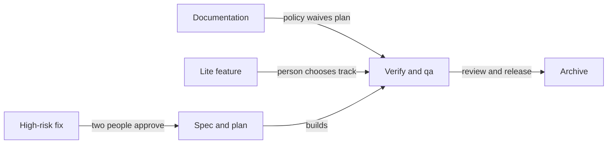

# 23. Example: tracks, small changes and human decisions

On October 16, 2026, the TodoMVC team used three paths through sdlc: a documentation edit, a small feature on the
lite track and a high-risk fix. Follow who chooses each track, answers questions and approves gates. This continues
the [from-scratch example](19-team-greenfield-example.md).

## On this page

- [Meet the team](#231-the-team)
- [Set the gate policy](#232-the-gate-policy)
- [Follow the documentation change](#233-documentation-the-policy-and-a-persons-waiver)
- [Follow the lite feature](#234-people-decide-the-questions-and-the-track)
- [Follow the high-risk fix](#235-high-risk-and-the-gate-limit)
- [Read the audit](#236-the-result-in-the-audit)
- [Lessons](#237-lessons-for-a-team)
- [Terms](#terms)
- [See also](#see-also)

## 23.1. The team

Each person has a role in choosing tracks or making gate decisions.

| Person | sdlc roles | Does |
|---|---|---|
| Linda Carter | tech-lead, maintainer, code-owner, release-manager | the gate policy, the track, high-risk approvals |
| Peter Owen | product-owner | answers to the intent's questions, the damaged-data item |
| David Smith | engineer | documentation, the plan gate |
| Kate Brown | engineer, later code-owner and release-manager | filter feature; review and release of the fix |
| Evan Turner | engineer | damaged-data fix with an agent |
| Olivia Miller | qa | checks in a browser, waives qa for documentation |

## 23.2. The gate policy

Linda sets the waiver policy and approval limits in protected files.

This diagram shows how the three changes reach their gate decisions:



Linda in the protected `openspec/sdlc.yaml` and `openspec/roles.yaml`:

```yaml
# openspec/sdlc.yaml
gates:
  plan:
    auto_waive:
      kinds: [docs]          # the policy waives plan for documentation
  spec:
    high_risk_approvers: [tech-lead]
# openspec/roles.yaml
separation:
  distinct_approvers: [[spec, review], [plan, review]]
  max_gates_per_person: 2
```

`auto_waive` applies when the kind **or** the track matches: `tracks: [lite]` in the same policy would waive plan for
every change on lite, features included. So Linda kept only `kinds: [docs]`.

## 23.3. Documentation: the policy and a person's waiver

The documentation change shows a policy waiver alongside a person's qa waiver.

David from his own terminal:

```bash
sdlc new readme-filters --kind docs --risk low
sdlc track set lite --change readme-filters --note "README only: a section on the filters"
```

sdlc suggested lite (`Track lite suggested`), David chose the track; the policy waived plan: `waived by the
auto_waive policy (kind docs)`. On lite the stage pipeline starts at plan. David's agent wrote a "Filters" section in
the README, David recorded one done task in `tasks.md`, and `sdlc verify` passed. Olivia waived qa with a reason:

```bash
sdlc waive qa --change readme-filters --note "README only: nothing to check in a browser; the text matches js/app.js"
```

Review and release: Linda, two gates. The audit shows the two kinds of waiver apart:

```text
verify runs 3, first run passed; rejections 0; waivers 1 (+1 by policy)
```

For comparison, Evan's agent created a change itself with `sdlc new docs-probe --kind docs`: its record says
`kind_by_agent: true`, and the policy did not waive plan, since a kind an agent chose does not count.

## 23.4. People decide the questions and the track

Kate explores a small feature, while Peter answers its open product questions.

**Exploration.** Kate's agent ran `/sdlc-explore` and wrote the note `openspec/explorations/b5-remember-filter.md`:
the filter already comes from the address (`#/active` survives a reload), while opening without `#` always shows
everything. It rewrote the intent and put five product-owner decisions under `## Open questions`: whether to open the
last filter without `#`, where to keep it, whether tabs share it, which wins when the address and the saved value
disagree, whether to reset it.

**Answers.** Kate asked the agent to answer for Peter, who was busy. `sdlc answer` from the agent's environment was
refused by the hook with `[sdlc:separation-of-duties]`; the agent typed the answers into `intent.md`, but
`sdlc answer --list` still showed every question unanswered: an answer typed into the file does not count. Kate
removed the typed text and Peter answered himself:

```bash
sdlc answer 1 --change b5-remember-filter --text "Yes: without # in the address, open the last chosen filter."
sdlc answer 4 --change b5-remember-filter --text "The address wins: #/active in the address beats the saved value, and it is saved too."
```

**The track.** Asked to switch to lite, the agent was refused by the hook; Linda chose the track:

```bash
sdlc track set lite --change b5-remember-filter --note "One function in js/app.js and the filter storage; the product owner's questions are answered in the intent"
```

| Step | Who | What happened |
|---|---|---|
| plan | Kate's agent, David | David rejected the plan; the agent fixed it and David approved. |
| build | Kate's agent | the test was red 16/1, then green 24/0 after the code. |
| verify | Kate | `npm test` passed |
| qa | Olivia | browser check exposed a missing saved filter; `sdlc reject qa` |
| fix | Kate's agent | the filter is saved on load too; Olivia checked again and approved |
| review, release | Linda | the review, two gates, the archive; the item `done` |

David found tasks without checkboxes, a store reading `window.location` and a test marked "skipped until the code
exists". During build, the agent used `t.skip` and logic against Peter's answer: `#/` opened the saved filter.
The expectation table first gave 16/1 and then 24/0 after the code. Olivia selected Active and opened without `#`;
Active remained. Loading directly with `#/completed` did not save the filter, so she cited answer 4 in the qa rejection.

Lite went through these gates:

- plan, build and verify;
- qa, review and release.

It skipped intent and spec. Verify and qa stayed.

## 23.5. High risk and the gate limit

The high-risk fix needs two people at early gates. Approval limits also affect review and release.

Peter added "Damaged data in storage does not break the app" as a bugfix with `--risk high`. Evan's agent started it
with `sdlc backlog start B8 --change b8-corrupt-storage`. Peter rejected a spec that treated a missing key as damage (a
first run would have created `todos-corrupt`) and approved the fixed one:

```text
✓ spec gate: Peter Owen approved as product-owner
  still needed: tech-lead
```

Linda approved spec and plan as tech-lead (`sdlc approve spec --change b8-corrupt-storage --as tech-lead`); David also
approved plan as engineer. Before the build Linda asked who would approve the review:

```text
review · b8-corrupt-storage — may approve: no one
  Linda Carter (linda): distinct_approvers — … already approved the paired gate spec/review.; max_gates_per_person — … reached the gate approval limit.
```

Linda gave Kate the code-owner and release-manager roles: `may approve: Kate Brown (kate)`.

| Step | Who | What happened |
|---|---|---|
| build | Evan's agent | tests first (red 25/1, green 26/0); Evan checked in the browser |
| qa | Olivia | damaged data checks passed; approved |
| review | Kate | F1 important: the agent removed the outer try, so a `getItem` that throws breaks the page |
| fix | Evan's agent, Evan | code and test fixed; Olivia approved qa after verify. |
| review | Kate | F1 fixed, approved |
| release | Linda, Kate | Linda refused: `reached the gate approval limit. Ask one of: Kate Brown`; Kate approved |

Olivia checked no key, `{}`, `"text"`, an empty string and broken JSON. Each gave an empty list, with the damaged
value kept in `todos-corrupt`. Evan's new test was red on the old `load()` and green on the new one. Olivia approved
qa again after the new verify.

## 23.6. The result in the audit

The audit distinguishes a person's waiver from a policy waiver.

```text
SDLC metrics across 3 change(s) (3 archived)
  verification first-pass rate: 1; rejections 3; waivers 1 (+1 by policy)
  people's participation (3 changes), planned / actual: … waivers 1, answers 5 …
```

## 23.7. Lessons for a team

These lessons show where policy helps and where a person must decide.

- **A policy waives gates by kind or by track.** Put in `auto_waive` only what is always waived, and look at
  `sdlc status` of the first change it applies to.
- **A kind the agent chose does not trigger the policy**: for documentation under the policy, a person creates the
  change.
- **The product owner answers with `sdlc answer`, not with a line in a file.** The agent lists the questions under
  `## Open questions`, the person answers; the answers stay in the intent and in the change record.
- **A person chooses the track.** Lite drops intent and spec, not verify and qa: qa on a small feature found that the
  filter was not saved on load.
- **High risk means two people on spec and plan.** Ask `sdlc roles who <gate> --change <id>` early: with
  `distinct_approvers` and a gate limit, the team needs a second code owner and release manager.

## Terms

- [Gate](glossary.md#-eh): a decision point before work advances.
- [Track](glossary.md#-rw): a configured path through gates.
- [Waiver](glossary.md#-rw): a recorded decision to skip a gate.

## See also

- [Roles and approvals](08-roles-and-signing.md) explains separation rules.
- [Process health](13-process-health.md) explains how waivers appear in findings.
