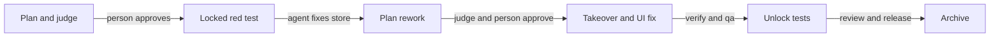

# 24. Example: a bug fix from an alert, with locked tests

On October 17, 2026, the TodoMVC team fixed a checkbox bug reported by an alert. Follow the change from intake to
archive, including a plan judge, locked tests, rework and a takeover. The run continues the
[from-scratch example](19-team-greenfield-example.md).

## On this page

- [Meet the team](#241-the-team)
- [Set up the judge](#242-a-judge-before-the-person)
- [Triage the alert](#243-the-alert-becomes-a-backlog-item)
- [Follow the fix](#244-the-fix)
- [Read the audit](#245-the-result-in-the-audit)
- [Lessons](#246-lessons-for-a-team)
- [Terms](#terms)
- [See also](#see-also)

## 24.1. The team

These people handle the alert, gate decisions and final review.

| Person | sdlc roles | Does |
|---|---|---|
| Linda Carter | tech-lead, maintainer, code-owner, release-manager | the plan gate's judge, the track, the takeover |
| Peter Owen | product-owner | the criteria of the item from the alert |
| David Smith | engineer | the plan gate, the rework |
| Kate Brown | engineer, code-owner, release-manager | review and release |
| Evan Turner | engineer | the fix with an agent |
| Olivia Miller | qa | checks in a browser |

## 24.2. A judge before the person

Linda configures a plan judge to check the rubric before a person approves.

Linda added a judge to the plan gate: a script that checks the plan against the rubric `docs/rubrics/plan.md` — a
test under `test/`, the test fails before the fix, the tests are locked before the fix.

```yaml
gates:
  plan:
    judge: { run: node tools/judge.mjs, rubric: docs/rubrics/plan.md, max_loops: 3 }
```

The judge reads the gate's artifacts on stdin and answers with a verdict `{ "pass": …, "route": …, "rework": … }`.

## 24.3. The alert becomes a backlog item

The "Mark all as complete" checkbox did not show when every todo was done. It also stayed checked after "Clear
completed". The TodoMVC specification requires both behaviours. The alert starts the backlog work.

```bash
echo '{"id":"ux-1042","title":"Mark all as complete does not show that every todo is done","severity":"low"}' \
  | sdlc triage intake
```

The backlog got an item with the source `alert:ux-1042`. The same alert again added nothing (`duplicate: true`).
Input that is not JSON was refused (`invalid_alert`). The item was not ready because it had no outcome or criteria.
Peter wrote them from the specification:

```bash
sdlc backlog edit B9 --kind bugfix --risk low --outcome "Mark all as complete shows the state of the list" \
  --accept "When every todo is done, Mark all as complete is checked" \
  --accept "Unchecking any todo unchecks it" \
  --accept "After Clear completed it is unchecked"
```

## 24.4. The fix

The plan, tests and implementation each need a separate check before archive.

The change returns to the plan after David finds a missing application edit:



1. **Start:** Evan's agent ran `sdlc backlog start B9 --change fix-toggle-all`. Linda chose the lite track with
   `sdlc track set lite --note …`.
1. **Plan and judge:** The agent's plan named the test and lock. `sdlc judge --gate plan` passed, but the gate still
   said "awaiting approval (engineer)". David approved it.
1. **Red test:** The agent added `isAllCompleted` in `test/store.test.js`: 27 passed, 1 failed. It ran
   `sdlc tests lock`. The agent's attempt to "adjust the expectation or delete the test" was refused by
   `[sdlc:tests-locked]`; the file did not change.
1. **Store fix:** The agent added `TodoStore#isAllCompleted()` and got 28 of 28 tests.
1. **Rework:** David found that the plan did not change `js/app.js`, so the checkbox stayed as it was. Both he and
   the judge had missed this. He ran `sdlc rework plan --reason missing-requirement`. `sdlc explain` showed the
   reason and that the agent acts first.
1. **Plan again:** The agent added `js/app.js` to the plan. The judge passed and David approved.
1. **Takeover:** Linda ran `sdlc takeover --note "I will wire the checkbox in js/app.js myself…"`. The agent's
   edit of `js/app.js` was refused by `[sdlc:takeover]`. Linda added one rendering line, checked it in the browser
   and ran `sdlc release-control --note …`.
1. **Verify and qa:** Evan ticked the tasks and `sdlc verify` passed. Olivia checked three todos: initially
   unchecked, checked after "Mark all as complete", then unchecked after unchecking one. On `#/completed` it was
   checked. After "Clear completed" it was unchecked, and the state held after reload.
1. **Unlock:** The agent could not run `sdlc tests unlock`: it "records a human decision and cannot run inside an
   agent session". Evan unlocked the tests himself.
1. **Review and release:** Linda was refused: "authored code in this change. Ask one of: Kate Brown". Her takeover
   edit made her an author. Kate approved review and release.
1. **Archive:** Linda merged and ran `sdlc archive`; the item became `done`.

> [!IMPORTANT]
> Evan unlocks the tests himself after qa. The agent cannot record that decision.

## 24.5. The result in the audit

The audit records the rework, takeover and repeated approval.

```text
Audit trail: fix-toggle-all[bugfix · risk low · lite]
  verify runs 2, first run passed; rejections 0; waivers 0 (+0 by policy)
  reworks 1: plan (missing-requirement, …)
  people's participation, planned / actual: gates plan, qa, review, release; approvals 4 / 5; reworks 1, takeovers 1, …
```

The change's log holds both judge verdicts (`gate.plan.judged`), `tests.locked`, `tests.unlocked`, `change.takeover`
and `change.released`.

## 24.6. Lessons for a team

These lessons came from the judge verdicts and the locked test run.

- **An alert becomes a backlog item at once.** `sdlc triage intake` takes the monitoring JSON and does not duplicate a
  repeat; the product owner writes the criteria.
- **A judge is evidence, not an approval.** It catches what the rubric names, but a person approves the gate; what the
  rubric does not name (here, `js/app.js`) a person finds and sends back with `rework`.
- **Locked tests close the fastest path.** The agent wanted to adjust the expectation — the hook said no, and it fixed
  the code.
- **A takeover for a fine manual edit.** While the change is with a person, the agent does not touch its files; the
  edit makes that person an author, and someone else approves the review.
- **Only a person unlocks the tests and chooses the track.**

## Terms

- [Judge](glossary.md#-ip): an optional rubric check before gate approval.
- [Locked tests](glossary.md#-ip): tests protected during a bug fix.
- [Takeover](05-guide.md): a person's control of a change while making a manual edit.

## See also

- [Tracks and decisions](23-tracks-and-decisions-example.md) shows another high-risk fix.
- [Roles and approvals](08-roles-and-signing.md) explains who can approve after a takeover.
