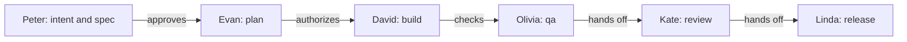

# 26. Example: signed approvals and an audit

This example ran on October 17, 2026, on the TodoMVC project of the
[from-scratch example](19-team-greenfield-example.md).
The project already had 45 approvals made without signatures. The team required signed approvals from that point on,
took one feature through every gate with signed approvals, tried to forge approvals, and handed the project to an
auditor who had never met the team.

## On this page

- [Set up signing keys](#261-keys)
- [Require signatures](#262-signatures-from-now-on)
- [Take a feature through the gates](#263-a-feature-with-signed-approvals)
- [Try forged approvals](#264-forging-an-approval)
- [Audit the change](#265-the-audit)
- [Lessons for a team](#266-what-the-team-takes-from-it)
- [Terms](#-terms)
- [See also](#-see-also)

The people in this run had these roles:

| Person | Roles | Gates in this example |
|---|---|---|
| Linda Carter | tech-lead, maintainer, release-manager, code-owner | signing settings, release |
| Peter Owen | product-owner | intent, spec |
| David Smith | engineer | author of the change |
| Evan Turner | engineer | plan |
| Olivia Miller | qa | qa |
| Kate Brown | code-owner, release-manager | review |
| Irene Walsh | auditor (not in roles.yaml) | none: she only reads |

## 26.1. Keys

Every person made an ssh key and set git to sign commits:

```bash
git config gpg.format ssh
git config user.signingkey ~/.ssh/id_ed25519.pub
git config commit.gpgsign true
```

The public keys go into `signing_key` in `openspec/roles.yaml`. Agents cannot edit that file, so Linda asked her
agent through `/sdlc-config` to prepare a settings proposal. Its first try made six proposals, one per key; Linda
dismissed them, because the first keys must arrive in one commit signed by a maintainer. The next proposal put a file
path into `signing_key` instead of the key; Linda saw it in the diff and dismissed it too. The third one had the keys
themselves, and Linda applied it:

```bash
sdlc config show C9
sdlc config apply C9
git commit -m "Apply config proposal C9: signing keys of every person"   # signed by Linda
```

`sdlc approvals verify` lists that commit as `bootstrap`: the first keys, signed by a maintainer named in the same file.

## 26.2. Signatures from now on

`signing: required` alone would make all 45 past approvals invalid and CI red. The proposal that Linda applied also
sets the cutoff, the commit before which approvals count as made before signing:

```text
+signing: required
+signing_since: deeb9ef9aafac03955f9d8ce01830de3f3da46dd
Validation: valid
Warning: signing_since is later or newly added
```

Adding a cutoff exempts approvals, so `sdlc config show` flags it as a weakening and `sdlc config apply` refused it
until Linda added `--yes`. After her signed commit:

```text
$ sdlc approvals verify
✓ openspec/roles.yaml linda@todo.example pre-signing 03755a26
45 approvals checked, 0 invalid
Approvals through signing_since deeb9ef9aafac03955f9d8ce01830de3f3da46dd are pre-signing; later approvals require signatures.
```

## 26.3. A feature with signed approvals

Peter added a backlog item: the footer shows how many todos are completed, and shows nothing when none are. David's
agent opened the change `b10` from that item and wrote the intent. Each approval is a signed commit in the
approver's own clone:

```bash
sdlc approve intent --change b10
git commit -m "chore(b10): approve the intent gate" -m "SDLC-Approval: …"   # signed by Peter
```

What sdlc stopped on the way:

| Where | What happened |
|---|---|
| intent | Peter rejected the first intent (it showed "0 items completed"); the second one he approved |
| spec | Three unanswered questions in `design.md` blocked approval. |
| plan | The plan judge returned the plan twice before Evan approved. |
| build | The agent tried to write the test before the plan was approved: `[sdlc:plan-gate]` denied it |
| build | David unlocked a wrong test expectation for the agent to fix. |
| review | `review.md` needed coverage for every review pass. |
| release | Linda rejected the first `release.md` for describing nonexistent checks. |

The spec gate said: "The spec gate cannot be approved yet: 3 open question(s) in design.md have no recorded answer."
Peter answered with `sdlc answer 1 --change b10 --artifact design --text "…"` and approved.

The plan had no test file under `test/`, no failing test first, and no `sdlc tests lock`. It passed after those were
addressed. The agent tried to write the test before plan approval, and `[sdlc:plan-gate]` denied it.

During build, the agent's test expected the wrong number. The tests were locked, so the agent could not change them.
David unlocked them with `sdlc tests unlock --change b10` (a person's command). The agent fixed and relocked them.

The review gate required every review pass under `## Coverage`, one line each. An example line is
`- bugs: none found — checked: …`. Linda rejected `release.md` because its staging environment and rollback rehearsal
do not exist.

The tests were green while the app was broken: David opened it in a browser and the list did not render. The agent
fixed the error, and Kate recorded the gap in the review (the footer rendering has no automated test). Olivia approved
qa, Kate review, Linda release; the change was archived and merged, and the tag `v1.1.0` was signed.

The run moved through these decisions:



```text
$ sdlc approvals verify --mode required
✓ b10/intent peter valid 617299a5 trailer: found
✓ b10/spec peter valid f862f053 trailer: found
✓ b10/plan evan valid f11e81df trailer: found
✓ b10/qa olivia valid 60286a5d trailer: found
✓ b10/review kate valid d23589a4 trailer: found
✓ b10/release linda valid c4cd6da3 trailer: found
51 approvals checked, 0 invalid
```

## 26.4. Forging an approval

In a separate clone, on branches off `main`, the team tried to pass an approval that Peter never signed:

| Attempt | Result |
|---|---|
| Peter's approval in an unsigned commit | `✗ a1/intent peter unsigned … trailer: found`, exit 1 |
| Peter's approval in a commit signed with David's key | `✗ a2/intent peter wrong-signer … trailer: found`, exit 1 |
| Peter's approval written into `.sdlc.yaml` by hand and committed by David | It fails verification; see below. |
| `intent.md` edited after Peter's signed approval | the approval no longer counts: the gate waits for Peter again |

`sdlc status` trusts the change record; signatures are what make a forged record visible. That is why
`sdlc approvals verify --mode required` belongs in CI on a full clone (`fetch-depth: 0`).

In the forged-record clone, `sdlc status` counts the approval. `sdlc approvals verify` reports
`✗ a3/intent peter wrong-signer … trailer: missing` and exits 1.

## 26.5. The audit

Irene cloned the repository and asked no one anything:

```bash
sdlc approvals verify --mode required
sdlc trace b10
sdlc changelog --change b10
sdlc audit --change b10
sdlc audit --export ../audit-export
```

- `approvals verify`: 51 approvals, 0 invalid; every b10 approval signed by the person it names; the `roles.yaml`
  commits as `bootstrap`, `valid` and `merge`.
- `trace b10`: seven requirements and eleven scenarios from the delta spec, and the gaps: every scenario "without
  evidence", because nobody filled the behavioural verification table of `verification.md`.
- `changelog --change b10`: the seven added requirements.
- `audit --change b10`: every event with its person and time (the rejection of intent and release, the answers, the
  judge verdicts, `tests.locked`, `tests.unlocked`, `tests.locked`), the commits, and the metrics: four verify runs,
  two rejections, six approvals of six planned.
- `audit --export`: a folder with `index.md`, `index.json`, the log and every change's files: 10 changes, 51
  approvals, 96 files. Each approval row has its gate, role, person, time, digest, signature status and trailer.

## 26.6. What the team takes from it

The audit gives the team several practices to keep:

- Turn on signing in a project with history with `signing_since`: past approvals stay valid, new ones need a
  signature. Add the keys first, in one commit signed by a maintainer.
- Read every settings proposal before applying it: the diff is the decision, not the agent's summary of it.
- Green tests are not a working app: the person who looks at it in a browser is part of verification.
- An unsigned or misattributed approval fails `sdlc approvals verify`; run it with `--mode required` in CI.
- An auditor needs only a full clone: signatures, the change records, the log and the evidence bundle.

## 📚 Terms

- [Signed approval](glossary.md) — an approval in a signed commit.
- [Trace](glossary.md) — the view connecting requirements and evidence.
- [Gate](glossary.md) — the decision point before a change moves on.

## 📚 See also

- [Roles and signing](08-roles-and-signing.md) — how signatures are checked.
- [Traceability and audit](14-traceability.md) — how to read the evidence.
