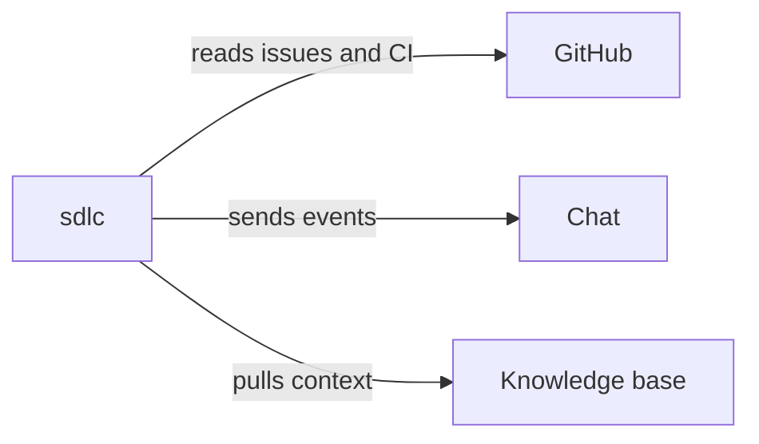

# 27. Example: sdlc in the ecosystem over MCP and events

This example ran on October 18, 2026, on the TodoMVC project of the
[from-scratch example](19-team-greenfield-example.md).
The team connected its MCP servers to sdlc: GitHub for issues and CI, a chat for events, a knowledge base. It served
the process to other systems over MCP, locally and over HTTP, and checked what those systems can and cannot do.
The servers were local stand-ins with the same tools as the real ones.

## On this page

- [Describe the servers](#271-the-teams-servers-described-once)
- [Serve process data](#272-sdlc-as-a-server-reading-never-deciding)
- [Import issues and knowledge](#273-issues-into-the-backlog)
- [Limit servers by stage](#275-servers-belong-to-stages)
- [Deliver events and results](#276-events-that-are-not-lost)
- [Lessons for a team](#278-what-the-team-takes-from-it)
- [Terms](#-terms)
- [See also](#-see-also)

The team divided the work this way:

| Person | Role in this example |
|---|---|
| Linda Carter | maintainer: the settings, the MCP checks |
| Peter Owen | product-owner: the backlog, the intent gate |
| David Smith | engineer: the change, verification |
| Olivia Miller | qa: the knowledge packs |

## 27.1. The team's servers, described once

The setup connects sdlc to three servers:



Agents cannot edit `openspec/sdlc.yaml`. Linda asked her agent through `/sdlc-config` for one proposal. Its two
tries had wrong keys, so she dismissed them and proposed the file herself (`sdlc config propose --file`). She applied:

```yaml
mcp:
  serve: true
  servers:
    github: { type: stdio, command: [node, …/mcp-stub.mjs, github], stages: [plan, deploy] }
    chat:   { type: stdio, command: [node, …/mcp-stub.mjs, chat], agents: false }
    kb:     { type: stdio, command: [node, …/mcp-stub.mjs, kb], stages: [design, build] }
issues: { server: github, repo: todo-team/todomvc }
events:
  - server: chat
    tool: send_message
    on: ["gate.*", "summary.daily"]
    message: text
context:
  sources:
    - { name: glossary, server: kb, resource: "kb://glossary", stages: [design], owner: linda, fresh_days: 30 }
    - { name: faq, server: kb, tool: search_docs, args: { query: counters }, stages: [build], owner: olivia }
verify:
  mcp:
    - name: ci-green
      server: github
      tool: list_workflow_runs
      args: { head_sha: "${HEAD}" }
      expect: { workflow_runs: { $any: { conclusion: success } } }
```

`sdlc update` put the sdlc server, github and kb into the agents' settings (`.qwen/settings.json`). The chat server
has `agents: false`: only the CLI calls it.

```text
$ sdlc mcp check --strict
✓ github (stdio): available, 4 tool(s)
✓ chat (stdio): available, 1 tool(s)
✓ kb (stdio): available, 1 tool(s)
```

With the chat server down, `sdlc mcp check --strict` exited 1 (without `--strict`, 0). A server with a `write_file`
tool got a warning: the hook does not see what a server writes.

## 27.2. sdlc as a server: reading, never deciding

Over HTTP, for a client on another machine, the token comes only from the environment:

```bash
export SDLC_MCP_TOKEN="<at least 16 characters>"
sdlc mcp serve --http 127.0.0.1:8765
```

| Request | Answer |
|---|---|
| no token, or another token | 401 |
| the right token, a browser `Origin` of another host | 403 |
| another path than `/mcp` | 404 |
| the right token | 11 read tools (listed below) |
| `approve`, `reject`, `waive`, `track` | `unknown_tool`: decisions are not tools |
| an argument that starts with `-` | `invalid_arguments` |

Without `SDLC_MCP_TOKEN`, or with a short one, the server does not start (`token_required`). Over stdio the agent
gets the same tools, and the resources: the context packs, the living specs and each change's artifacts.

The 11 tools are:

- `board_list`, `status`, `next`, `instructions`;
- `trace`, `audit`, `help`, `guide`;
- `explain`, `health`, `report`.

## 27.3. Issues into the backlog

```bash
sdlc backlog import --issues
```

Two open issues became backlog items with `**Issue**: GH-21` and `GH-22`; the pull request among them was skipped. A
second import added nothing. Peter gave the imported backlog item an outcome and acceptance criteria. He also set
its kind and risk with `sdlc backlog edit`.

## 27.4. Knowledge from the knowledge base

Olivia ran `sdlc context pull`. It brought in `docs/context/glossary.md` from `kb://glossary` and
`docs/context/faq.md` from `search_docs`. Each has these header fields:

- `owner`;
- `source: mcp:kb …`;
- `updated`;
- `fresh_days`;
- `stages`.

She committed them; they go through review like any file. `sdlc instructions` then hands the glossary to the agent
for proposal, specs and design. It hands over the FAQ for tasks and nothing for the other artifacts.

## 27.5. Servers belong to stages

David's agent started the change from the imported backlog item. At the plan stage it called three servers:

| Call | Result |
|---|---|
| `status` of the sdlc server | the change and the gate that waits for Peter |
| `list_issues` of github (stages plan, deploy) | the open issues |
| `search_docs` of kb (stages design, build) | `[sdlc:mcp-stage] The MCP server kb is for the stages design, build; the active changes are at plan.` |

Qwen Code reports MCP tools as `mcp__<server>__<tool>`, so the hook checks them by stage.

## 27.6. Events that are not lost

When a gate started waiting for Peter, the chat got one line naming the change, the gate and Peter. Then the chat
server went down, and Peter rejected the intent:

```text
$ sdlc events list
Events waiting for delivery: 1
  gate.intent.rejected  sort-todos-alphabetically
$ sdlc events flush
Delivered: 0; not delivered (they wait): 1.
```

When the server was back, `sdlc events flush` delivered the event once; a second flush delivered nothing. The waiting
events are kept in `.git/sdlc/outbox`, not in the working copy. `sdlc events summary` sent the daily summary once; a
second run the same day said it was already recorded.

## 27.7. A result for the agent who was not there

David ran `sdlc verify` in his terminal. Next to `npm test`, the CLI itself asked the github server about the CI runs
of the head commit (`head_sha` became the commit id):

```text
✓ test (1.1s)
✓ ci-green (github/list_workflow_runs, 0.6s)
```

Outside an agent session the result also went to the inbox. In its next session David's agent retold it and marked
it read with `sdlc inbox done <id>`. Marking decides nothing, so an agent may do it.

## 27.8. What the team takes from it

These are the practices the team kept from the run:

- Describe each server once in `mcp.servers`: sdlc lays it out for every agent tool, and `stages` keep it to its
  stages.
- Give other systems sdlc over MCP: they read the process and can decide nothing. Over HTTP, always with a token.
- Use `agents: false` for servers only the CLI calls, such as the event receiver.
- Run `sdlc mcp check --strict` in CI; review any server that can write files before adding it.
- Read every settings proposal before applying it; when an agent cannot get the keys right, a person proposes the
  file.

## 📚 Terms

- [MCP](glossary.md) — the protocol for these tools and resources.
- [Event receiver](glossary.md) — a tool that receives selected process events.
- [Stage](glossary.md) — a part of the change lifecycle.

## 📚 See also

- [Integrations](10-integrations.md) — configuration and limits for these connections.
- [MCP use cases](11-mcp-use-cases.md) — how clients read process data.
