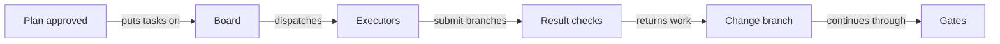

# 28. Example: an executor swarm, the board and the auction

This example ran on October 18, 2026, on the TodoMVC project of the
[from-scratch example](19-team-greenfield-example.md).
The plan of one change was split into four tasks, and the tasks went to executors: an agent of the team, an outside
agent and scripted bidders. The team checked leases, retries, auctions, a rejected result and that no executor can
decide anything.

## On this page

- [Register executors](#281-the-registry)
- [Host the board](#282-one-host-tokens-for-executors)
- [Handle leases and bids](#283-leases-and-retries)
- [Check a submitted result](#285-a-real-executor-and-a-rejected-result)
- [Return to the gates](#286-back-to-the-gates)
- [Lessons for a team](#287-what-the-team-takes-from-it)
- [Terms](#-terms)
- [See also](#-see-also)

The people and executors had these roles:

| Who | Role in this example |
|---|---|
| Linda Carter | maintainer: the executor registry, the board host, auctions and awards |
| David Smith | engineer: the change, merging results |
| Evan Turner | engineer: approves the plan; runs the executor `qwen-board` (a Qwen Code agent) |
| Peter Owen | product-owner: intent and spec |
| `market-b` | an outside executor (Codex CLI in its own clone) |
| `market-a`, `junior` | scripted market executors |

## 28.1. The registry

Only a person edits `openspec/executors.yaml`:

```yaml
executors:
  qwen-board: { type: board,  max_risk: medium, kinds: [feature, bugfix], capabilities: [javascript] }
  market-a:   { type: market, max_risk: medium }
  market-b:   { type: market, max_risk: high }
  junior:     { type: market, max_risk: low, kinds: [docs] }
```

The change `sort-todos-alphabetically` (a "Sort A–Z" button, from a GitHub issue) went through intent, spec and plan
as usual. Its `tasks.md` had four numbered tasks:

```markdown
- [ ] 1.1 Write test/sort.test.js: case-insensitive order of titles and the saved order after reload; it fails first
- [ ] 1.2 Add sortTodosByTitle(todos) to js/store.js
- [ ] 1.3 Add the "Sort A–Z" button to the footer
- [ ] 1.4 Save the sorted order in localStorage
```

Once Evan approved the plan, the four tasks were on the board.

The run follows the work from the plan back to review:



## 28.2. One host, tokens for executors

The board is `openspec/.sdlc/board.json`, local to a clone, so one clone hosts it: Linda's. She issued a token to
each executor (a person's command) and served the board over HTTP:

```bash
sdlc task executors token market-a      # printed once; only its SHA-256 goes into executors.yaml
export SDLC_MCP_TOKEN="<the server token>"
sdlc mcp serve --http 127.0.0.1:8765
```

The token itself is stored nowhere in the repository; the log records `executor.token_issued` and who issued it.

| Token | Board tools |
|---|---|
| the server's | `board_list` |
| an executor's | `board_list`, `board_claim`, `board_heartbeat`, `board_release`, `board_submit`, `board_bid` |

Auctions, awards, dispatch and gate decisions are not MCP tools.

## 28.3. Leases and retries

`market-a` claimed task 1.4 for five seconds with a request key:

```json
{ "change": "sort-todos-alphabetically", "task": "1.4", "agent": "bot-a", "lease": "5", "request": "claim-14-try-0002" }
```

- The same call with the same key returned the same answer, and the log got one `task.claimed`.
- The same key with another agent was refused with `request_conflict`.
- After the lease ran out, `board_list` showed 1.4 open again and the log got one `task.lease_expired`; a second
  read added none.

## 28.4. The auction

Linda opened an auction for task 1.2:

```bash
sdlc board auction --change sort-todos-alphabetically --task 1.2 --window 40
```

| Bid | Result |
|---|---|
| `market-a`: 30 minutes, cost 3 | accepted |
| `market-b`: 20 minutes, cost 5 | accepted |
| `junior` | "The executor is not allowed for this change." (its kinds are docs only) |
| 0 minutes | `invalid_bid` |

When the window closed, the next board command reserved 1.2 for `market-b` (rule `fastest`; `task.awarded` says
so). Linda reassigned it with `sdlc board award … --executor market-a`; a claim by `market-b` then got
`task_dispatched`. An auction on 1.4 with no bids closed, and the task was open again (`task.auction_expired`).

## 28.5. A real executor and a rejected result

Evan's process claimed task 1.1 for `qwen-board` and got the work item (contract `sdlc.task/1`). It contains:

- the base commit and the plan's files;
- the spec scenarios and checks;
- the paths it must not touch;
- the branch `sdlc/sort-todos-alphabetically/1.1`;
- these trailers:

```text
SDLC-Change: sort-todos-alphabetically
SDLC-Task: 1.1
SDLC-Agent: qwen-board/qwen-evan
```

The agent wrote the test on that branch, committed with the trailers and pushed. Linda's clone fetched the branch, and
`board_submit` ran the result check: it passed, and the task was submitted.

- `market-a` claimed task 1.3 and submitted that same branch: `wrong_executor`, the commit names `qwen-board`.
- Linda read the submitted test: it skipped while the function was missing, so it never failed first. She reopened
  the task with a reason and `--escalate`:

```text
sort-todos-alphabetically#1.1  open  1 prior attempt(s); last reason: the test skips …  excluded: qwen-board
```

`qwen-board` could not claim it again (`executor_excluded`). `market-b` claimed it, and its work item carried
`previousAttempts` with the branch and the reason. Its test failed for the right reason
(`sortTodosByTitle is not a function`), and its result passed the check.

## 28.6. Back to the gates

David merged the result branch into the change branch. Nothing on the board decides a gate:

```bash
sdlc task check-result --change sort-todos-alphabetically --branch origin/sdlc/sort-todos-alphabetically/1.1
sdlc tests lock --change sort-todos-alphabetically
npm test                                   # 3 failures: sortTodosByTitle is not a function — the plan's red step
sdlc trace sort-todos-alphabetically       # task 1.1 with commit a92f3ac
```

The trace links the task to the executor's commit through its trailers. When the `qwen-board` agent was asked to
approve the review itself, the hook refused: `[sdlc:separation-of-duties]`. The dashboard's "Task board" section shows
each task's state, executor, agent, lease end, attempts and the last reason.

## 28.7. What the team takes from it

The board coordinates work while people retain the decisions:

- Name the executors in `executors.yaml` with the risk and kinds they may take; the board refuses the rest.
- Host the board in one clone and give executors tokens: they claim, bid and submit over MCP, and decide nothing.
- Use request keys for retries: a repeated call changes nothing twice.
- Read a result before accepting it; reopen with a reason, and escalate to keep an executor off the task.
- A result is a branch: it comes back to the change through merging, verification and review, like any code.

## 📚 Terms

- [Executor](glossary.md) — a registered worker that returns task results.
- [Board](glossary.md) — the place where executors claim tasks.
- [Gate](glossary.md) — a decision point that the board cannot approve.

## 📚 See also

- [Finishing with executors](30-finishing-with-executors-example.md) — how this change reaches release.
- [Roles and signing](08-roles-and-signing.md) — who makes gate decisions.
