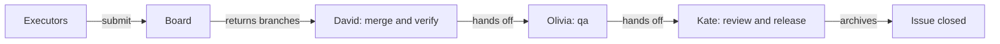

# 30. Example: finishing a change with executors, closing the issue, one server for two projects

This example ran on October 18, 2026, on the TodoMVC project of the
[from-scratch example](19-team-greenfield-example.md)
and the node-semver project of the [large codebase example](22-adopt-large-codebase-example.md). The change "Sort A–Z",
started from a GitHub issue, was finished by executors on the task board: a representative and a mesh peer. It went
through review with real findings, was archived, and the issue was closed. Then one MCP server served both projects.

## On this page

- [Run representative and mesh tasks](#301-a-representative-and-a-mesh-peer)
- [Merge and review](#302-merging-and-review)
- [Release and close the issue](#303-release-archive-and-the-issue)
- [Serve two projects](#304-one-server-for-two-projects)
- [Lessons for a team](#305-what-the-team-takes-from-it)
- [Terms](#-terms)
- [See also](#-see-also)

The people and executors had these roles:

| Who | Role in this example |
|---|---|
| Linda Carter | maintainer: the executor registry, the board host |
| David Smith | engineer: merges the results, checks the app in a browser |
| Evan Turner | engineer: approves the plan; runs the mesh peer (Qwen Code) |
| Olivia Miller | qa |
| Kate Brown | code-owner and release-manager: review, release, the merge and the tag |
| `rep-claude` | a representative executor (Claude Code in its own clone) |
| `mesh-a` | a mesh peer |

## 30.1. A representative and a mesh peer

This run carries task results through the change's remaining gates:



Linda added two executors to `openspec/executors.yaml` and issued their tokens:

```yaml
  rep-claude: { type: representative, max_risk: medium }
  mesh-a:     { type: mesh, max_risk: medium }
```

The representative claimed task 1.2 over MCP and got its work item. Claude Code, in its own clone, implemented
`sortTodosByTitle`, ran the tests (34 passed), committed with the work item's trailers and pushed. The submit named only
the branch:

```json
{ "claim": "…", "branch": "sdlc/sort-todos-alphabetically/1.2" }
```

The board host fetched the branch from origin into a private ref, ran the result check, and the task was submitted.

In a mesh, a request can reach the board twice. Two peers sent the same claim of task 1.4 at once, with the same request
key: both got the same claim, and the log got one `task.claimed`. The work item named the branch
`sdlc/sort-todos-alphabetically/1.4-3`: every claim of a task gets its own branch. Evan's Qwen agent did the task; two
identical submits at once gave one answer and one submission. The representative did task 1.3, the button, the same
way.

## 30.2. Merging and review

David merged the three result branches. Tasks 1.2 and 1.4 had both added the sorting function, so `js/store.js`
conflicted; he kept the one implemented for task 1.2. `npm test` passed, and `sdlc verify` passed. David marked the
tasks done. Olivia
approved qa.

Claude Code wrote the review through the reviewer subagent of the team's reviewer role: 14 findings, 8 of them
important, so the review gate stayed closed. Among them: a second click did not bring back the original order, a
malformed stored item broke loading, the click handler bypassed the store, and Cyrillic titles sorted out of
alphabetical order.

```bash
sdlc tests unlock --change sort-todos-alphabetically --note "F6: the reload test copies the handler"
```

Claude Code fixed the findings (44 tests), locked the tests again and said what it could not decide: the fix departed
from the plan, qa was now stale, and nobody had checked the button in a browser. David brought `plan.md` in line, the
judge passed it, and Evan approved the plan again. David checked the app in a browser and wrote down what he saw:

- five titles in mixed case, two of them Cyrillic, came out in alphabetical order after one click;
- a second click → the original order; `aria-pressed` follows;
- after a reload the list is still sorted, and localStorage keeps the order of creation.

Olivia approved qa again. Claude Code re-checked the review and set each finding's status, with the people's decisions
on the ones left to them; Kate approved the review.

## 30.3. Release, archive and the issue

Kate handled release after Linda's code contribution blocked Linda's approval.

Linda had commits on the change branch, so `sdlc approve release` refused her: "Linda Carter authored code in this
change." Kate, the other release manager, approved it. Then:

```bash
sdlc archive sort-todos-alphabetically --yes
```

The GitHub server got two calls: a comment on issue 21 ("The change sort-todos-alphabetically was archived.") and
`update_issue` with `state: closed`. Kate merged the branch into `main`, ran the tests and pushed the signed tag
`v1.2.0`. `sdlc approvals verify --mode required` found 57 approvals and 0 invalid. This includes the repeated ones.

## 30.4. One server for two projects

```bash
sdlc mcp serve --project C:\work\todomvc\lead --project C:\work\semver\lead
```

Both folders are called `lead`, so the server did not start: "Two projects are named "lead": … and …".
The fix was to give one of them its own `project.name` in openspec/sdlc.yaml. Each lead set `project.name` through a
settings proposal (`todomvc`, `semver`).
Then:

| Call | Answer |
|---|---|
| `status` without `project` | both projects |
| `next` with `project: todomvc` | start the backlog item |
| `next` with `project: semver` | `no_active_changes` |
| `next` with `project: nope` | `unknown_project`, with the served names |
| `next` without `project` | `project_required` |

Resources carry the project in their address: `sdlc://todomvc/context/glossary.md`.

## 30.5. What the team takes from it

The finished change shows how execution and decisions stay connected:

- Executors of every kind meet the same board: a representative and a mesh peer claim, submit and get checked alike.
- A submit can name just the branch; a retry or a relayed request never writes twice.
- A real review finds real bugs; fixes go back through the plan, verification and qa before the gate opens.
- The person who wrote code on a change does not approve its release: keep a second release manager.
- Archiving closes the GitHub issue the change came from.
- One MCP server can serve several projects once each has its own `project.name`.

## 📚 Terms

- [Executor](glossary.md) — a registered worker that returns task results.
- [Board](glossary.md) — the place where tasks are claimed and submitted.
- [Review](glossary.md) — the gate where findings are checked before approval.

## 📚 See also

- [Executor swarm](28-executor-swarm-example.md) — the earlier task dispatch in this change.
- [MCP integrations](27-mcp-integrations-example.md) — the server connections used by this team.
