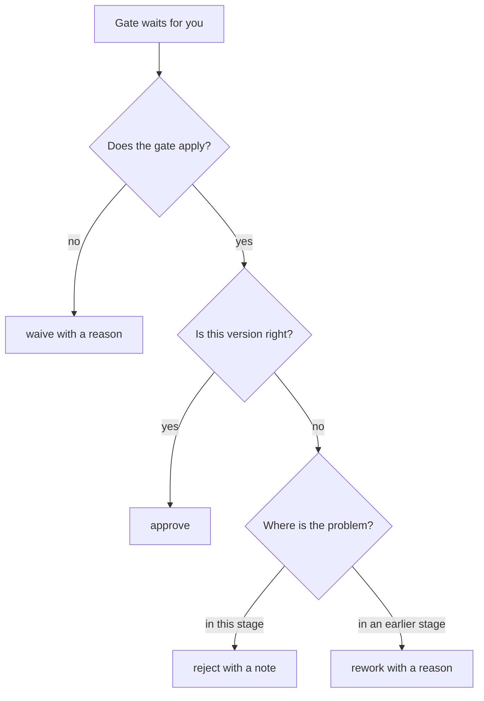

# 34. Gate decisions and tracks

A gate is the point where a person decides whether a change may go on. sdlc gives that person four decisions and
two tracks. This page explains what each one means, why it exists and when to use it, with commands you can copy.
All of them are a person's commands: an agent prepares the decision and gives you the command, and the CLI and the
hooks refuse it inside an agent session.

## On this page

- [Four decisions at a gate](#four-decisions-at-a-gate) — the short version.
- [approve](#approve) — the gate is needed and the content is accepted.
- [reject](#reject) — the gate is needed, but not in this form.
- [waive](#waive) — the gate does not apply to this change.
- [rework](#rework) — the problem is at an earlier stage.
- [Choosing a decision](#choosing-a-decision) — a quick way to pick one.
- [Tracks: full and lite](#tracks-full-and-lite) — how many gates a change passes.
- [Common mistakes](#common-mistakes) — what each command is not for.
- [Related pages](#related-pages) — where to read further.

## Four decisions at a gate

| Command | Meaning | What happens next |
|---|---|---|
| `sdlc approve` | the gate is needed, and the content is accepted | the change moves to the next stage |
| `sdlc reject` | the gate is needed, but it cannot be accepted in this form | the agent revises the same stage, then the gate waits for a person again |
| `sdlc waive` | the gate does not apply to this change | the gate counts as passed, with your reason on record |
| `sdlc rework` | the problem lies at an earlier stage | the change goes back to that stage, and later approvals stop counting |

Every decision is recorded in the change's `.sdlc.yaml` and in the project log. The record holds who decided, under
which role, when, and for approve and reject the digest of exactly what was decided on. Audit, reports and
`sdlc health` read these records, so the choice of decision is visible to the team later.

## approve

**Why it exists.** An approval is the only way a change moves past a gate. It ties a person and a role to an exact
version of the artifacts, so nobody can later claim that a different text was approved.

**When to use it.** You read the artifacts of the gate, they are right, and you hold the gate's role.

```bash
sdlc approve intent --change add-export
sdlc approve review --change add-export --as code-owner
```

Read before you approve:

- `sdlc approve plan --change add-export --preview` shows what you would approve and what changed since the last
  approval. It also says whether you may approve and prints the digest.
- `--expect-digest sha256:…` approves exactly the version you read. If the artifacts changed in between, nothing is
  recorded.
- With `openspec/roles.yaml`, your git identity must hold the gate's role. The separation rules apply as well: the
  author of the code may not approve its review.
- A gate with `min_approvals: 2` waits for two different people.

**What happens when the artifacts change later.** The approval goes stale. The status shows `↻ stale`, and the gate
needs a new approval of the new version.

## reject

**Why it exists.** Most problems a reviewer finds belong to the stage under review: a vague intent, a missing scenario
in the spec, a plan without a rollback. Reject keeps the change at that stage and tells the agent what to fix. Nothing
earlier is thrown away.

**When to use it.** The gate is needed, the work is at the right stage, but this version is not good enough.

```bash
sdlc reject spec --change add-export --note "Add the scenario for an empty export"
sdlc reject review --change add-export --note "F2 is still open: the token is logged"
```

What happens next:

- The note is required. It is the agent's instruction.
- `sdlc next` shows your note to the agent, and the agent revises the gate's artifacts.
- Once the artifacts change, the gate waits for a person again: `sdlc next` names the people, and `sdlc next --me`
  lists it for you.
- The rejection stays visible in `sdlc status` until a later approval of the same gate.

## waive

**Why it exists.** Not every gate makes sense for every change. A README fix has nothing for a QA gate to check, and a
change with nothing to roll out has nothing for a release gate. Waive records that decision openly, instead of
someone approving a gate they did not really check.

**When to use it.** The gate does not apply to this change, and you can say why in one sentence.

```bash
sdlc waive qa --change readme-filters --note "Documentation only: no behaviour to test"
sdlc waive release --change readme-filters --note "Nothing is deployed; the README ships with the next tag"
```

What to know:

- The note is required, because a waiver is part of the audit.
- A person may waive any gate, verify included. A waiver is never a way to skip work the gate exists for.
- A project can waive gates by policy: `gates.<gate>.auto_waive: { kinds, tracks }` in `openspec/sdlc.yaml` waives
  intent, spec or plan for the listed kinds or tracks. A policy never waives verify or review.
- `sdlc health` reports `discipline.waivers` when people waive a large share of gates. That usually means a gate is
  configured for the wrong changes: adjust the configuration instead of waiving it every time.

## rework

**Why it exists.** Sometimes review or verification shows that the cause lies earlier: the requirement was missing,
an assumption was wrong, or the design does not hold. Fixing the code alone would leave the spec or the plan wrong.
Rework sends the change back to the stage where the problem is, so the agent fixes the cause and every later stage is
checked again.

**When to use it.** The problem is not in the gate's own artifacts but in an earlier stage's.

```bash
sdlc rework spec --change add-export --reason missing-requirement --note "No case for an empty name"
sdlc rework plan --change add-export --reason design-flaw --note "Use the queue, not a cron job" --reset
```

What happens next:

- The change returns to the named stage: intent, spec, plan, qa or review.
- The approvals given before the rework stop counting, including the approvals of later gates.
- `--reason` is a category from `rework.reasons`: missing-requirement, wrong-assumption, design-flaw,
  implementation-bug, test-gap, scope-change or other. Audit counts them, so the team sees where rework comes from.
- `--reset` restores the plan's files and the change folder from the checkpoint taken when that gate was approved. It
  refuses uncommitted edits.
- After `rework.max_cycles` reworks of one gate (3 by default), `sdlc next` asks a person to take the change over or to
  review its scope, instead of starting another agent round.

## Choosing a decision

Ask the questions in this order:

1. Does this gate apply to this change at all? If not, **waive** it with the reason.
2. Is the version in front of you right? If yes, **approve** it.
3. Is the problem in this stage's own artifacts? If yes, **reject** with a note on what to fix.
4. Is the cause at an earlier stage? Then **rework** to that stage with a reason category.



A worked example. During review of `add-export`, the reviewer finds that exports of an empty list crash:

- If the spec covers empty lists and the code ignores it, the fix belongs to the code: **reject review**.
- If the spec never mentioned empty lists, the requirement is missing: **rework spec** with
  `missing-requirement`, so the spec, the plan and the tests are corrected and approved again.

## Tracks: full and lite

A track decides which gates a change must pass. sdlc has two tracks.

| Gate | full | lite |
|---|---|---|
| intent: why and what (`intent.md`), product owner | required | not required |
| spec: requirements and design (proposal, specs, design), product owner and tech lead | required | not required |
| plan: the plan before code, engineer | required | required |
| verify: checks with recorded evidence | required | required |
| review: review by a person | required | required |
| qa and release | as the project configures | as the project configures |

**Why lite exists.** For a small, bounded change, writing and approving an intent and a spec costs more than it saves.
Lite skips only those two gates. The plan is still approved before any code, verification evidence is still
required, and a code owner still reviews.

**How the track is chosen.**

- `sdlc new` suggests a track from the kind and the risk of the change.
- High risk, and the kinds `security` and `incident`, always get full.
- Low risk with the kind `bugfix`, `refactor`, `chore` or `docs` gets a lite suggestion. Everything else gets full.
- The suggestion is only a hint. A person confirms or changes it before the plan is approved; without that the change
  stays on full. An agent cannot choose lite.

```bash
sdlc new fix-rounding --kind bugfix --risk low
sdlc track set lite --change fix-rounding --note "One function, covered by tests"
sdlc track set full --change fix-rounding --note "Touches the payment API after all"
```

**When not to use lite.** Use full for new behaviour that users will notice, and for anything touching security, data
or public APIs. Use it as well for any change whose scope is still unclear: those need the spec gate.

A project can also waive gates for every lite change by policy (`auto_waive` with `tracks: [lite]`). `sdlc doctor`
warns about it, because it then waives features as well.

## Common mistakes

- **Rejecting when the cause is earlier.** The agent will patch the code to pass review while the spec stays wrong.
  Use rework to the stage that holds the cause.
- **Reworking for a local fix.** Rework drops later approvals and repeats stages. Use reject when the gate's own
  artifacts are what needs fixing.
- **Waiving to save time.** A waiver says the gate does not apply. If the gate applies and nobody checked, approving
  or waiving it is the wrong record; let the right person review it.
- **Lite for a feature.** Lite removes the spec gate, the one place where requirements are agreed before code.

## Related pages

- [User guide: lifecycle and gates](05-guide.md) — the full lifecycle and every command.
- [Tracks and decisions example](23-tracks-and-decisions-example.md) — a team using lite, waivers and rework.
- [Roles and signed approvals](08-roles-and-signing.md) — who may decide which gate.
- [Process health](13-process-health.md) — how waivers, rejections and reworks show up in health.
- `sdlc guide gates`, `sdlc guide tracks` and `sdlc guide rework` — the same topics inside your agent session.
