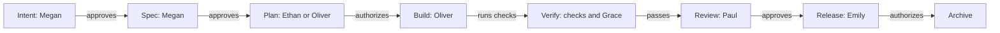

# Module 5. One change from idea to archive (tasklet)

Follow "Add due dates to tasks" (`add-due-dates`) through every stage in the `tasklet` API. Oliver guides the agent.
Megan, Ethan, Grace, Paul and Emily handle their own decisions. Use this module to see the commands and evidence
at each gate, from the first intent to the archived record.

## On this page

In this module:

- [Lesson 5.1: The map](#s5-1)
- [Lesson 5.2: Intent](#s5-2)
- [Lesson 5.3: Spec](#s5-3)
- [Lesson 5.4: Plan](#s5-4)
- [Lesson 5.5: Rework](#s5-5)
- [Lesson 5.6: Build](#s5-6)
- [Lesson 5.7: Verify](#s5-7)
- [Lesson 5.8: Review](#s5-8)
- [Lesson 5.9: Release](#s5-9)
- [Lesson 5.10: Archive](#s5-10)
- [Lesson 5.11: Judge](#s5-11)
- [Gaps found](#gaps-found)
- [Terms](#-terms)
- [See also](#-see-also)

---

<a id="s5-1"></a>
## Lesson 5.1 — The map: stages, gates, people and Telegram            (video: ~7 min)

**Role:** everyone; Steven for the Telegram setup   **Project:** tasklet
**You need:** Modules 3 and 4 (roles, the team, a ready backlog item); the `telegram` server in `mcp.servers`

Each person runs commands with their own git identity, outside the agent session. The outputs come from a trial
run of `tasklet` with the configuration of Modules 1 to 3. The `github` and `telegram` MCP servers are small local
stand-ins using the Module 2 tool names `list_workflow_runs` and `report_event`. Your servers may give fuller answers.

After rework, the agent revises the named gate's artifacts, then a person approves. A repeated approval for the
same digest by the same person and role writes nothing. A waived plan with no `tasks.md` still needs fresh passing
verification. `sdlc drop <change> --note "why"` closes a mistaken change without merging its delta specs.

For a high-risk change, `approve --preview` names every required role, including high-risk extras and roles still
missing. `status` and `next` flag a remaining gate when no one may approve it.

**Goal.** Know the whole path of the change before it starts: who acts at each step, which command they run, and
what the team's Telegram chat receives.

This map shows the order of stages and where a person or the checks decide:



### Steps

1. Show the path of `add-due-dates`. The agent works in Oliver's Claude Code; every gate is a person's command in their
   own terminal.

   | Step | Workflow (agent) | Gate | Who decides | Person's command |
   |---|---|---|---|---|
   | 1 | `/sdlc:intent` | intent | Megan (product-owner) | `sdlc approve intent --change add-due-dates` |
   | 2 | `/sdlc:spec` | spec | Megan; Ethan for high risk | `sdlc approve spec --change add-due-dates` |
   | 3 | `/sdlc:plan` | plan | Ethan or Oliver (engineer) | `sdlc approve plan --change add-due-dates` |
   | 4 | `/sdlc:build` | — | — | — |
   | 5 | `/sdlc:verify` | verify | nobody: the checks; Grace reads the evidence | — |
   | 6 | `/sdlc:review` | review | Paul (code-owner) | `sdlc approve review --change add-due-dates` |
   | 7 | `/sdlc:release` | release | Emily (release-manager) | `sdlc approve release --change add-due-dates` |
   | 8 | `/sdlc:archive` | — | — | — |

   Megan first answers the intent question with `sdlc answer …`. At any moment, `sdlc next` names the next step and
   person; `/sdlc:next` in Claude Code runs the next agent
   step or stops and names the person.

2. Show how the team is told. Steven added the receiver in Module 2 (lesson 2.6):

   ```yaml
   events:
     - server: telegram
       tool: send_message             # the tool name your server exposes
       on: ["gate.*.awaiting", "gate.*.overdue", "gate.*.approved", "gate.*.rejected", "gate.*.rework",
            "verify.failed", "change.archived"]
       args: { chat_id: "-1001234567890" }
       message: text
   gates:
     intent: { required: true, approvers: [product-owner], overdue_hours: 24 }
   ```

   After a command, sdlc calls `send_message` with the static `args` plus `text`: one line that names the project,
   the change, the gate and the people by their names from `roles.yaml`. The recorded event below shows the
   structured payload. With the configuration above, the server receives one line of text instead:

   ```json
   {"chat":"tasklet-team","event":{"id":"7db8a1d5f45a4b0d3220a23d","project":"tasklet",
    "event":"gate.intent.awaiting","change":"add-due-dates","gate":"intent","at":"2026-10-09T21:01:48.218Z",
    "sdlc":"0.14.4","waitingFor":["megan"]}}
   ```

   `waitingFor` holds the people from `roles.yaml` who may take the gate, so the bot can mention Megan. A decision
   event carries `by` instead. With `message: text`, the same event arrives as one line of text that names Megan.

3. Show the whole sequence the chat received during this module, in order (event, then `waitingFor` or `by`):

   ```text
   gate.intent.awaiting   ["megan"]          gate.plan.approved     by ethan
   gate.intent.awaiting   ["megan"]          gate.review.awaiting   ["paul"]
   gate.intent.approved   by megan           gate.review.rejected   by paul
   gate.spec.awaiting     ["megan"]          gate.review.awaiting   ["paul"]
   gate.spec.approved     by megan           gate.review.approved   by paul
   gate.plan.awaiting     ["ethan","oliver"] gate.release.awaiting  ["emily"]
   gate.spec.rework       by ethan           gate.release.approved  by emily
   gate.spec.approved     by megan           change.archived        by oliver
   gate.plan.awaiting     ["ethan","oliver"]
   ```

   Read the left column first, then the right one. Passing verifications are not sent: the `on` list names only
   `verify.failed`. The chat also gets `gate.spec.awaiting` (`["megan"]`) once the agent revises the spec that Ethan
   sent back.

4. Explain delivery. It takes at most 5 seconds and never fails a command. An event that could not be sent waits in
   `.git/sdlc/outbox/` and goes with the next command:

   ```bash
   sdlc events list
   ```

   ```text
   Receiver telegram/report_event: gate.*.awaiting, gate.*.overdue, gate.*.approved, gate.*.rejected, gate.*.rework, verify.failed, change.archived
   No events wait for delivery.
   ```

   This real output is from the trial, whose receiver used a `report_event` tool. With the configuration above, the
   first line names `telegram/send_message`.

   `sdlc events flush` sends the waiting events now. A gate that waits longer than its `overdue_hours` raises
   `gate.<gate>.overdue` once; sdlc notices it at the next command, so Steven runs `sdlc events flush` from a
   scheduler every hour.

5. Show the three read-only views everyone uses in this module:

   | Command | Shows |
   |---|---|
   | `sdlc status --change <id>` | the stepper, every gate with its state and approver, the next step |
   | `sdlc next` | the next step and the person, with the exact command |
   | `sdlc explain --change <id>` | why the change is where it is, what unblocks it, the latest decisions |

### Check yourself

- You can name the person and the command for each gate of `add-due-dates`.
- `sdlc events list` names the `telegram` receiver.
- You can say which field of an event tells the bot whom to mention (`waitingFor`).

### Pitfalls

- With `message: text`, sdlc sends one line of text, which a Telegram MCP server's `send_message` takes as it is.
  Without `message`, sdlc sends a structured `event`, and the server needs a tool that accepts it.
- Events omit emails and command output. A receiver can opt into a masked, one-line rework or
  rejection note with `include_note: true` (default off). The note is at most 200 characters; it appears as
  `note` in an event or after the ready message text.
- Events are sent by the CLI. `agents: false` lets the CLI use `telegram`
  without adding it to agent MCP settings. Without `stages`, the stage rule does not apply.
### On screen (for the video)

- The path table as a horizontal timeline with a face at each gate.
- A phone mock-up of the Telegram chat next to the terminal; each event appears as the lessons go on.

---

<a id="s5-2"></a>
## Lesson 5.2 — Intent: Megan answers a question and approves            (video: ~7 min)

**Role:** Oliver with Claude Code (writes), Megan (decides)   **Project:** tasklet
**You need:** lesson 5.1; a ready backlog item (Module 4)

**Goal.** Turn the ready backlog item into an approved `intent.md`. Megan answers the open question in her own terminal.

### Steps

1. Oliver starts the item and asks the agent to complete the intent:

   > Start the due dates item as add-due-dates, then run /sdlc:intent add-due-dates.

   The agent runs `sdlc backlog start B1 --change add-due-dates` (lesson 4.4), then `/sdlc:intent`. It reads the
   draft built from the backlog item, asks Oliver about scope and users one or two questions at a time, and rewrites
   `intent.md`: problem, proposed outcome, affected users, constraints, success measures, out of scope. It records
   what it could not decide under `## Open questions`:

   ```markdown
   ## Open questions
   1. Is a due date a date only (2026-10-20) or a date and time?
   ```

   It stops at the gate and gives Megan two commands: the answer and the approval.

2. Show what the agent may not do. It may not answer the question for Megan; the CLI refuses (and the hook denies
   the call in Claude Code):

   ```text
   error: `sdlc answer` records a human decision and cannot run inside an agent session (claude-code).
   fix: Run it yourself in your own terminal, not in the agent chat (a `!` command there runs in the agent's shell):
   sdlc answer 1 --change add-due-dates --text "A date only"
   ```

   It may not approve either:

   ```text
   error: `sdlc approve` records a human decision and cannot run inside an agent session (claude-code).
   ```

3. Telegram receives `gate.intent.awaiting` with `waitingFor: ["megan"]`. Megan opens **her own terminal** and
   previews the gate:

   ```bash
   sdlc approve intent --change add-due-dates --preview
   ```

   ```text
   Approval preview: gate intent of change add-due-dates (pending)
   Artifacts:
     intent  intent.md
   Changed since the last approval: nothing
   Approvals: 0 of 1
   You may not approve it now:
     - The intent gate cannot be approved yet: 1 open question(s) in intent.md have no recorded answer.
   ```

4. She lists the questions and answers the first one:

   ```bash
   sdlc answer --change add-due-dates --list
   ```

   ```text
   [ ] intent 1. Is a due date a date only (2026-10-20) or a date and time?
   ```

   ```bash
   sdlc answer 1 --change add-due-dates --text "A date only, for example 2026-10-20. A time can come later."
   ```

   ```text
   Answer to question 1 of intent.md recorded by Megan <megan@northwind.example>.
   ```

   sdlc writes the answer under the question in `intent.md` and records it, with the exact question text, in the
   change record:

   ```markdown
   1. Is a due date a date only (2026-10-20) or a date and time?
     - Answer (Megan, 2026-10-09): A date only, for example 2026-10-20. A time can come later.
   ```

5. Now the gate is hers to take:

   ```bash
   sdlc next --me
   ```

   ```text
   Waiting for you (1):
     add-due-dates, gate intent: sdlc approve intent --change add-due-dates --as product-owner
   ```

   ```bash
   sdlc approve intent --change add-due-dates
   ```

   ```text
   ✓ intent gate: Megan <megan@northwind.example> approved as product-owner (1d2438bcf31f)
   Suggested commit message (its trailer ties the commit to this approval):
     $ git commit -m "chore(add-due-dates): approve the intent gate" -m "SDLC-Approval: add-due-dates:intent:1d2438bcf31f"
   Next: agent — Write proposal (proposal.md) for the spec gate. (/sdlc:spec)
   ```

   She commits with the suggested message (signed, lesson 3.3) and pushes. Telegram receives
   `gate.intent.approved` by `megan`.

6. Gate card:

   | Gate | Who | Command | Telegram | `sdlc next` after |
   |---|---|---|---|---|
   | intent | Megan | `sdlc approve intent --change add-due-dates` | agent: write proposal (`/sdlc:spec`) |

   Megan uses `sdlc answer 1 …` before approval. Telegram moves from `gate.intent.awaiting` to
   `gate.intent.approved`.

### Check yourself

- `sdlc status --change add-due-dates` shows `intent ✓ approved  Megan <megan@northwind.example> as product-owner`.
- `sdlc answer --change add-due-dates --list` shows the question as answered.
- `git log -1` in Megan's clone shows the `SDLC-Approval` trailer.

### Pitfalls

- `sdlc next --me` lists the gate awaiting Megan's answer, and `sdlc next` asks her to answer first.
  Run `sdlc answer --change <id> --list` to see the questions.
- An answer typed into `intent.md` by hand, or by the agent, does not count. Only `sdlc answer` records it.
- Editing `intent.md` after the approval makes it stale; Megan approves again. Every change to `intent.md` before the
  approval starts a new wait too, including the answer sdlc writes into it: the trial sent `gate.intent.awaiting`
  twice.
- Denials: `sdlc guide denials#separation-of-duties`.

### On screen (for the video)

- Claude Code writing the intent; zoom on `## Open questions`.
- Megan's terminal: preview (refused), answer, preview again (allowed), approve.
- The Telegram chat: "Megan, add-due-dates waits for your intent approval", then "approved".

---

<a id="s5-3"></a>
## Lesson 5.3 — Spec: requirements and design, Megan approves            (video: ~7 min)

**Role:** Oliver with Claude Code; Megan (decides); Ethan (for high-risk changes)   **Project:** tasklet
**You need:** lesson 5.2

**Goal.** The agent writes the proposal, the delta specs and the design; `sdlc validate` passes; Megan approves the
spec gate.

### Steps

1. Oliver runs the next step:

   > /sdlc:spec add-due-dates

   The agent checks that the intent gate is approved, loads REVIEW.md and the project rules, and writes three
   artifacts in order. Broad code searches go to the `sdlc-researcher` subagent; the stage's resources name the
   team's `sdlc-analyst` and `sdlc-architect` (Module 3):

   | File | Content in this change |
   |---|---|
   | `proposal.md` | Why the change matters and how intent question 1 was answered. |
   | `specs/tasks/spec.md` | `## ADDED Requirements` for due dates and overdue tasks. |

   The proposal covers an optional `dueDate`, the overdue filter and the `tasks` capability. The spec has "Due date
   on a task" with two scenarios and "Overdue tasks" with one scenario.
   | `design.md` | decisions (store `YYYY-MM-DD`; "today" is the UTC date), areas of concern, risks, rollback |

   A scenario looks like this:

   ```markdown
   #### Scenario: Invalid due date
   - **WHEN** a client creates a task with `dueDate` `2026-13-45`
   - **THEN** the request is refused with status 400
   ```

2. The agent validates:

   ```bash
   sdlc validate --change add-due-dates
   ```

   ```text
   ✓ add-due-dates
   ```

   `sdlc validate` reports OpenSpec and delta errors and warnings. Warnings alone leave the change valid.
   `sdlc approve spec` runs the same check and refuses errors; show warnings to the approver verbatim.
   It also warns about other active changes that touch the same requirements.

3. The agent stops at the gate. `sdlc next` shows:

   ```text
   add-due-dates: Design (requirements + design spec)
   person: Megan (product-owner) must review and approve the spec gate (proposal, specs, design).
   $ sdlc approve spec --change add-due-dates --as product-owner
   ```

4. Megan reads the three files and previews:

   ```bash
   sdlc approve spec --change add-due-dates --preview
   ```

   ```text
   Approval preview: gate spec of change add-due-dates (pending)
   Artifacts:
     proposal  proposal.md
     specs  specs/tasks/spec.md
     design  design.md
   Changed since the last approval: nothing
   Approvals: 0 of 1
   You may approve it:
   $ sdlc approve spec --change add-due-dates
   ```

   ```bash
   sdlc approve spec --change add-due-dates
   ```

   ```text
   ✓ spec gate: Megan <megan@northwind.example> approved as product-owner (254381749a18)
   Next: agent — Write plan (plan.md) for the plan gate. (/sdlc:plan)
   ```

   (Shortened: the suggested commit lines are left out from here on.)

5. Explain the high-risk case. This change is `risk: medium`. For a `risk: high` change, the spec gate also needs
   the tech lead, as a second approval:

   ```bash
   sdlc approve spec --change <id> --as tech-lead      # Ethan, in his own terminal
   ```

   The gate stays pending until both Megan and Ethan have approved.

6. Gate card:

   | Gate | Who | Command | Telegram | `sdlc next` after |
   |---|---|---|---|---|
   | spec | Megan; Ethan for high risk | `sdlc approve spec --change add-due-dates` | agent: plan (`/sdlc:plan`) |

   Telegram moves from `gate.spec.awaiting` to `gate.spec.approved`.

### Check yourself

- `sdlc validate --change add-due-dates` prints a check mark.
- `sdlc status --change add-due-dates` shows `spec ✓ approved`.
- `openspec/specs/` is still empty: the delta specs merge only at archive (lesson 5.10).

### Pitfalls

- Open questions in `proposal.md` or `design.md` block the spec gate the same way:
  `sdlc answer <n> --change <id> --artifact proposal|design --text "…"`.
- With `design: { debate: true }`, the spec gate waits for the `## Debate` section and a person's decision in
  `design.md` (lesson 3.6).
- The agent writes no code at this stage. If it tries, the plan gate denies it (lesson 5.4).

### On screen (for the video)

- The three artifacts in the editor, one after the other; highlight the WHEN/THEN lines.
- `sdlc validate` passing, then Megan's preview and approval.

---

<a id="s5-4"></a>
## Lesson 5.4 — Plan: the plan gate holds the code back            (video: ~6 min)

**Role:** Oliver with Claude Code; Ethan (reads the plan)   **Project:** tasklet   **You need:** lesson 5.3

**Goal.** The agent writes `plan.md` and `tasks.md`. Until an engineer approves the plan, the hook stops every code
edit, including shell writes.

### Steps

1. Oliver runs:

   > /sdlc:plan add-due-dates

   The agent works read-only, asks Oliver what could break and which step is riskiest, then writes `plan.md`:

   ```markdown
   ## Files that change
   - src/tasks.js (new) — task store with `createTask`, `getTask`, `listTasks` and due-date validation
   - test/tasks.test.js (new) — one test per spec scenario

   ## Proof
   - test/tasks.test.js: "Task created with a due date", "Invalid due date", "Only overdue open tasks are listed".
   - `sdlc verify` (build, test, ci-green).
   ```

   The other sections are Order of work, Risks, Alternatives considered and Rollback. `tasks.md` holds three tasks:
   the failing tests, the implementation, and `sdlc verify`.

2. Show the plan gate. Oliver asks the agent to "start coding while Ethan reads". The agent tries to write
   `src/tasks.js` and the hook denies it (block mode; real reason):

   ```text
   [sdlc:plan-gate] No active change has an approved plan yet (add-due-dates). Finish the plan and have an engineer
   run `sdlc approve plan --change <id>` before editing src/tasks.js. Why, and what to do:
   `sdlc guide denials#plan-gate`.
   ```

   A shell write is checked the same way: `echo export {} > src/tasks.js` gets the same denial. Docs and `openspec/`
   are exempt.

3. Ethan checks what waits for him and previews the plan:

   ```bash
   sdlc next --me
   ```

   ```text
   Waiting for you (1):
     add-due-dates, gate plan: sdlc approve plan --change add-due-dates --as engineer
   ```

   ```bash
   sdlc approve plan --change add-due-dates --preview
   ```

   ```text
   Approval preview: gate plan of change add-due-dates (pending)
   Artifacts:
     plan  plan.md
     tasks  tasks.md
   Changed since the last approval: nothing
   Approvals: 0 of 1
   You may approve it:
   $ sdlc approve plan --change add-due-dates
   ```

4. Ethan reads the plan against the spec and finds a hole: there is no way to **remove** a due date once it is set.
   That is a missing requirement, not a planning detail. He does not approve. Lesson 5.5 continues from here.

5. Gate card (as it ends in lesson 5.5):

   | Gate | Who | Command | Telegram | `sdlc next` after |
   |---|---|---|---|---|
   | plan | Ethan or Oliver; Ethan for high risk | `sdlc approve plan --change add-due-dates` | `/sdlc:build` |

   Telegram moves from `gate.plan.awaiting` (`["ethan","oliver"]`) to `gate.plan.approved`. Ethan or Oliver
   approves as engineer. For high risk, Ethan also approves as tech lead.

### Check yourself

- `sdlc status --change add-due-dates` shows `plan … pending  awaiting approval (engineer; 0 of 1)`.
- `src/` does not exist yet: the agent could not write it.
- `sdlc log` lists the `plan-gate` denial.

### Pitfalls

- In `warn` mode the plan gate only reminds the agent once per session; in `block` mode it denies. `tasklet` uses
  `block`.
- Ticking checkboxes in `tasks.md` later does not make the plan stale; changing a task's text does.
- If the plan shows that the spec is wrong, do not plan around it: send the spec back (lesson 5.5).

### On screen (for the video)

- `plan.md` in the editor; highlight "Files that change" and "Proof".
- The denied write in Claude Code: highlight `[sdlc:plan-gate]` and the `sdlc guide` pointer.

---

<a id="s5-5"></a>
## Lesson 5.5 — Rework: Ethan sends the spec back            (video: ~7 min)

**Role:** Ethan (sends back), Oliver with Claude Code (revises), Megan (approves again)   **Project:** tasklet
**You need:** lesson 5.4

**Goal.** Send an approved gate back with a reason, let the agent fix it, approve it again, and approve the plan.

### Steps

1. Ethan sends the change back to the spec stage, in his own terminal. The reason is a category; the note says what
   has to change:

   ```bash
   sdlc rework spec --change add-due-dates --reason missing-requirement \
     --note "No way to clear a due date: PATCH /tasks/:id with dueDate null"
   ```

   ```text
   ↺ spec gate sent back by Ethan <ethan@northwind.example> (missing-requirement): No way to clear a due date: PATCH /tasks/:id with dueDate null
   Next: agent — The spec gate was sent back by Ethan <ethan@northwind.example> (missing-requirement): No way to clear a due date: PATCH /tasks/:id with dueDate null. Revise the proposal, specs, design artifact(s), then ask for approval again. (/sdlc:spec)
   ```

   Ethan may do this because he holds `tech-lead`, which the spec gate accepts. The reasons come from
   `rework.reasons`: missing-requirement, wrong-assumption, design-flaw, implementation-bug, test-gap, scope-change,
   other. `sdlc audit` counts them.

2. Show the state. The spec approval no longer counts, and every later gate waits:

   ```bash
   sdlc status --change add-due-dates
   ```

   ```text
   add-due-dates  [feature · risk medium · full track · schema sdlc]
     stage     Design (requirements + design spec)
     source    backlog B1
     artifacts intent ✓  proposal ✓  specs ✓  design ✓  plan ✓  tasks ✓
     intent ✓ ─ spec ● ─ plan ○ ─ build ○ ─ verify ○ ─ review ○ ─ release ○ ─ archive ○
     tasks     ░░░░░░░░░░  0/3
     gates
       intent   ✓ approved           Megan <megan@northwind.example> as product-owner
       spec     ✗ rejected           sent back by Ethan <ethan@northwind.example> (missing-requirement): No way to clear a due date: PATCH /tasks/:id with dueDate null
       plan     · blocked            waiting on the spec gate
       ...
   ```

   `sdlc explain --change add-due-dates` says the same in words and lists what unblocks it:

   ```text
   What unblocks it:
     1. agent: The spec gate was sent back by Ethan ... Revise the proposal, specs, design artifact(s), then ask for approval again.
     2. person: Then a person reviews and approves the spec gate.
        $ sdlc approve spec --change add-due-dates
   ```

   Telegram receives `gate.spec.rework` by `ethan` (without the note).

3. Oliver runs `/sdlc:next`. The agent reads the reason and the note from `sdlc next`, adds the requirement and its
   scenario to `specs/tasks/spec.md`, adds one line to `proposal.md`, and validates:

   ```markdown
   ### Requirement: Clearing a due date
   A client SHALL be able to remove the due date of a task.

   #### Scenario: Due date cleared
   - **WHEN** a client updates a task with `dueDate` `null`
   - **THEN** reading the task returns no `dueDate`
   ```

   It then tells Oliver that the spec is ready for Megan and gives her command. sdlc tells her too: once the agent
   has changed the spec's artifacts, the spec gate waits for Megan again, `sdlc next` names her, her
   `sdlc next --me` lists it, and Telegram receives `gate.spec.awaiting`.

4. Megan previews. The preview lists exactly what changed since her first approval:

   ```bash
   sdlc approve spec --change add-due-dates --preview
   ```

   ```text
   Approval preview: gate spec of change add-due-dates (rejected)
   Artifacts:
     proposal  proposal.md
     specs  specs/tasks/spec.md
     design  design.md
   Changed since the last approval: proposal.md, specs/tasks/spec.md
   Approvals: 0 of 1
   You may approve it:
   $ sdlc approve spec --change add-due-dates
   ```

   ```bash
   sdlc approve spec --change add-due-dates
   ```

   ```text
   ✓ spec gate: Megan <megan@northwind.example> approved as product-owner (5bbfb701caa0)
   Next: person — Ethan or Oliver (engineer) must review and approve the plan gate (plan, tasks): sdlc approve plan --change add-due-dates --as engineer
   ```

5. The agent adds the new scenario to the plan's Proof and to task 1.1. Ethan approves the plan:

   ```bash
   sdlc approve plan --change add-due-dates
   ```

   ```text
   ✓ plan gate: Ethan <ethan@northwind.example> approved as engineer (77c0c941f5d1)
   Next: agent — Implement the approved plan: 3 of 3 task(s) remain. (/sdlc:build)
   ```

6. Explain checkpoints. Each approval records a snapshot of the working tree as a git ref; branches and HEAD do not
   move:

   ```bash
   git for-each-ref refs/sdlc --format="%(refname)"
   ```

   ```text
   refs/sdlc/add-due-dates/intent
   refs/sdlc/add-due-dates/plan
   refs/sdlc/add-due-dates/spec
   ```

   `sdlc rework <gate> … --reset` restores from that checkpoint the files listed under "Files that change" in
   `plan.md` and the change folder. It refuses when those files have uncommitted edits.

### Check yourself

- `sdlc status` shows `spec ✓ approved` and `plan ✓ approved`.
- `sdlc audit --change add-due-dates` lists `reworks 1: spec (missing-requirement, …)`.
- Telegram shows `gate.spec.rework`, then `gate.spec.awaiting` for Megan, then `gate.spec.approved`, then
  `gate.plan.approved`.

### Pitfalls

- Until the agent has changed the spec's artifacts, `sdlc next` says "agent: … Revise …" and Megan's
  `sdlc next --me` says "Nothing is waiting for you.". After the change, the gate waits for her again; she checks
  with `--preview` what changed.
- Approving again with nothing changed since the approval before the rework needs `--note` (why nothing had to
  change).
- After `rework.max_cycles` reworks of one gate (default 3), `sdlc next` asks a person to take the change over or
  review its scope instead of another agent round.
- A rework is a person's command; the agent proposes it and gives the command (`denials#separation-of-duties`).
  `sdlc takeover --change <id> --note "…"` is the stronger tool: the agent may not edit the change until the person
  runs `sdlc release-control`.

### On screen (for the video)

- Ethan's terminal: the rework command; then the status with the red `✗ rejected` line.
- The new requirement appearing in `spec.md`.
- Megan's preview: highlight "Changed since the last approval".

---

<a id="s5-6"></a>
## Lesson 5.6 — Build: Oliver and Claude Code under the hooks            (video: ~7 min)

**Role:** Oliver with Claude Code   **Project:** tasklet   **You need:** lesson 5.5 (plan approved)

**Goal.** Implement the approved plan task by task, with commits that `sdlc trace` can follow, while the hooks keep
the agent inside the rules.

### Steps

1. Oliver starts a new Claude Code session. The session-start hook gives the agent the state of the project (real
   context, shortened):

   ```text
   - add-due-dates: stage build; next (agent): Implement the approved plan: 3 of 3 task(s) remain.
   Enforcement mode is block. Gate approvals are made by people with `sdlc approve`, never by the agent.
   ```

2. He runs:

   > /sdlc:build add-due-dates

   The agent checks that the plan gate is approved, loads the artifacts from disk and copies the tasks into its todo
   list (`tasks.md` stays the source of truth). It runs `sdlc verify --list` to learn the checks:

   ```text
   build      npm run build
   lint       npm run lint
   test       npm test
   ```

   The list also shows the `verify.mcp` checks (here `ci-green`) with their server, tool and required status.

3. It works the tasks in order: writes the four failing tests first, runs them, implements `src/tasks.js` until they
   pass, and ticks `- [x]` only when a task's check passed. The write to `src/tasks.js` is now allowed: the hook
   answers nothing, which means "allow".

4. Show a hard rule. To "make a test pass quickly", the agent writes a GitHub token into a config file. The hook
   denies the edit, in any mode (real reason, wrapped):

   ```text
   [sdlc:secret-in-edit] Secret in src/config.js: GitHub token, password or token assigned in the code. Do not
   write keys, tokens or passwords into the project; use an environment variable or a secret store reference
   instead. A person can exempt test data in enforcement.secret_allow (openspec/sdlc.yaml). Why, and what to do:
   `sdlc guide denials#secret-in-edit`.
   ```

5. Show the commit. The agent ends each commit message with the task trailers; sdlc's `prepare-commit-msg` git hook
   adds the agent marker:

   ```text
   feat(tasks): due dates and the overdue filter

   SDLC-Change: add-due-dates

   SDLC-Task: 1.2
   SDLC-Agent: claude-code
   ```

   `SDLC-Change` and `SDLC-Task` link the commit to task 1.2 in `sdlc trace`; `SDLC-Agent` lets the audit count the
   agents' share of the commits.

6. When every implementation task is ticked, the agent continues with `/sdlc:verify` (lesson 5.7).

7. Mention the bug-fix protocol, which `add-due-dates` does not need. For `kind: bugfix`, the first task writes a test
   that reproduces the bug; after it fails for the right reason and is committed, the agent runs
   `sdlc tests lock --change <id>`. From then on the hook denies edits to test files (`denials#tests-locked`); only a
   person can run `sdlc tests unlock`.

### Check yourself

- `sdlc status --change add-due-dates` shows the implementation tasks complete before verify.
- `git log` shows `SDLC-Change: add-due-dates` and `SDLC-Task:` trailers.
- No file outside the plan's "Files that change" was edited (lesson 5.8 checks this as plan drift).

### Pitfalls

- When the work departs from `plan.md`, the agent updates `plan.md` in the same commit. A changed task text makes
  the plan stale and Ethan approves again.
- Protected paths (`enforcement.protected_paths`) are denied in any mode (`denials#protected-path`).
- If Oliver wants to fix something delicate by hand, he runs `sdlc takeover --change add-due-dates --note "…"` in his
  terminal. The hook then denies the agent's edits in the plan's files until `sdlc release-control`.

### On screen (for the video)

- Claude Code's todo list next to `tasks.md`; tick marks appear in both.
- The secret denial: highlight that the reason names the kind and the file, never the value.
- `git log -1` with the three trailers.

---

<a id="s5-7"></a>
## Lesson 5.7 — Verify: evidence, CI and Grace's check            (video: ~8 min)

**Role:** Oliver with Claude Code; Grace (QA)   **Project:** tasklet   **You need:** lesson 5.6

**Goal.** Record literal evidence of every check, including the CI status from GitHub Actions, get an independent
behavioural verification, and let Grace confirm that every scenario was exercised.

### Steps

1. Show the configuration Steven wrote in lesson 2.4. Besides the commands, the verify gate asks the `github` server
   about the CI run of the head commit. The CLI calls the tool itself, so the agent cannot fake the answer:

   ```yaml
   verify:
     commands:
       - { name: build, run: npm run build }
       - { name: lint,  run: npm run lint }
       - { name: test,  run: npm test }
     mcp:
       - name: ci-green
         server: github
         tool: list_workflow_runs     # the tool name your server exposes
         args: { owner: northwind-labs, repo: tasklet, workflow_id: ci.yml, head_sha: "${HEAD}", per_page: 1 }
         expect:
           workflow_runs:
             - { status: completed, conclusion: success }
   ```

   `${HEAD}` becomes the head commit and `${CHANGE}` the change id; the answer must contain `expect`.

2. Oliver runs:

   > /sdlc:verify add-due-dates

   The agent runs the checks:

   ```bash
   sdlc verify --change add-due-dates
   ```

   ```text
   running build: npm run build
   running lint: npm run lint
   running test: npm test
   → ci-green: github/list_workflow_runs (MCP)
   ✓ build (0.7s)
   ✓ lint (0.7s)
   ✓ test (0.9s)
   ✓ ci-green (github/list_workflow_runs, 0.5s)
   Verification passed - evidence recorded in openspec\changes\add-due-dates\verification.md
   ```

   `verification.md` now starts with the evidence block (shortened, from the last run of the change):

   ```markdown
   - **Result**: PASSED (4/4 required checks)
   - **Commit**: 1c25d68a3d60 + uncommitted changes

   | Check | Command | Result | Duration |
   |---|---|---|---|
   | build | `npm run build` | ✅ exit 0 | 0.7s |
   | lint | `npm run lint` | ✅ exit 0 | 0.7s |
   | test | `npm test` | ✅ exit 0 | 0.9s |
   | ci-green | `mcp github/list_workflow_runs` | ✅ ok | 0.5s |
   ```

   Below it come the literal last lines of each command and, in a collapsed block, the server's answer. The trial's
   stand-in server answered:

   ```json
   { "total_count": 1,
     "workflow_runs": [ { "id": 101, "name": "ci.yml", "head_sha": "1c25d68a3d605af6330ef7f1c16e28a6ca2eb3bb",
                          "status": "completed", "conclusion": "success" } ] }
   ```

   The result is bound to a fingerprint of the working tree: committing keeps it fresh, changing code makes it
   stale.

3. The agent delegates the behavioural check to the `sdlc-tester` subagent (the team's tester, Module 3). In a fresh
   context it runs the tests and exercises every spec scenario, then reports. The agent writes one row per scenario
   under `## Behavioral verification`, and `## Not run / limits`:

   ```markdown
   | Scenario / proof item | What was run | What was seen | Result |
   |---|---|---|---|
   | Task created with a due date | createTask with dueDate 2026-10-20, then getTask | dueDate 2026-10-20 | PASS |
   | Invalid due date | createTask with 2026-13-45 and 2026-02-30 | status 400 for both | PASS |
   | Only overdue open tasks are listed | three tasks, today 2026-10-10, overdue filter | only "late" | PASS |
   | Due date cleared | updateTask with dueDate null | no dueDate | PASS |
   ```

4. Grace checks the coverage. Before the table was written, the check reported:

   ```bash
   sdlc verify --check --change add-due-dates
   ```

   ```text
   ! 4 of 4 scenario(s) have no behavioral verification row:
     - Task created with a due date
     - Invalid due date
     - Only overdue open tasks are listed
     - Due date cleared
   ```

   After it, with `--strict` (exit 1 when a scenario is uncovered):

   ```bash
   sdlc verify --check --strict --change add-due-dates
   ```

   ```text
   ✓ every spec scenario (4) has a row under "Behavioral verification".
   ```

   Grace reads every row and the "Not run / limits" section. A row that says PASS for a case that was not run is a
   defect of the verification: she asks Oliver's agent to fix the gap, not to change the test.

5. Grace runs the checks once herself, in her own terminal. Outside an agent session, the MCP results also go to the
   inbox, so the agent learns about them at its next session start:

   ```bash
   sdlc verify --change add-due-dates
   ```

   ```bash
   sdlc inbox list
   ```

   ```text
   20261009T210255997Z-ci-green-43c30a  add-due-dates  ci-green (github/list_workflow_runs)  ok
   ```

   The agent marks an item read with `sdlc inbox done <id>` after it has acted on it.

6. Gate card:

   | Gate | Who | Command | Telegram | `sdlc next` after |
   |---|---|---|---|---|
   | verify | Required checks; Grace reads evidence | `sdlc verify` | agent: review (`/sdlc:review`) |

   An agent or a person can run the checks. Telegram sends nothing when they pass and `verify.failed` when they fail.

### Check yourself

- `sdlc status --change add-due-dates` shows `verify ✓ passed`.
- `verification.md` has the evidence block, four PASS rows and a "Not run / limits" section.
- `sdlc verify --check --strict --change add-due-dates` exits 0.

### Pitfalls

- The verify gate passes on the automated checks alone. The behavioural table is checked only by
  `sdlc verify --check`, which is not part of the gate. Grace (or CI) runs it with `--strict`.
- `${HEAD}` is the head commit. A check that uses `${HEAD}` is not called while code outside
  `openspec/` is uncommitted: it fails and asks you to commit (and push) first. Commit, push, let CI finish, then run
  `sdlc verify`.
- `sdlc verify --list` shows the `verify.mcp` checks (name, server, tool, required) next to the commands.
- `sdlc verify --only <names>` runs some checks for a quick look but never passes the gate.
- Editing the evidence block by hand changes nothing: the gate reads the result that `sdlc verify` stored in the
  change record (`.sdlc.yaml`, which only the CLI writes), and the next run rewrites the block.

### On screen (for the video)

- `sdlc verify` running, then `verification.md` with the evidence block; zoom on the `ci-green` row and the server's
  answer.
- Grace's terminal: `--check` (warning) and `--check --strict` (passing).

---

<a id="s5-8"></a>
## Lesson 5.8 — Review: findings, a rejection and Paul's approval            (video: ~8 min)

**Role:** Oliver with Claude Code; Paul (code owner)   **Project:** tasklet   **You need:** lesson 5.7

**Goal.** The agent reviews the change in independent passes and fixes what matters. Paul rejects once, the agent
addresses his note, and Paul approves.

### Steps

1. Oliver runs:

   > /sdlc:review add-due-dates

   The agent gathers the context:

   ```bash
   sdlc review context --change add-due-dates
   ```

   ```text
   Review context for add-due-dates (base main)
     changed files: 2
     plan drift: 0 unplanned, 0 planned but untouched
     policy: REVIEW.md
     diff: git diff main...HEAD && git diff HEAD
   ```

2. It delegates each pass (bugs, security, compliance) and each lens (adversarial, edge-cases, verification-gaps) to
   the `sdlc-reviewer` subagent, in a fresh context each time, and writes `review.md`:

   ```markdown
   ### F1 [important][bugs] Updating an unknown task crashes
   - **Where**: src/tasks.js:29
   - **Detail**: `updateTask(99, { dueDate: null })` throws a TypeError instead of a 404-style error.
   - **Fix**: return a not-found error when the id is unknown; add a test.
   - **Status**: open

   ### F2 [nit][edge-cases] Overdue is computed in UTC
   ...
   - **Status**: deferred (D2)

   ## Coverage
   - bugs: 1 finding
   - security: none found — checked: input validation of dueDate, no secrets, no new dependencies
   ...
   ```

   For F2, Oliver chose "defer" when the agent asked. The agent recorded it:

   ```bash
   sdlc defer add "Overdue in the user's time zone" --why "First version is UTC only" \
     --change add-due-dates --finding F2
   ```

   ```text
   D2 Overdue in the user's time zone
   ```

3. The review check blocks on the open important finding:

   ```bash
   sdlc review check --change add-due-dates
   ```

   ```text
   2 finding(s), 1 open; blocking open: 1
     ✗ F1 [important][bugs] Updating an unknown task crashes (src/tasks.js:29)
   ```

4. The agent fixes F1 with a test, sets its status to `fixed (…)`, and notices that the evidence is now stale:

   ```text
       verify   ↻ stale              code changed since the last passing `sdlc verify`
   ```

   It runs `sdlc verify` again, then the check passes:

   ```text
   2 finding(s), 0 open; blocking open: 0
   ```

5. The agent stops at the gate and names the reviewer:

   ```bash
   sdlc review suggest --change add-due-dates
   ```

   ```text
   Paul (paul) - suggested: owns 0 of 2 changed files, open reviews: 0
   ```

   Telegram receives `gate.review.awaiting` with `waitingFor: ["paul"]`.

6. Paul previews in his own terminal:

   ```bash
   sdlc approve review --change add-due-dates --preview
   ```

   ```text
   Approval preview: gate review of change add-due-dates (pending)
   Artifacts:
     review  review.md
   Changed since the last approval: nothing
   Approvals: 0 of 1
   Open blocking findings: 0
   Verification: passed 2026-10-09T21:03:10.898Z, matches the current code
   You may approve it:
   $ sdlc approve review --change add-due-dates
   ```

7. Paul reads the diff and `review.md`. The code is fine, but the README says nothing about due dates. He rejects
   with a note:

   ```bash
   sdlc reject review --change add-due-dates --note "README has no word about due dates. Document dueDate and the overdue filter."
   ```

   ```text
   ✗ review gate rejected by Paul <paul@northwind.example>: README has no word about due dates. Document dueDate and the overdue filter.
   ```

   After the rejection, `sdlc next` hands the change to the agent: it revises `review.md`, fixes what the note asks,
   and then asks Paul for approval again. The review gate waits for Paul once the agent is done.

   `sdlc status` shows the note on the review line:

   ```text
       review   ✗ rejected           rejected by Paul <paul@northwind.example>: README has no word about due dates. Document dueDate and the overdue filter.
   ```

8. Oliver tells the agent:

   > Paul rejected the review of add-due-dates. Read the note in sdlc status and address it.

   The agent adds a "Due dates" section to `README.md`. The README is part of the code, so the evidence is stale again
   and the agent re-runs `sdlc verify`. Telegram receives a new `gate.review.awaiting`.

9. Show who may not approve. Oliver wrote the code; Ethan approved the plan:

   ```text
   error: Oliver does not hold code-owner; ask Paul. Oliver authored code in this change.
   fix: Ask one of: Paul.
   ```

   ```text
   error: Ethan does not hold code-owner; ask Paul. Ethan already approved the paired gate plan/review.
   fix: Ask one of: Paul.
   ```

10. Paul approves:

    ```bash
    sdlc approve review --change add-due-dates
    ```

    ```text
    ✓ review gate: Paul <paul@northwind.example> approved as code-owner (bb6b43013e8f)
    ```

11. Gate card:

    | Gate | Who | Command | Telegram | `sdlc next` after |
    |---|---|---|---|---|
    | review | Paul | `sdlc approve review --change add-due-dates` | agent: prepare `release.md` |

    Paul first uses `sdlc reject review … --note "…"`. Telegram moves through `gate.review.awaiting`,
    `gate.review.rejected`, `gate.review.awaiting` and `gate.review.approved`. The agent then runs `/sdlc:release`.

### Check yourself

- `review.md` has a Coverage line for each of the six passes and lenses.
- `sdlc review check --change add-due-dates` exits 0; `sdlc defer list` shows D2 linked to F2.
- `sdlc status` shows `review ✓ approved  Paul <paul@northwind.example> as code-owner`.

### Pitfalls

- A rejection hands the change to the agent through `sdlc next`, with the reviewer's note. When the agent must
  clearly do more work for a recorded reason, `sdlc rework review --reason … --note "…"` hands the change back
  with the reason in `sdlc next`.
- A finding marked `deferred (D<n>)` must link to an open item in `openspec/deferred-work.md`, or the review check
  fails.
- Every code change after the verification makes the evidence stale, and the review gate waits for a new
  `sdlc verify`.

### On screen (for the video)

- `review.md` with F1 open, then fixed; the `review check` turning green.
- Paul's rejection and the note on the status line; then the README diff.
- The two refused approvals side by side: author and paired gate.

---

<a id="s5-9"></a>
## Lesson 5.9 — Release: Emily authorizes production            (video: ~7 min)

**Role:** Oliver with Claude Code; Emily (release manager)   **Project:** tasklet   **You need:** lesson 5.8

**Goal.** The agent prepares `release.md` and deploys to staging. Production waits for Emily's approval, and the
approval waits for the release checks in GitHub.

### Steps

1. Show the configuration from lesson 2.5. Northwind made the release gate required and added a release check: the
   staging deploy workflow (`release.yml`) must be green for the head commit. The production commands the agent may
   not run come from `release.commands` (regular expressions):

   ```yaml
   release:
     mcp:
       - name: staging-deploy-green
         server: github
         tool: list_workflow_runs     # the tool name your server exposes
         args: { owner: northwind-labs, repo: tasklet, workflow_id: release.yml, head_sha: "${HEAD}", per_page: 1 }
         expect:
           workflow_runs:
             - { status: completed, conclusion: success }
     commands:
       - \bdeploy\b.*\bprod(uction)?\b
   ```

2. Oliver runs:

   > /sdlc:release add-due-dates

   The agent puts the changelog into `release.md`:

   ```bash
   sdlc changelog --change add-due-dates
   ```

   ```text
   ### Added

   - Due date on a task (tasks, add-due-dates)
   - Overdue tasks (tasks, add-due-dates)
   - Clearing a due date (tasks, add-due-dates)
   ```

   It fills the other sections: rollout per environment (development, staging, production), monitoring signals and
   their bands, the exact rollback command and when it was rehearsed. It deploys to staging, which the agent is
   allowed to do, and records the result.

3. The agent runs the release checks before asking Emily. The command writes nothing:

   ```bash
   sdlc release check --change add-due-dates
   ```

   ```text
   ✓ staging-deploy-green (github/list_workflow_runs, 0.5s)
   Every required release check passed.
   ```

4. Show the release gate. Oliver asks the agent to deploy to production. The hook denies the command (real reason,
   wrapped):

   ```text
   [sdlc:release-gate] This looks like a production release (matched /\bdeploy\b.*\bprod(uction)?\b/). Production
   releases need a named release authorization: a release manager runs `sdlc approve release --change <id>` after
   reviewing release.md (or sets SDLC_RELEASE_APPROVAL for this session). The agent prepares the release; it does
   not authorize it. Why, and what to do: `sdlc guide denials#release-gate`.
   ```

5. Telegram receives `gate.release.awaiting` with `waitingFor: ["emily"]`. Emily opens her own terminal:

   ```bash
   sdlc next --me
   ```

   ```text
   Waiting for you (1):
     add-due-dates, gate release: sdlc approve release --change add-due-dates
   ```

   ```bash
   sdlc approve release --change add-due-dates --preview
   ```

   ```text
   Approval preview: gate release of change add-due-dates (pending)
   Artifacts:
     review  review.md
     release  release.md
   Changed since the last approval: nothing
   Approvals: 0 of 1
   Open blocking findings: 0
   Verification: passed 2026-10-09T21:03:29.540Z, matches the current code
   You may approve it:
   $ sdlc approve release --change add-due-dates
   ```

6. She reads `release.md`, especially the rollback, and approves. sdlc runs the release checks again at this moment;
   a failing required check refuses the approval (`release_checks_failed`):

   ```bash
   sdlc approve release --change add-due-dates
   ```

   ```text
   ✓ release gate: Emily <emily@northwind.example> approved as release-manager (cd6018fe3d9b)
   ```

   Now the same production command passes the hook. The agent deploys, records the outcome in `release.md` and
   watches the signals it listed.

7. Gate card:

   | Gate | Who | Command | Telegram | `sdlc next` after |
   |---|---|---|---|---|
   | release | Emily | `sdlc approve release --change add-due-dates` | agent: archive |

   Telegram moves from `gate.release.awaiting` to `gate.release.approved`. The agent runs
   `sdlc archive add-due-dates --yes`.

### Check yourself

- `sdlc status --change add-due-dates` shows every gate approved and the stage `Done (ready to archive)`.
- `release.md` has the changelog, the rollout table, the bands and the rollback command.
- The production command was denied before Emily's approval and allowed after it.

### Pitfalls

- The release approval is bound to the code. A code change after it makes it stale, and production is denied again.
- `release.commands` are patterns on the command text. A deploy script with another name is not caught; list it.
- `SDLC_RELEASE_APPROVAL` in the environment of the session also lets a release command through. It is a person's
  override for an emergency, not a gate decision: prefer the approval, which is recorded with the change.

### On screen (for the video)

- `release.md` in the editor; highlight the rollback row.
- The denied production deploy, Emily's approval, the same deploy passing.

---

<a id="s5-10"></a>
## Lesson 5.10 — Archive: living specs, the backlog and the record            (video: ~6 min)

**Role:** Oliver with Claude Code; Laura watches   **Project:** tasklet   **You need:** lesson 5.9

**Goal.** Close the change: merge its delta specs into the living specs, mark the backlog item done, and read the
record the change leaves behind.

### Steps

1. `sdlc next` says what remains:

   ```text
   add-due-dates: Done (ready to archive)
   agent: All gates are satisfied: archive the change to merge its delta specs into openspec/specs/.
   $ sdlc archive add-due-dates --yes
   ```

2. Oliver runs:

   > /sdlc:archive add-due-dates

   The agent checks every gate again and archives:

   ```bash
   sdlc archive add-due-dates --yes
   ```

   ```text
   ✓ archived add-due-dates → openspec\changes\archive\2026-10-09-add-due-dates
     specs: +3 added, ~0 modified, -0 removed, 0 renamed
   Next: agent — Start backlog item B3: Export tasks as CSV. (sdlc backlog start B3)
   ```

   The three requirements are now in `openspec/specs/tasks/spec.md`. The change folder, with every artifact, the
   evidence and the approvals, moved to `openspec/changes/archive/2026-10-09-add-due-dates/`. Telegram receives
   `change.archived`.

3. The agent closes the loop, as proposals for Oliver: a CLAUDE.md rule for a mistake that happened twice, and
   follow-up intents for deferred work (D2). When the backlog item carries `Issue: GH-<n>`, archive comments on
   the GitHub issue and closes it (lesson 4.3). The agent need not do that by hand.

4. The backlog item is done, and the next one is proposed:

   ```bash
   sdlc backlog list --epic E1
   ```

   ```text
   E1 Task planning  ███░░░░░░░  1/3
   ID  Status   Ready  Title                         Change
   B1  done     -      Add due dates to tasks        add-due-dates
   B3  open     ✓      Export tasks as CSV           -
   B2  open     -      Reminders for overdue tasks   -
   B4  dropped  -      Dark mode for the web client  -
   ```

5. Read the trace of the change:

   ```bash
   sdlc trace add-due-dates
   ```

   ```text
   Trace: add-due-dates (archived)
   Intent: Add due dates to tasks
   Requirement: Due date on a task (specs/tasks/spec.md)
     Scenario: Task created with a due date — evidence: PASS
     Scenario: Invalid due date — evidence: PASS
   Requirement: Overdue tasks (specs/tasks/spec.md)
     Scenario: Only overdue open tasks are listed — evidence: PASS
   Requirement: Clearing a due date (specs/tasks/spec.md)
     Scenario: Due date cleared — evidence: PASS
   Tasks:
     1.1 [x] Failing tests for the four scenarios in test/tasks.test.js — no commit
     1.2 [x] Implement src/tasks.js until the tests pass — commits: 0bedd0f
   Review findings:
     F1 fixed — Updating an unknown task crashes
     F2 accepted — Overdue is computed in UTC
   Gaps (1):
     task without a commit: 1.1
   ```

   The gap is honest: the tests of task 1.1 went into the same commit as task 1.2. A gap is a question for the
   reviewer, not a failure.

6. Check the approvals. Approvals committed while the change was active retain their status before the archive move
   is committed:

   ```bash
   sdlc approvals verify --mode warn
   ```

   ```text
   ✗ add-due-dates/intent megan unsigned eb59275b
   ✗ add-due-dates/spec megan unsigned 927d1e4b
   ✗ add-due-dates/plan ethan unsigned b8d37b6b
   ✗ add-due-dates/review paul unsigned f49dc3f9
   ✗ add-due-dates/release emily unsigned 305f15e4
   ✗ openspec/roles.yaml steven@northwind.example unsigned e17e6b14
   5 approvals checked, 6 invalid (warn: not blocking)
   ```

   Nobody signed commits in the trial; with the setup of lesson 3.3 each line says `valid`. Laura reads the full
   history of the change with `sdlc audit --change add-due-dates` (Module 9).

### Check yourself

- `openspec/specs/tasks/spec.md` exists with three requirements.
- `sdlc status` no longer lists `add-due-dates`; `sdlc status --archived` does.
- `sdlc next` proposes the next ready backlog item.

### Pitfalls

- `sdlc archive` refuses while a required gate is not satisfied. `--force` is a person's command and needs `--note`;
  `sdlc health` counts forced archives.
- `--skip-specs` archives without touching the living specs; use it only for tooling or docs changes.
- The trace shows a deferred finding as `deferred (D2)`.
- Commit the archive move for a complete history; `sdlc approvals verify` also works before that commit.

### On screen (for the video)

- The change folder moving to `archive/` in the file tree; `openspec/specs/tasks/spec.md` appearing.
- The trace; highlight the evidence per scenario and the two gaps.
- End card: the Telegram chat with the whole sequence from lesson 5.1, now complete.

---

<a id="s5-11"></a>
## Lesson 5.11 — A judge before the person            (video: ~7 min)

**Role:** Steven (configures), Oliver with Claude Code (runs the judge), Megan (decides)   **Project:** tasklet
**You need:** lessons 5.3 and 5.5; a judge the team trusts: a command, or a tool of an MCP server in `mcp.servers`

**Goal.** An independent model checks the spec by the team's rubric before Megan reads it. The agent fixes what the
judge finds. Megan still approves.

The outputs of this lesson come from a trial on a small change of `tasklet`, `fix-empty-title`. The
judge in that trial was a small local script with one rule of the rubric: every requirement has a scenario. Your
judge will be a model with a real rubric.

### Steps

1. Steven writes the rubric, `docs/rubrics/spec.md`, a file of the project under review like any other:

   ```markdown
   # Spec rubric

   - Every requirement has at least one scenario.
   - A scenario names the input and the exact result.
   ```

2. Steven sets the judge on the spec gate in `openspec/sdlc.yaml`, in his editor:

   ```yaml
   gates:
     spec:
       required: true
       approvers: [product-owner]
       judge: { run: node tools/judge.mjs, rubric: docs/rubrics/spec.md, max_loops: 3 }
       # or a tool of the MCP registry:
       # judge: { server: judges, tool: judge, rubric: docs/rubrics/spec.md }
   ```

   `sdlc judge` sends `{ change, gate, rubric, artifacts: [{ path, content }] }` to the judge. A command reads it on
   stdin and prints the verdict as JSON; a tool gets it as arguments. The verdict is `{ pass, route, rework }`.
   `max_loops` is 3 when you leave it out.

3. The gate is blocked until the judge passes. When Megan tries to approve too early, she is refused:

   ```text
   error: The spec gate cannot be approved yet: waiting for the judge (`sdlc judge --gate spec`).
   ```

   `sdlc next` gives the step to the agent:

   ```text
   fix-empty-title: Design (requirements + design spec)
   agent: Run the judge for the spec gate: `sdlc judge --gate spec --change fix-empty-title`.
   $ sdlc judge --gate spec --change fix-empty-title
   ```

4. The agent runs the judge. Anyone may run `sdlc judge`, the agent too:

   ```bash
   sdlc judge --gate spec --change fix-empty-title
   ```

   ```text
   Judge rejected the spec gate (route author).
   Rework: Add a scenario to the requirement "Empty title".
   ```

   The command exits 1. sdlc records the verdict, bound to the digest of the spec artifacts.

5. A failing verdict sends the rework instruction to the agent. `sdlc status --change fix-empty-title` shows it on
   the gate and in `next`:

   ```text
   gates
     intent   ✓ approved           Megan <megan@northwind.example> as product-owner
     spec     · blocked            judge asked for rework: Add a scenario to the requirement "Empty title".
   next      agent: The judge rejected the spec artifacts: Add a scenario to the requirement "Empty title".. Revise them, then run `sdlc judge --gate spec --change fix-empty-title` again.
              $ sdlc judge --gate spec --change fix-empty-title
   ```

   (Shortened: the later gates are left out.)

6. The agent adds the scenario to the delta spec and runs the judge again:

   ```markdown
   #### Scenario: Title of spaces only
   - **WHEN** Oliver adds a task with the title "   "
   - **THEN** the task is refused with "The title is empty"
   ```

   ```text
   Judge passed the spec gate (route human).
   ```

   With `--json`, the answer has the verdict, the digest it is bound to, and the next step:

   ```text
   "verdict": {
     "pass": true,
     "route": "human",
     "rework": ""
   },
   "digest": "sha256:d11aede961b1b6fbc11518bc286d250ff580d1e9e82f890a498ce6745e377d02",
   ```

7. A passing verdict is evidence only. The approval stays with the product owner. `sdlc next` now names a person:

   ```text
   fix-empty-title: Design (requirements + design spec)
   person: A product-owner must review and approve the spec gate (proposal, specs, design).
   $ sdlc approve spec --change fix-empty-title --as product-owner
   ```

   The agent cannot take this step. In its session the approval is refused:

   ```text
   error: `sdlc approve` records a human decision and cannot run inside an agent session (claude-code).
   ```

   Megan reads the three files and approves in her own terminal:

   ```text
   ✓ spec gate: Megan <megan@northwind.example> approved as product-owner (d11aede961b1)
   ```

8. The loop has an end. After `max_loops` failing verdicts, the author-critic loop stops and a person decides. In the
   trial, a second change, `add-due-date`, had `max_loops: 2` and failed twice. `sdlc next` then said:

   ```text
   add-due-date: Design (requirements + design spec)
   person: The judge rejected the spec gate Add a scenario to the requirement "Due date". — a person decides (the author-critic loop stopped).
   $ sdlc approve spec --change add-due-date --as product-owner
   ```

   The gate is `pending` again, not approved. Megan reads the judge's notes and decides: she approves, rejects, or
   sends the spec back with `sdlc rework`. The judge never approves.

9. Know what the judge cannot do. A command judge runs as an agent (`SDLC_AGENT=judge`), so it can never approve or
   unlock. An answer that is not a verdict is refused (`judge_invalid_answer`) and records nothing:

   ```text
   error: The judge answer was not a verdict `{ pass, route, rework }`.
   fix: Fix the judge so it returns JSON `{ "pass": boolean, "route": string, "rework": string }` and run `sdlc judge` again.
   ```

   A judge that fails or times out is an error, never a pass.

### Check yourself

- Before a passing verdict, `sdlc approve spec` is refused with "waiting for the judge".
- After a failing verdict, `sdlc status` shows the judge's instruction on the spec line.
- After a passing verdict, `sdlc next` names the product owner, and only Megan's approval moves the gate.

### Pitfalls

- A changed artifact makes the verdict stale. If the agent edits `design.md` after a pass, `sdlc next` asks for the
  judge again.
- Every failing verdict counts toward `max_loops`, also after the agent changed the artifacts.
- The judge gets only the rubric and the gate's artifacts. Write the rubric as short rules that a reader can check.
- `gates.<g>.judge` works on any approval gate, not only on spec.

### On screen (for the video)

- The rubric and the `gates.spec.judge` line side by side.
- Megan's refused approval, then the failing verdict and the rework line in `sdlc status`.
- The scenario the agent adds; the passing verdict; Megan's approval in her own terminal.
---

## Gaps found

These limits may affect how you configure gates and review status. See lesson 4.3 for issue import and closing
issues on archive.

- `sdlc backlog add` has no `--source-url` (only `sdlc new` has one), so an issue link kept by hand is a ref string.
  `sdlc backlog import --issues` uses the `Issue: GH-<n>` field.
- `min_approvals` cannot require one approval per role (for example code owner and tech lead) outside
  `high_risk_approvers`. For QA, the optional `gates.qa` gate is an approval of its own.
- The `missing_role` hint ("ask Paul, Ethan, …") can name people whom `distinct_approvers` excludes (seen in the
  first trial).
- Set `agents: false` for an event-only `telegram` server: the CLI sends events,
  while agent MCP settings omit it. A server without `stages` is not checked by the stage rule.

## 📚 Terms

Start with the [glossary](../glossary.md) for change, gate, intent, evidence, living spec and judge.

## 📚 See also

- [Handbook chapter 5](../handbook/05-lifecycle-greenfield.md) — read the same change as a chapter.
- [Backlog module](04-backlog.md) — prepare the item that starts this change.
- [Roles module](03-roles-and-team.md) — see who can decide at each gate.
