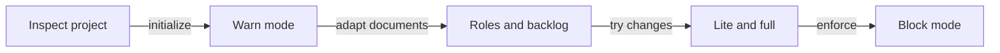

# Module 8. Converting an existing project

`billing-api` is an existing Northwind Labs service. It has code, tests, a CI workflow on GitHub Actions, a
CODEOWNERS file and open GitHub issues. It has no sdlc. **Steven** (platform engineer) converts it, with **Ethan**
(tech lead) deciding what the team keeps and what changes. The rest of the team keeps working while this happens.

## On this page

In this module:

- [Lesson 8.1: What you have, and the plan](#lesson-8-1)
- [Lesson 8.2: `sdlc init` on an existing repository](#lesson-8-2)
- [Lesson 8.3: The documents: `layout check`, `layout adapt` or `layout convert`](#lesson-8-3)
- [Lesson 8.4: `/sdlc:adopt`, `sdlc adopt --apply` and the roles of the real team](#lesson-8-4)
- [Lesson 8.5: Open issues and planning documents into the backlog](#lesson-8-5)
- [Lesson 8.6: The first changes in warn mode: lite, then full](#lesson-8-6)
- [Lesson 8.7: From warn to block](#lesson-8-7)
- [Lesson 8.8: What to tell the team](#lesson-8-8)
- [Gaps found](#gaps-found)
- [Terms](#terms)
- [See also](#see-also)


---

This sequence shows how Steven introduces gates while the team keeps working:



> [!TIP]
> Keep each conversion step in a separate commit so the team can review and revert it.

<a id="lesson-8-1"></a>
## Lesson 8.1 — What you have, and the plan            (video: ~5 min)

**Role:** Steven (platform engineer), Ethan (tech lead)   **Project:** billing-api   **You need:** the repository
cloned, sdlc installed (`sdlc --version`)

**Goal.** Steven and Ethan list what the project already has, what sdlc adds, and in which order they switch it on,
so that nobody's work stops.

The example uses a small copy of `billing-api`. Its `package.json` has `build`, `test` and `lint` scripts.
The copy also contains:

- `src/` and `test/`;
- `.github/workflows/ci.yml` and `.github/CODEOWNERS`;
- `ARCHITECTURE.md` and `CONTRIBUTING.md`;
- `docs/adr/`.

Ethan, Paul and Oliver have commits in its history.

### Steps

1. Steven and Ethan write down what exists:

   | What | Where in billing-api | What sdlc does with it |
   |---|---|---|
   | Code and tests | `src/`, `test/` | nothing moves; tests become `enforcement.test_paths` |
   | Build, test, lint commands | `package.json` scripts | detected into `verify.commands` |
   | CI | `.github/workflows/ci.yml` (GitHub Actions) | proposed as a protected path; its runs can become `verify.mcp` evidence |
   | Code owners | `.github/CODEOWNERS` | `code-owner` in the roles draft; reviewer suggestions |
   | Documents | `ARCHITECTURE.md`, `CONTRIBUTING.md`, `docs/adr/` | mapped (adapt) or moved (convert) into the AI-ready layout |
   | People | git history | people in the `openspec/roles.yaml` draft |
   | Open work | GitHub issues | brought into `openspec/backlog.md` by `sdlc backlog import --issues` |

2. They agree on the order. Each step is a separate commit, so it can be reviewed and reverted:

   1. `sdlc init` in `warn` mode (Lesson 8.2).
   2. The documents (Lesson 8.3) and the settings draft (Lesson 8.4).
   3. The backlog from the open issues (Lesson 8.5).
   4. One lite change and one full change, still in `warn` mode (Lesson 8.6).
   5. `block` mode (Lesson 8.7), and a short talk to the team (Lesson 8.8).

3. They agree on who decides. Steven runs the setup. Ethan approves the layout choice and the roles. Every person's
   command in this module runs in that person's own terminal, never in the agent chat.

### Check yourself

- You can name, for each row of the table, the file that holds it in your project.
- You know who runs `sdlc adopt --apply` (a person, Steven) and who checks the roles (Ethan).

### Pitfalls

- Converting in one big step on `main` blocks the team. Use `warn` mode first, and a worktree for moves.
- `sdlc backlog import --issues` brings the open GitHub issues in, but a person still adds the outcome and acceptance
  and orders the backlog. Plan time for that (Lesson 8.5).

### On screen (for the video)

- The repository tree of `billing-api` next to the table.
- The five steps as a checklist that the next lessons tick off.

---

<a id="lesson-8-2"></a>
## Lesson 8.2 — `sdlc init` on an existing repository            (video: ~6 min)

**Role:** Steven (platform engineer)   **Project:** billing-api   **You need:** Lesson 8.1, a clean working copy

**Goal.** Steven installs the harness without changing the code, and reads what `sdlc init` detected.

### Steps

1. In a terminal, Steven runs `sdlc init`. With no flags in a terminal, a wizard asks for the tools, the enforcement
   mode, the status line and the roles, and shows a summary before it writes. For the video, the flags show the same
   choices (`warn` is the default mode):

   ```bash
   cd ~/work/billing-api
   sdlc init --tools claude
   ```

   ```text
   SDLC harness initialized in ...\billing-api
     OpenSpec: created openspec/ (via openspec init), default schema: sdlc
     config: created openspec/sdlc.yaml (enforcement: warn)
     verify.commands detected: npm run build (package.json scripts.build); npm run lint (package.json scripts.lint); npm test (package.json scripts.test)
     review policy: created REVIEW.md
     tools: Claude Code
     sdlc 0.14.4, license: community (...)
     git hook .git/hooks/prepare-commit-msg: installed (commits made in agent sessions get an SDLC-Agent trailer)
   warning: community license, but the project declares no OSI-approved license. ...
     files: 49 created, 0 updated, 0 unchanged, 0 removed
     Claude Code hooks: installed in .claude/settings.json

   Existing project: prepare it for agents (documents from the code, settings draft):
     Claude Code  /sdlc:adopt

   Compared with the AI-ready layout:
     missing: AGENTS.md, CLAUDE.md, docs/glossary.md, docs/runbook.md, docs/security.md
     under other names: ARCHITECTURE.md -> docs/architecture.md, CONTRIBUTING.md -> docs/conventions.md, docs/adr/ -> docs/decisions/
   Make it AI-ready: `sdlc init --layout adapt` (here, moves nothing) or `sdlc init --layout worktree --worktree <path>` (in a new worktree, this copy stays as it is)
   ```

2. Steven reads what was detected:

   | Line | Meaning |
   |---|---|
   | `verify.commands detected` | the three `package.json` scripts became the verify checks |
   | `review policy: created REVIEW.md` | a starting review policy; Paul adds the team's principles |
   | `git hook ... installed` | agent commits get `SDLC-Agent: <agent>`; an existing hook of the project is kept |
   | `warning: community license ...` | `billing-api` declares no OSI-approved license; a commercial project records its license with `sdlc license set` (a person's command) |
   | `Compared with the AI-ready layout` | missing documents, and documents under other names (Lesson 8.3) |

   Without `--layout`, init only reports the differences. Nothing in `src/` or `test/` changed.

3. Steven checks the installation and commits it:

   ```bash
   sdlc doctor
   git add -A
   git commit -m "chore: set up sdlc in warn mode"
   ```

### Check yourself

- `openspec/sdlc.yaml` exists with `enforcement: mode: warn` and the three verify commands.
- `.claude/settings.json` has the `SessionStart`, `PreToolUse` and `Stop` hooks.
- `sdlc doctor` shows `✓ verify commands  build, lint, test` and `✓ claude hooks`.

### Pitfalls

- Install the CLI from the release URL or the `release` branch. The package named `sdlc` on the npm registry is
  unrelated.
- If the CLI is installed in the project (`npm i -D ...`), use `--cli "npx --no-install sdlc"`.
- The project's own `prepare-commit-msg` hook is kept; `sdlc doctor` shows the one line to chain sdlc's hook from it.
- Commit the generated files: they are shared by the team.

### On screen (for the video)

- `git status` before init (clean), then the init output, then `git status` (only new files under `openspec/`,
  `.claude/` and `REVIEW.md`).
- Highlight "verify.commands detected" and "Compared with the AI-ready layout".

---

<a id="lesson-8-3"></a>
## Lesson 8.3 — The documents: `layout check`, `layout adapt` or `layout convert`            (video: ~7 min)

**Role:** Steven (platform engineer), Ethan decides   **Project:** billing-api   **You need:** Lesson 8.2

**Goal.** The agents get the documents they rely on. Ethan chooses between keeping the current file names (adapt) and
moving them to the canonical paths (convert, in a worktree).

### Steps

1. Steven checks the layout:

   ```bash
   sdlc layout check
   ```

   ```text
   Role | Status | Path | Purpose
   agents-guide | missing | - | Main guide for coding agents (read by OpenCode; imported by CLAUDE.md).
   claude-guide | missing | - | Thin Claude Code entry point: imports AGENTS.md, adds Claude-only notes.
   readme | canonical | README.md | What the project is and how a person starts with it.
   review-policy | canonical | REVIEW.md | Review passes and severities used by /sdlc:review.
   architecture | alias | ARCHITECTURE.md | System map: modules, boundaries, data flows, external dependencies.
   conventions | alias | CONTRIBUTING.md | Code style, naming, error handling and testing rules.
   glossary | missing | - | Domain vocabulary shared by people, specs and code.
   runbook | missing | - | How to build, run, test and debug; environments and their commands.
   security | missing | - | Threat model, sensitive zones and rules agents must not break.
   decisions | alias | docs/adr/ | Architecture decision records (ADR), one file per decision.
   Run `sdlc layout adapt` to record aliases and create missing documents.
   ```

2. Option A, adapt: keep the files where they are. Preview, then apply:

   ```bash
   sdlc layout adapt --dry-run
   ```

   ```text
   Would create: AGENTS.md, CLAUDE.md, docs/glossary.md, docs/runbook.md, docs/security.md
   Kept: README.md, REVIEW.md
   Run `sdlc layout check` to review readiness.
   ```

   ```bash
   sdlc layout adapt
   ```

   Adapt records the other names under `layout:` in `openspec/sdlc.yaml`, creates only the missing documents and
   writes `AGENTS.md` with links to the real locations. It moves nothing:

   ```yaml
   layout:
     architecture: ARCHITECTURE.md
     conventions: CONTRIBUTING.md
     decisions: docs/adr/
   ```

   `sdlc layout check` now ends with `Layout ready.` and shows the three roles as `mapped`.

3. Option B, convert: move the documents to the canonical paths. Without `--apply`, the command only shows the plan:

   ```bash
   sdlc layout convert
   ```

   ```text
   Move: ARCHITECTURE.md -> docs/architecture.md
   Move: docs/adr/ -> docs/decisions/
   Skipped: CONTRIBUTING.md (Pinned by tool convention.)
   ```

   `README.md`, `CONTRIBUTING.md`, `SECURITY.md` and anything under `.github/` are never moved.

4. To apply the conversion, a **person** runs it. It creates a new worktree on the branch `sdlc/layout-convert`, uses
   `git mv`, rewrites relative Markdown links and commits with the person's git identity. The main copy stays as it
   is:

   ```bash
   sdlc layout convert --apply
   ```

   ```text
   Move: ARCHITECTURE.md -> docs/architecture.md
   Move: docs/adr/ -> docs/decisions/
   Skipped: CONTRIBUTING.md (Pinned by tool convention.)
   Review: git diff main...sdlc/layout-convert
   Merge the branch or open a PR after review.
   Discard: git worktree remove ...\billing-api-layout-convert && git branch -D sdlc/layout-convert
   ```

   Ethan reviews `git diff main...sdlc/layout-convert` and merges it through a pull request, or discards it with the
   two commands printed. Only committed content is copied into the worktree.

5. When the agent tries to apply the conversion, the CLI refuses, because it would commit on a person's behalf:

   ```text
   error: An agent session cannot commit a layout conversion.
   fix: Run `sdlc layout convert --apply` yourself in your terminal.
   ```

For `billing-api`, Ethan chose adapt: the team knows `ARCHITECTURE.md`, and links from the wiki point to it.

### Check yourself

- `sdlc layout check` ends with `Layout ready.`
- With adapt: `layout:` in `openspec/sdlc.yaml` lists the mapped roles; `AGENTS.md` links to `ARCHITECTURE.md`.
- With convert: `git worktree list` shows the worktree; `git diff main...sdlc/layout-convert` shows only moves and
  link fixes.

### Pitfalls

- A mapping to a file that later disappears makes the role `missing`, even if another candidate exists. Fix the
  mapping or run adapt again.
- `sdlc layout convert --apply --in-place` converts the current working copy and needs it clean. Prefer the worktree.
- The new documents from adapt are starting templates. The agent fills them from the code in Lesson 8.4.

### On screen (for the video)

- The layout table: highlight `alias` and `missing`.
- Two columns: adapt (nothing moves, `layout:` mapping) and convert (a worktree, `git mv`).
- The agent's refused `convert --apply`, then Steven running it in his terminal.

---

<a id="lesson-8-4"></a>
## Lesson 8.4 — `/sdlc:adopt`, `sdlc adopt --apply` and the roles of the real team            (video: ~8 min)

**Role:** Steven with the agent; Ethan checks the roles   **Project:** billing-api   **You need:** Lessons 8.2 and 8.3

**Goal.** The agent fills the documents from the real code and drafts the settings. A person applies the draft, and
`openspec/roles.yaml` names the real team, with CODEOWNERS as the source of truth for the code owner.

### Steps

1. Steven starts Claude Code and runs:

   ```text
   > /sdlc:adopt
   ```

   The adopt workflow runs `sdlc layout check`, `layout adapt` for existing documents (conversion is only proposed),
   `layout scaffold` for missing ones, and then fills each document from the code: architecture, conventions, build
   and test commands, glossary, sensitive areas, decisions. Every statement carries a file reference. Anything the
   agent could not confirm is marked "to check". The agent does not edit `REVIEW.md`, `openspec/config.yaml` or the
   schema; it puts its proposals for them in the report.

2. The workflow ends with the settings draft. Anyone may run it; it writes nothing:

   ```bash
   sdlc adopt
   ```

   ```text
   Adoption draft
   Stack: node
   CI: .github/workflows/ci.yml
   Protected: .github/workflows/**
   Protected: .github/CODEOWNERS
   Person: Ethan <ethan@northwind.example>
   Person: Oliver <oliver@northwind.example>
   Person: Paul <paul@northwind.example>
   Person: Steven <steven@northwind.example>
   Roles (written to openspec/roles.yaml only if it does not exist):
     product-owner: steven (to check)
     tech-lead: steven (to check)
     engineer: steven (to check)
     code-owner: paul
     release-manager: steven (to check)
     maintainer: steven (to check)
   Owner of some paths only, to check: ethan@northwind.example (/src/payments/)
   A person can apply this draft with: sdlc adopt --apply
   ```

   How the draft is made:
   - The people come from the git history (and Steven, who runs the command). Bots are skipped.
   - `code-owner` comes from the catch-all CODEOWNERS rule `* paul@northwind.example`. Owners of narrower rules
     (Ethan, for `/src/payments/`) are listed "to check".
   - Every other role goes to the person who runs it, marked "to check", to hand over later.
   - The CI configuration and CODEOWNERS are proposed as protected paths.

3. The agent may not apply the draft:

   ```text
   error: Only a person may apply the adoption draft
   fix: Run it yourself in your own terminal, not in the agent chat (a `!` command there runs in the agent's shell):
   sdlc adopt --apply
   ```

   Steven applies it in his own terminal:

   ```bash
   sdlc adopt --apply
   ```

   ```text
   Adoption draft applied
   ```

   The proposed commands and protected paths are added to `openspec/sdlc.yaml`, and everything already there stays.
   `openspec/roles.yaml` is written only because it did not exist. A second run with nothing new writes nothing.

4. Ethan replaces the "to check" holders with the real team. Megan, Grace and Emily never committed to `billing-api`,
   so the draft could not know them. Steven (a maintainer) edits `openspec/roles.yaml` by hand; the agent may not edit
   it (`[sdlc:state-integrity]`):

   ```yaml
   version: 1
   signing: warn
   people:
     megan:  { name: Megan,  emails: [megan@northwind.example] }
     ethan:  { name: Ethan,  emails: [ethan@northwind.example] }
     oliver: { name: Oliver, emails: [oliver@northwind.example] }
     grace:  { name: Grace,  emails: [grace@northwind.example] }
     paul:   { name: Paul,   emails: [paul@northwind.example] }
     emily:  { name: Emily,  emails: [emily@northwind.example] }
     steven: { name: Steven, emails: [steven@northwind.example] }
   roles:
     product-owner: [megan]
     tech-lead: [ethan]
     engineer: [ethan, oliver]
     code-owner: [paul, ethan]        # CODEOWNERS: * -> paul, /src/payments/ -> ethan
     release-manager: [emily]
     maintainer: [steven, ethan]
   separation:
     author_cannot_approve: [review, release]
     distinct_approvers: [[spec, review], [plan, review]]
     max_gates_per_person: 3
   ```

   ```bash
   sdlc roles check
   ```

   ```text
   ID      Name    Roles
   megan   Megan   product-owner
   ethan   Ethan   tech-lead, engineer, code-owner, maintainer
   oliver  Oliver  engineer
   grace   Grace
   paul    Paul    code-owner
   emily   Emily   release-manager
   steven  Steven   maintainer
   ```

5. CODEOWNERS stays the source of truth for the code owner. Keep `code-owner` in `roles.yaml` equal to the owners in
   CODEOWNERS, and change both in one pull request. `sdlc review suggest` reads CODEOWNERS to put the owners of the
   changed files first. An owner written as an email matches the person with that email. An owner written as a
   `@handle` matches a person id or a listed `handles` value in `roles.yaml`.
   For example, `paul: { name: Paul, emails: [paul@northwind.example], handles: [paul-s] }`.
   A team such as `@northwind/billing-reviewers` matches nobody.

6. Steven commits the documents, `openspec/sdlc.yaml` and `openspec/roles.yaml`, and adds `openspec/roles.yaml` to
   CODEOWNERS with the maintainers, so a change to it needs a maintainer's review.

### Check yourself

- `sdlc layout check` says `Layout ready.` and the new documents are filled, with file references.
- `openspec/sdlc.yaml` lists `.github/workflows/**` and `.github/CODEOWNERS` under `enforcement.protected_paths`.
- `sdlc roles who review --change <id>` names Paul (and Ethan for payments), never the author of the code.

### Pitfalls

- `sdlc adopt` lists unresolved personal handles in text and JSON
  `owners_unresolved`. Add `handles` to the right people; team handles are not supported.
- People who left the company are still in the git history. Remove them from the draft before you apply it.
- `sdlc.yaml` that still has `roles:` keeps them; the draft points to `sdlc roles migrate` (a person's command).
- One person holding every role is a `sdlc health` finding. The draft does this on purpose, as a placeholder.

### On screen (for the video)

- `/sdlc:adopt` filling `docs/runbook.md`: highlight a file reference and a "to check" mark.
- The draft: highlight `code-owner: paul` next to the CODEOWNERS line.
- The agent's refused `--apply`; Steven's apply; the edited `roles.yaml`; `sdlc roles check`.

---

<a id="lesson-8-5"></a>
## Lesson 8.5 — Open issues and planning documents into the backlog            (video: ~6 min)

**Role:** Ethan (tech lead) with the agent; Megan orders the backlog   **Project:** billing-api   **You need:**
Lesson 8.4, the `github` MCP server in `mcp.servers`

**Goal.** The open GitHub issues that the team still wants become backlog items with an outcome and acceptance
criteria. Planning documents, if the team has them in BMAD format, are imported.

### Steps

1. sdlc brings the open GitHub issues into the backlog itself, through the team's GitHub MCP server.
   `openspec/sdlc.yaml` is a protected file, so Ethan adds the setting by hand:

   ```yaml
   issues:
     server: github                # a server of mcp.servers
     repo: northwind/billing-api   # owner/name on GitHub
   ```

   Then he runs the import in his terminal:

   ```bash
   sdlc backlog import --issues
   ```

   It adds one item per open issue that is not linked yet: the issue title and the field `- **Issue**: GH-<n>` in
   `openspec/backlog.md`. Pull requests are not issues and are skipped. A second import adds only issues that are new
   since the last one. Without `issues:` the command is refused with `issues_not_configured`. The import takes every
   open issue; a person drops the ones the team no longer wants (`sdlc backlog drop`).

2. The imported items have a title and a link, nothing more, so they are not ready yet. The agent reads each issue
   through the GitHub MCP server and proposes an outcome and acceptance criteria. Ethan confirms them, and the agent
   records them:

   ```bash
   sdlc backlog edit B1 --kind feature --risk medium --outcome "Support refunds one line of a paid invoice" \
     --accept "a refund never exceeds the amount paid for the line"
   sdlc backlog edit B2 --kind bugfix --risk low --outcome "VAT on the PDF matches the API" \
     --accept "an invoice of 3 x 0.10 EUR shows 0.06 EUR VAT"
   sdlc backlog list
   ```

   ```text
   Unassigned
   ID  Status  Ready  Title                                 Change
   B1  open    ✓      Refund one invoice line               -
   B2  open    ✓      Invoice PDF shows wrong VAT rounding  -
   ```

3. The order is Megan's decision. The agent proposes it and gives the command; Megan runs it:

   ```bash
   sdlc backlog move B2 --top
   ```

4. If the team planned with BMAD, the agent imports the documents. First a preview:

   ```bash
   sdlc import bmad _bmad-output/refunds --to-backlog --dry-run --json
   ```

   Use `--json` for a JSON preview. It shows one epic named after the PRD and one item per functional requirement, with
   acceptance from its testable consequences:

   ```text
   "title": "Refund one invoice line",
   "kind": "feature",
   "outcome": "Support can refund one line of a paid invoice.",
   "acceptance": [ "The refund never exceeds the amount paid for the line." ],
   "source": "bmad _bmad-output/refunds/prd-partial-refunds.md#FR-1"
   ```

   Without `--dry-run`, the items are added. With `--change <id>` instead of `--to-backlog`, the PRD becomes the
   artifacts of one change (`intent.md`, `proposal.md`, `specs/`, and `design.md` from an architecture document).
   Nothing is started or approved by the import. Run `sdlc validate --change <id>` after it.

### Check yourself

- `sdlc backlog list` shows the items with `Ready ✓`.
- Each imported item links to its issue (`Issue: GH-<n>`); no pull request became an item.
- `sdlc backlog next` names the item Megan put at the top.

### Pitfalls

- The agent may not edit `openspec/backlog.md` directly (`[sdlc:state-integrity]`); it uses `backlog add` and
  `backlog edit`. People may edit the file by hand.
- `backlog move` and `backlog drop` are a person's commands.
- Archiving a change whose item has `Issue: GH-<n>` comments on the issue (the comment names the
  change) and closes it. The calls go through the event outbox: when the GitHub server fails, the archive still
  succeeds and `sdlc events flush` delivers them later. An item without an issue never calls GitHub.
- sdlc holds no GitHub token. The import and the closing use the team's `github` server from `mcp.servers` and the
  token in each person's own environment.
- The `github` server is checked against `stages` only while a change is active. List `plan` in its `stages` if the
  agent reads issues while changes are open.
- Read the imported requirement text. Actor-first sentences become requirements such as
  "The system SHALL let the policyholder see …".

### On screen (for the video)

- The GitHub issues page next to the output of `sdlc backlog import --issues`.
- `sdlc backlog list` with the bars; Megan's `backlog move`.
- The BMAD dry run, then `sdlc backlog list` after the import.

---

<a id="lesson-8-6"></a>
## Lesson 8.6 — The first changes in warn mode: lite, then full            (video: ~7 min)

**Role:** Oliver with the agent; Ethan, Megan, Paul decide   **Project:** billing-api   **You need:** Lesson 8.5

**Goal.** The team runs one small change on the lite track and one full change while the hooks only remind. They see
the gates, the people and the reminders before anything is denied.

### Steps

1. The first change is the VAT bug. Oliver asks the agent to start its backlog item:

   ```bash
   sdlc backlog start B2 --change fix-vat-rounding
   ```

   ```text
   Started B2 as fix-vat-rounding.
   ```

   The change record shows `track_suggestion: lite` with the reason `bugfix with low risk`. The track stays `full`
   until a person decides. Ethan confirms it in his terminal:

   ```bash
   sdlc track set lite --change fix-vat-rounding --note "One rounding function, covered by tests"
   ```

   ```text
   Track for fix-vat-rounding: full → lite
   Next: agent — Write plan (plan.md) for the plan gate. (/sdlc:plan)
   ```

   From here the change follows Module 6: plan, Ethan's plan approval, the bug-fix protocol with locked tests,
   `sdlc verify`, the review, Paul's approval and the archive.

2. In `warn` mode, an edit of code before the plan is approved goes through, and the agent gets a reminder once per
   session:

   ```text
   [sdlc:plan-gate] No SDLC change covers this edit (src/invoice.js). Nothing is implemented without an accepted
   plan: start with /sdlc:intent (or `sdlc new <name>`), or keep the edit out of scope. Why, and what to do:
   `sdlc guide denials#plan-gate`.
   ```

   The hard rules already deny in `warn` mode. The CI workflow is protected from the first day:

   ```text
   [sdlc:protected-path] .github/workflows/ci.yml is a protected path (enforcement.protected_paths in
   openspec/sdlc.yaml). Change it through its owning process, not in an agent session.
   ```

3. The second change is a full one for partial refunds: `sdlc backlog start B1`, then `/sdlc:intent`, Megan's intent
   approval, `/sdlc:spec`, Megan's spec approval (Ethan's too when the risk is `high`), `/sdlc:plan`, Ethan's plan
   approval, and the rest as in Modules 6 and 7.

4. To make GitHub Actions part of the evidence, Steven adds a `verify.mcp` check for the existing `ci` workflow
   (Lesson 2.4; Grace reads it in Lesson 7.2). The workflow file itself stays as it is.

### Check yourself

- `sdlc status` lists `fix-vat-rounding` on the lite track with the plan gate as the first gate.
- `sdlc log` shows `hook.warned` lines for the reminders and `hook.denied` lines for the hard rules.
- After the first archive, `openspec/specs/` holds the first living spec of `billing-api`.

### Pitfalls

- Old pull requests opened before sdlc are not changes. Finish them the old way, or start a change for the rest.
- The first full change takes longer: people learn the commands. Pick a change with a clear scope.
- `sdlc approve` uses each person's git identity. A person whose `git config user.email` is not in `roles.yaml` is
  refused. Check it before the first approval: `sdlc next --me`.

### On screen (for the video)

- `sdlc backlog start B2`, the suggestion in the record, and Ethan's `sdlc track set lite`.
- The warn reminder in Claude Code (the edit goes through) next to the protected-path denial (it does not).
- `sdlc status` with both changes.

---

<a id="lesson-8-7"></a>
## Lesson 8.7 — From warn to block            (video: ~5 min)

**Role:** Steven (platform engineer), Ethan decides   **Project:** billing-api   **You need:** at least one change
archived in warn mode

**Goal.** Steven switches the process rules from reminding to denying, when the team is ready and the reminders show
no surprise.

### Steps

1. Steven looks at what the hooks reminded and denied:

   ```bash
   sdlc log
   ```

   ```text
   2026-10-09T20:34:17.401Z  hook.denied   agent:claude - protected-path: Edit .github/workflows/ci.yml [sdlc 0.14.4 · community]
   2026-10-09T20:34:41.280Z  hook.warned   agent:claude - plan-gate: Edit src/invoice.js [sdlc 0.14.4 · community]
   ```

   Every `hook.warned` line is an action that `block` mode would have denied. Steven and Ethan read each one: was it a
   real skip of the plan, or work that should be exempt (for example a generated folder)?

2. `sdlc health` says the same from the configuration side:

   ```text
   Project health: 0 bad, 2 warn, 0 info
   ! warn The installation has problems (config.doctor)
       - license: community license, but the project declares no OSI-approved license
       Recommendation: Run `sdlc doctor` and follow its fixes.
   ! warn Enforcement is warn (config.enforcement)
       - `enforcement.mode` is warn
       Recommendation: Use `enforcement.mode: block`, so the hooks deny actions that skip a gate.
   ```

3. Ethan agrees. Steven edits `openspec/sdlc.yaml` himself (the agent may not):

   ```yaml
   enforcement:
     mode: block
   ```

   Then he regenerates the agent files and checks the setup:

   ```bash
   sdlc update
   sdlc doctor
   git commit -am "chore: sdlc enforcement block"
   ```

4. From now on the plan gate and the MCP stages deny. The next Claude Code session says `Enforcement mode is block.`
   in its summary.

### Check yourself

- `sdlc health` no longer reports `config.enforcement`.
- An agent edit of `src/` with no approved plan is denied with `[sdlc:plan-gate]`.

### Pitfalls

- An agent session cannot lower the mode: `sdlc init` and `sdlc update` refuse to weaken the guard there
  (`agent_cannot_weaken_guard`), and the hook denies edits of `openspec/sdlc.yaml`.
- Paths the team really wants open before a plan go under `enforcement.exempt_paths`, decided by a person. Do not
  return to `warn` for a single folder.
- Use `sdlc log --event hook.warned --json`
  to inspect reminders before switching to block. Count them per rule in the filtered output.

### On screen (for the video)

- `sdlc log` filtered by eye to `hook.warned`; discuss two lines.
- The one-line edit of `enforcement.mode`, then `sdlc update` and `sdlc doctor`.
- The same agent edit as in Lesson 8.6, now denied.

---

<a id="lesson-8-8"></a>
## Lesson 8.8 — What to tell the team            (video: ~5 min)

**Role:** Ethan (tech lead), Steven (platform engineer)   **Project:** billing-api   **You need:** Lessons 8.2–8.7

**Goal.** Every person on the team knows what changed for them, which commands they run, and where to ask.

### Steps

1. Ethan shows one table at the team meeting:

   | Person | What changes | Their commands (own terminal) |
   |---|---|---|
   | Megan (product owner) | approves intent and spec; answers open questions; orders the backlog | `sdlc approve intent`, `sdlc approve spec`, `sdlc answer`, `sdlc backlog move` |
   | Ethan (tech lead) | approves plans, high-risk specs; sets the track; sends work back | `sdlc approve plan`, `sdlc track set`, `sdlc rework`, `sdlc tests unlock` |
   | Oliver (developer) | works through `/sdlc:next`; takes a change over when needed | `sdlc takeover`, `sdlc release-control`, `sdlc next --me` |
   | Grace (QA) | reads and completes the evidence; runs verify outside the agent | `sdlc verify`, `sdlc verify --check`, `sdlc trace` |
   | Paul (code owner) | approves the review gate | `sdlc review suggest`, `sdlc approve review --preview`, `sdlc approve review` |
   | Emily (release manager) | authorizes production releases | `sdlc release check`, `sdlc approve release` |
   | Steven (platform) | owns `openspec/sdlc.yaml`, MCP servers, CI | `sdlc update`, `sdlc doctor`, `sdlc mcp check` |
   | Laura (manager) | reads health and audit | `sdlc health`, `sdlc audit`, `sdlc report` |

2. Ethan repeats three rules:
   - An answer in the chat is never an approval. Approve in your own terminal; a `!` command in the agent chat is
     refused.
   - When the hook says no, read the rule in brackets and run `sdlc guide denials#<rule>`, or ask `/sdlc:guide`.
   - `sdlc next --me` shows what waits for you.

3. Steven points newcomers to the tour: `sdlc guide tour` (seven short steps), and to `sdlc guide` for the topics.

4. Steven adds the sdlc checks to the CI pipeline. CI configuration is often a protected path and is a person's
   decision, so he runs the command himself, in his own terminal: `sdlc ci init --provider github`. It
   writes `.github/workflows/sdlc.yml`, which runs `sdlc validate --all` and `sdlc approvals verify` on a full clone
   (`fetch-depth: 0`). `.github/workflows/ci.yml` stays as it is. Steven may add more steps himself, for example
   `sdlc review check --change <id>`.

### Check yourself

- Every person runs `sdlc next --me` once from their own terminal and sees their gates (or "Nothing is waiting for
  you.").
- Every person's git email is in `openspec/roles.yaml`.

### Pitfalls

- People approving from a shared machine or a shared git identity break the separation of duties. Each person needs
  their own identity; with `signing: required`, their own signing key.
- A team that does not commit the approval records loses the `SDLC-Approval` trailers. Commit with the message that
  `sdlc approve` prints.

### On screen (for the video)

- The table, one row at a time.
- Three people running `sdlc next --me` in three terminals.

---

## Gaps found

These examples use temporary copies of `tasklet` and `billing-api`. These cases have supported commands:

- GitHub issues: `sdlc backlog import --issues` brings them into the backlog, and archiving a change
  closes its linked issue (Lesson 8.5).
- Alerts: `sdlc triage intake` adds an alert from monitoring to the backlog as data (Lesson 6.9).

## Terms

- [Gate](../glossary.md) — a decision point before a change advances.
- [Evidence](../glossary.md) — recorded results tied to the checked tree.

## See also

- [AI-ready project](../07-ai-ready-project.md) — the document layout used here.
- [Roles and approvals](../08-roles-and-signing.md) — decisions after adoption.
